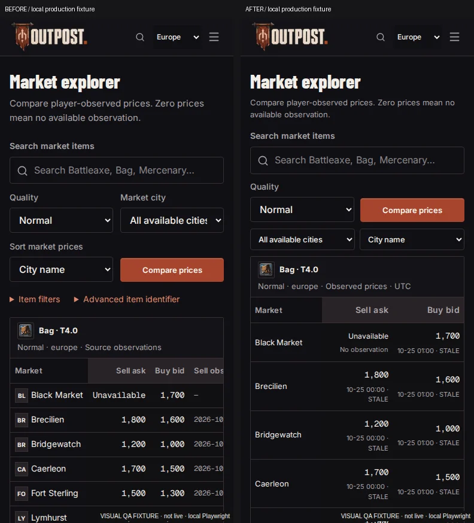
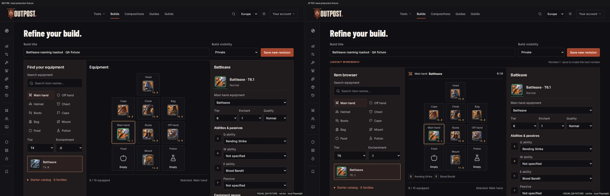
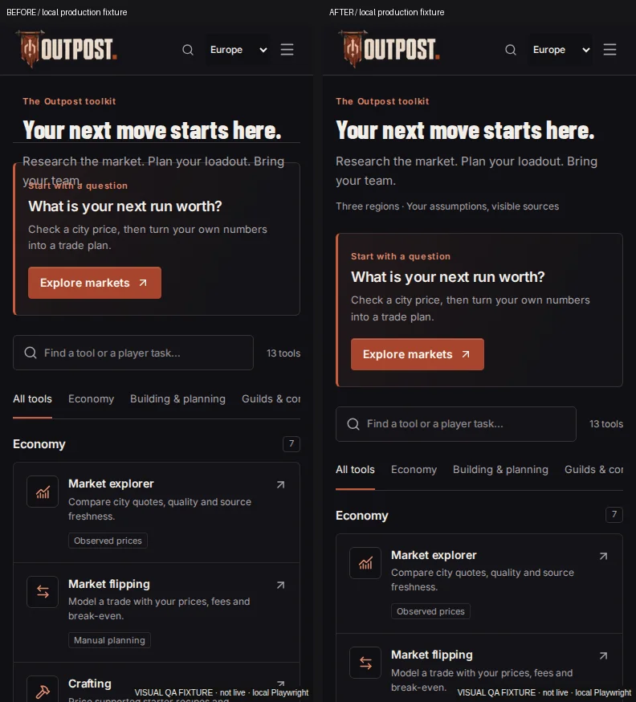
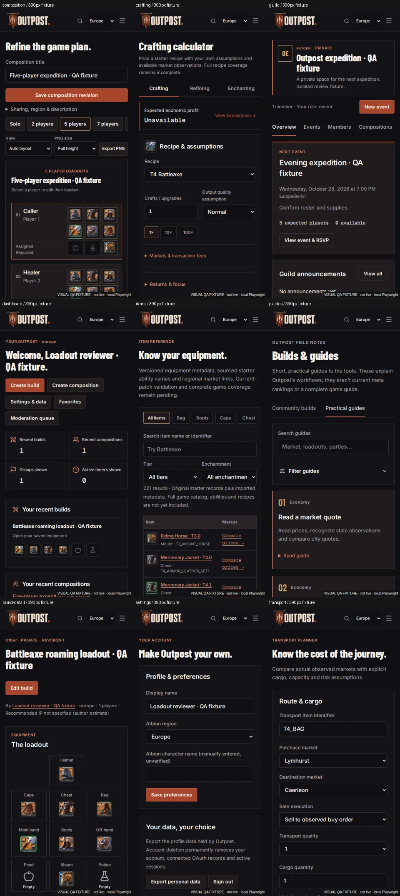

# Outpost implementation report

Subsequent work is recorded in [the next development milestone](docs/engineering/NEXT_MILESTONE_2026-10-26.md), including the activated July catalog, calculator fixes, watchlists and updated performance evidence. The account below preserves the earlier checkpoint.

Report date: **26 October 2026**. This is a dated account of the skill-system work and the subsequent frontend improvement pass. It explains the implementation, the files involved, the checks performed and the remaining limitations. The generated [QA report](QA_REPORT.md), [implementation status](IMPLEMENTATION_STATUS.md) and [release readiness](RELEASE_READINESS.md) remain authoritative for current project status.

The frontend pass improved Market Explorer and Build Editor first, then compositions, calculators, guilds, item browsing, the dashboard, guides and supporting pages. The final application phase passed all ten automated gates. **This does not establish full product completion or production readiness. Release remains NO-GO.**

## 1. Market Explorer

### What changed

- Reorganized the primary workflow around item search, quality and Compare prices.
- Moved city filters and sorting into a compact toolbar directly above the observations.
- Placed selected-item research beside the quote table on desktop.
- Moved advanced catalog and identifier controls below the observations so they no longer dominate the first screen.
- Added each ask and bid's own observation date and stale/unavailable status beside its amount. The full timestamp remains available through its title, and the visible date has a UTC caption.
- Simplified the phone quote table to city, ask and bid, removing redundant columns from that layout.
- Corrected the failed-request empty state to say that no observations loaded and explain how to retry.

### Behavior retained

Existing market/history endpoints, region and quality selection, explicit fetching, city sorting, request cancellation and missing-price handling remain in use. Missing observations were not converted to zero, and synthetic observations were not presented as live market data.

### Verification

Exact bid/ask assertions were retained while targeting the amount element separately from its new timestamp. Responsive tests now cover all six required widths and check the quote table itself for overflow. Supplementary captures include initial, loading, empty, error, unavailable and light-theme states.

Files: [market.tsx](src/components/market.tsx), [workspace styles](src/app/player-workspaces.css), [market visual tests](e2e/market-visual.spec.ts), [market regressions](e2e/qa-regressions.spec.ts).

## 2. Build Editor and build details

### What changed

- Tightened the equipment board and connected the item browser, equipped slots and selected-item context more clearly.
- Initialized browser tier/enchantment from the actual equipped main-hand item rather than always using T4.0.
- Added desktop selected-slot context and a compact revision/workbench context bar.
- Added a recorded-ability summary ordered by Q, W, E, Active and Passive.
- Added authentic item-icon previews for saved equipment alternatives while keeping their existing selection controls.
- Kept all ten equipment slots visible on the phone layout and removed duplicate context from the narrow view.
- Reordered the read-only build page so equipment appears before secondary dates and description.
- Improved the phone read view with compact inventory, wrapping text and accessible item links/tooltips.
- Changed “Validated selections” to “Recorded selections” so stored choices do not imply current-patch verification.

### Behavior retained

The existing equipment, ability and alternative schemas, manual unsupported IDs, save/revision handling, visibility and deletion controls remain. No missing ability statistics, unlocks or artwork were invented.

### Verification

Editor visual coverage now includes all six required widths. Additional captures exercised the equipment-details panel, an actual helmet selection, the unavailable food catalog and an intercepted failed save. The failed-save check verified that the edited draft/title survived. Existing saved-build tests were updated only for the more accurate “Recorded selections” wording.

Files: [equipment workbench](src/components/equipment-workbench.tsx), [build editor](src/components/build-editor.tsx), [loadout read view](src/components/build-loadout-view.tsx), [build detail page](src/app/builds/[id]/page.tsx), [editor visual tests](e2e/build-editor-visual.spec.ts), [saved-build tests](e2e/verified-builds.spec.ts).

## 3. Composition builder

- Made party-size choices a compact, horizontally scrollable control strip.
- Put view and PNG settings into a shorter phone control row.
- Reduced the small-party heading's mobile footprint so player equipment appears sooner.
- Preserved the existing boards, compact large-party roster, member dialogs, pointer/keyboard reorder, saved assignments and PNG/JSON exports.

These are layout improvements to the working composition workflow. They do not add complete templates, a full game catalog or new authorization rules.

Implementation: [workspace styles](src/app/player-workspaces.css). Related regression coverage remains in [composition tests](e2e/compositions.spec.ts) and [composition visual tests](e2e/composition-visual.spec.ts).

## 4. Crafting, refining and enchanting

- Kept recipe, quantity and quality controls primary.
- Added 1, 10 and 100 batch shortcuts using the existing quantity state.
- Grouped purchase/output markets and station/tax/setup fields under an explicit “Markets & transaction fees” disclosure.
- Replaced internal item IDs in missing-price messages with readable item names where available.
- Retained calculation modules, defaults, supplied assumptions, manual overrides, observation provenance and private saved scenarios.

Tests now open the disclosure when editing its fields and exercise quantity shortcuts. Missing-price tests still distinguish an incomplete calculation from an intentional manual zero. Separate manual examples, negative-profit and invalid-quantity captures were reviewed.

**No recipes, city bonuses, focus coefficients or specialization mechanics were newly certified as current-patch correct.** Accounting tests establish the tested arithmetic under stated assumptions.

Files: [production calculator](src/components/production-calculator.tsx), [production tests](e2e/production.spec.ts), [mode tests](e2e/production-modes.spec.ts), [freshness tests](e2e/production-freshness.spec.ts).

## 5. Guild workspace

- Reduced the visual weight of the guild identity/banner area.
- Improved upcoming-event typography and activity-panel density.
- Prioritized real upcoming events and shared equipment/compositions.
- Preserved membership/role enforcement, event and announcement dialogs, invitations, RSVP and shared-resource access.

No fabricated activity or replacement generated guild banner was added. Populated screenshots used isolated owned fixtures.

Implementation: [workspace styles](src/app/player-workspaces.css). Existing [guild visual tests](e2e/guild-visual.spec.ts), [guild workflows](e2e/groups.spec.ts) and [editing tests](e2e/group-editing.spec.ts) remain part of the browser suite.

## 6. Item catalog

- Added category navigation derived from actual available metadata categories.
- Reset pagination when the category changes.
- Aligned each real item icon, readable name and exact ID into a coherent identity group.
- Improved the two-column phone table and wrapped long IDs so they do not collide with market actions.
- Preserved search, tier/enchantment filtering, pagination, regional market links and source limitations.

The catalog regression checks that a category can remove an incompatible item and that choosing Main hand restores the expected fixture. The category UI does not imply complete equipment coverage.

Files: [item catalog](src/components/item-catalog.tsx), [catalog tests](e2e/catalog.spec.ts).

## 7. Personal dashboard

- Added actual equipment previews to the user's saved-build summaries.
- Added direct navigation with bounded recent counts rather than presenting those counts as complete totals.
- Improved section hierarchy, icons and display typography.
- Extended the existing owner-scoped build query with the equipment fields needed for previews.
- Retained authenticated-user scoping, bounded queries, role-dependent moderation navigation and authorization when opening group resources.

A new two-user regression warms the owner's dashboard, verifies an outsider cannot see the private title/equipment preview, checks a direct private-build API request returns 404 and confirms the owner can still see the build after reload. This is evidence for that specific privacy boundary, not a complete security audit.

Files: [dashboard page](src/app/dashboard/page.tsx), [dashboard isolation test](e2e/dashboard-loadouts.spec.ts).

## 8. Guides, tool directory and supporting pages

- Added an editorial numbered index to original guides.
- Used the existing mobile filter panel for guide topics, keeping search visible.
- Added an optional filter-panel label while preserving the existing default for build consumers.
- Fixed a real tool-directory overlap: a nested content header inherited the fixed site-header height. A scoped rule now restores the content header's intended layout.
- Applied the established display-heading class explicitly on relevant major page titles, including item/build/composition details, account/settings, profiles, timers, favorites, guild creation/invitations, moderation, gold and transporting pages.
- Preserved body text readability and the existing Inter UI, Barlow Condensed display and Geist Mono numeric roles.

Supporting routes received shared typography/responsive corrections and inspection; they were not all rebuilt into new feature sets. Existing forms remain where input is the user's actual task, such as settings and manual accounting.

Files: [guide directory](src/components/guide-directory.tsx), [mobile filter panel](src/components/mobile-filter-panel.tsx), [workspace styles](src/app/player-workspaces.css), and the corresponding page components under [src/app](src/app).

## 9. Shared styles and performance work

### Implementation

- Added [player-workspaces.css](src/app/player-workspaces.css) and loaded it after the existing global/workspace styles in [layout.tsx](src/app/layout.tsx).
- Used scoped page/component rules to improve density, hierarchy and responsive behavior.
- Moved 134 homepage-only rules from [globals.css](src/app/globals.css) into [homepage.css](src/app/homepage.css), imported by the [homepage route](src/app/page.tsx).
- Used the installed PostCSS parser to check that the extraction preserved declarations and the relative order of both rule sets.
- Compared homepage viewport pixels before/after extraction: they matched exactly at 1440px and 390px in the captured states.

### Repeated local lab results

Three samples per route were taken before and after the CSS extraction with Lighthouse 13.5.0 and local Chromium. Market used fresh audit contexts; Build Editor used an isolated authenticated persistent profile with storage reset disabled. These protocols are different and should not be pooled.

| Measurement                             | Before extraction   | Final result                              | Interpretation                         |
| --------------------------------------- | ------------------- | ----------------------------------------- | -------------------------------------- |
| Market stylesheet transfer              | 25,146 bytes        | 21,595 bytes                              | 3,551 bytes / 14.12% reduction         |
| Market Performance                      | 93–96               | 94–97; median 94                          | Lab score only                         |
| Market Accessibility                    | 100                 | 100                                       | Automated audit only                   |
| Market LCP                              | 2.800–3.179 seconds | 2.658–3.104 seconds; median 3.101 seconds | Still above the 2.5-second target      |
| Market CLS                              | 0                   | 0                                         | No shift recorded in those audits      |
| Warm fixture Build Editor Performance   | 100                 | 100                                       | Warm authenticated fixture protocol    |
| Warm fixture Build Editor Accessibility | 100                 | 100                                       | Automated audit only                   |
| Warm fixture Build Editor LCP           | About 0.622 seconds | About 0.621 seconds                       | Not a cold real-user login measurement |
| Warm fixture Build Editor CLS           | 0                   | 0                                         | No shift recorded in those audits      |

The Market LCP ranges overlap. **The evidence supports lower CSS transfer, not a reliable load-time speedup.** Field INP, production p75, hosting performance and physical-device behavior were not established.

Detailed samples: [portable evidence](docs/design-review/frontend-pass/evidence.json) and [performance report](docs/engineering/PERFORMANCE_REPORT.md).

## 10. Runtime defect found and fixed

During the full browser suite, concurrent fixture/account deletion exposed a public build-gallery rendering failure: the author could disappear between related database reads, producing an inconsistent required-author result and a React rendering error.

The bounded public-gallery query now runs in a `RepeatableRead` transaction using the installed Prisma client's supported API. Existing filters, ordering and ownership behavior remain. Subsequent complete phase runs passed. The failed run is retained; passing later runs do not prove the absence of every possible concurrency issue.

File: [public build gallery](src/app/builds/page.tsx). Tracked as QA-052 in the [bug tracker](BUG_TRACKER.md). The tool-directory header fix is tracked as QA-053.

## 11. Skill-system foundation

The earlier skill-system work authored seven actionable skills, integrated a concise development contract into [AGENTS.md](AGENTS.md), added a real structure/link validator and documented invocation, testing and maintenance.

| Skill                                                                   | Scope                                                                                    |
| ----------------------------------------------------------------------- | ---------------------------------------------------------------------------------------- |
| [outpost-frontend](skill-system/skills/outpost-frontend/SKILL.md)       | Page-specific design, components, typography, interactions and responsive implementation |
| [outpost-visual-qa](skill-system/skills/outpost-visual-qa/SKILL.md)     | Actual rendered inspection, reference comparisons, screenshots and acceptance evidence   |
| [outpost-albion-data](skill-system/skills/outpost-albion-data/SKILL.md) | IDs, recipes, abilities, provenance, import stages and patch compatibility               |
| [outpost-calculators](skill-system/skills/outpost-calculators/SKILL.md) | Assumptions, independent expected values, precision and missing/stale observations       |
| [outpost-security](skill-system/skills/outpost-security/SKILL.md)       | Trust boundaries, server authorization, negative cases, caches and safe migrations       |
| [outpost-performance](skill-system/skills/outpost-performance/SKILL.md) | Reproducible measurement, bounded optimizations and honest performance claims            |
| [outpost-release](skill-system/skills/outpost-release/SKILL.md)         | Repository checks, actual evidence, unresolved gates and GO/NO-GO decisions              |

Supporting references cover page patterns, formula verification and an authorization matrix. All seven skills passed metadata, identity, body and relative-link checks; the bundled skill-creator validator also passed them. Adversarial validation cases rejected malformed or incomplete copies.

**Installation and automatic discovery remain blocked.** The intended `.agents` directory is read-only here. The full bundle is staged in `skill-system/skills`, and applicable skills were explicitly read during the frontend work. File validation does not establish automatic activation. The attempted Codex app-server discovery exited with a read-only-filesystem error before returning a skill list.

The earlier explicit A–E exercises covered frontend review, independent crafting accounting, composition permissions, Market performance and release readiness. They are recorded with their actual limits in [skill validation](docs/engineering/SKILL_SYSTEM_VALIDATION.md). The new frontend review supersedes that earlier visual baseline.

Files: [skill-system guide](docs/engineering/SKILL_SYSTEM.md), [validator](scripts/validate-skills.py), [validation record](docs/engineering/SKILL_SYSTEM_VALIDATION.md).

## 12. Functional and responsive verification

### Latest application phase

Environment: Node 22.22.2, local PostgreSQL/Redis and the production application build. The recorded `npm run qa:phase` completed at **2026-10-26T16:04:45.411Z**.

| Gate                            | Recorded result               |
| ------------------------------- | ----------------------------- |
| Database connectivity           | PASS                          |
| TypeScript                      | PASS                          |
| Lint                            | PASS                          |
| Unit tests                      | PASS — 132 tests              |
| Game-data structure             | PASS — structural checks only |
| Disposable database integration | PASS — 15 checks              |
| Production build                | PASS                          |
| Browser suite                   | PASS — 58 tests               |
| Dependency check                | PASS for the configured check |
| Regional endpoints              | PASS — 9 endpoint checks      |

Related formula, authorization, private-cache and migration regressions remain in the phase gate. These results apply to the recorded source/build; this report-only follow-up does not rerun the application suite or imply a new application phase.

### Visual coverage

- Baseline: 21 routes × 2 widths = 42 configurations.
- Final: 29 routes × 6 viewports = 174 configurations.
- Required viewports: 1440×900, 1920×1080, 768×1024, 390×844, 375×844 and 320×844.
- Supplementary: 19 state captures, including failures and retained drafts.
- Final capture exercise: no document overflow, page/console errors or failed requests recorded.
- Actual supplied references, full-size primary screenshots and responsive contact sheets were opened and inspected.

The 29 final route labels were: home, market, editor, build-detail, builds, composition, composition-detail, compositions, crafting, refining, enchanting, dashboard, items, item-detail, guides, guild, guilds, new-guild, favorites, gold, trade, transport, timers, tools, settings, profile, moderation, invitation-unavailable and legal.

Populated equipment, parties, guild activity and dashboard content used isolated owned database fixtures. Market/history fixtures were explicitly synthetic. Fixture sessions are not real Discord OAuth. The final visual fixture had moderator privileges to expose the moderation route; ordinary-user privacy was checked separately.

### Additional validation

- Skill validator: seven manifests passed; no automatic-discovery claim.
- Documentation-validator test suite: 17 tests passed.
- Documentation/report freshness checks: passed.
- Source scan: 410 candidate files scanned, no findings for the configured rules.
- Built-artifact scan: 44 files scanned, no configured-secret matches.
- Portable frontend manifest: 393 referenced artifact hashes checked without mismatches at handoff.
- Formatting check: passed.

The scanners do not certify every possible secret or inspect unavailable Git history. Documentation validation does not prove natural-language truth, image fidelity or legal adequacy.

## 13. Failed runs and tool restrictions

Earlier failures were retained rather than omitted:

- Adding timestamps exposed an old exact whole-cell assertion; it now checks the exact amount and its separate date annotation.
- One run ended with exit 143 before a new browser result. It was not counted as passing.
- Another run exposed outdated heading and internal-ID expectations. These were updated while retaining price-availability and authorization assertions.
- The post-extraction run exposed the real gallery read race described above; it was fixed and the complete gate rerun.
- A supplementary alert selector also matched the framework route announcer. It was scoped to the page's main content and rerun successfully.

| Requested capability         | Actual outcome                                                             | Fallback or limitation                                                    |
| ---------------------------- | -------------------------------------------------------------------------- | ------------------------------------------------------------------------- |
| Playwright MCP               | Navigation required approval unavailable under this session's policy       | Installed local Playwright Chromium performed UX and screenshots          |
| Chrome DevTools MCP          | Stable Chrome missing at `/opt/google/chrome/chrome`                       | Local Chromium CDP provided console/network observations and traces       |
| Lighthouse                   | Local installed tool ran successfully                                      | Reproducible lab evidence, not field performance                          |
| Fresh Docker build           | Buildx could not write its activity file in the protected Docker directory | No fresh image/container claim                                            |
| Git status/history           | No usable Git metadata in this workspace view                              | No authoritative Git diff/clean-tree/history claim; no Git initialization |
| Skill installation/discovery | Protected directories/app-server initialization blocked the operation      | Complete staged bundle and explicit reading only                          |

No permissions or global configuration were changed to hide these restrictions.

## 14. Documentation and evidence delivered

- [Frontend review](docs/design-review/frontend-pass/README.md): implementation, rendered comparisons, corrections, performance and limitations.
- [Portable evidence manifest](docs/design-review/frontend-pass/evidence.json): routes/viewports, build identity, measurements, samples and artifact hashes.
- Four retained WebP artifacts: Market comparison, editor comparison, tool-directory comparison and player-page gallery, embedded above.
- Updated page-review links/index entries for affected workflows, preserving prior reviews as historical evidence.
- Updated [performance evidence](docs/engineering/PERFORMANCE_REPORT.md), [security audit](docs/engineering/SECURITY_AUDIT.md) and [skill-system maintenance notes](docs/engineering/SKILL_SYSTEM.md).
- Updated structured [QA inventory](docs/qa-inventory.json) and [defect records](docs/qa-bugs.json) with scoped evidence and the two fixed defects.
- Refreshed generated root QA/status reports, including [QA report](QA_REPORT.md), [checklist](QA_CHECKLIST.md), [implementation status](IMPLEMENTATION_STATUS.md), [bug tracker](BUG_TRACKER.md), [release readiness](RELEASE_READINESS.md) and [product improvements](PRODUCT_IMPROVEMENTS.md).
- Updated [project plan](PROJECT_PLAN.md) and [development progress](docs/DEVELOPMENT_PROGRESS.md).

Detailed raw screenshots, traces, intermediate failed runs and local capture scripts remain under ignored `.qa/frontend-pass`. They are available in this workspace but may not exist in a clean checkout. Important comparisons and portable summaries are retained in the documentation tree.

Because Git metadata is unavailable, the file references in this report describe the work performed; they are not presented as an independently verified complete Git diff.

## 15. Remaining work and honest acceptance boundaries

| Area                   | Remaining work                                                                                                                 |
| ---------------------- | ------------------------------------------------------------------------------------------------------------------------------ |
| Market performance     | Reach the simulated-mobile 2.5-second LCP target with comparable repeated measurement; final median is 3.101 seconds           |
| Visual acceptance      | Global owner review, physical-device sessions, broader screen-reader testing and full accessibility acceptance                 |
| Market product scope   | Complete watchlists and multi-item research                                                                                    |
| Build/composition data | Complete permitted equipment, abilities, consumables, templates and source-backed current-patch coverage                       |
| Calculator mechanics   | Source-backed city/focus/specialization coefficients and recipe verification; resolve the plain/pristine steel source mismatch |
| Authentication         | Actual credentialed Discord login/lifecycle and deployed HTTPS/Secure-cookie verification                                      |
| Database operations    | Review/apply the pending watchlist migration through the authorized deployment process                                         |
| Media/legal            | Genuine permitted replacement scenes, media rights, operator/contact disclosures and owner license decisions                   |
| Deployment operations  | Hosted CI, backup/recovery, monitoring, rollback and remaining repository/security policy evidence                             |
| Tooling                | Repair browser MCP availability, enable authorized skill installation/discovery and obtain a fresh container build             |

The data audit still records **181 equipment variants, 221 combined IDs and zero current-patch-verified entries**. That is starter-data coverage, not a complete Albion catalog.

The work preserved existing data and migrations; no existing-database migration, deployment, publication or Git-history rewrite was performed. Automated results and inspected screenshots support the specific changes above. They do not close the independent product, data, security, legal, operational or owner-acceptance gates listed in [release readiness](RELEASE_READINESS.md).
