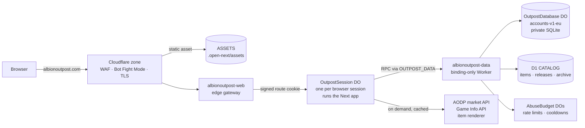

# Architecture

Outpost is a Next.js 16 / React 19 / TypeScript app that runs in production on **Cloudflare Workers Paid** (zone on the Free plan): two Workers, SQLite Durable Objects and a D1 database, built with OpenNext. Locally the same code runs on Node with Postgres and Redis. One codebase, two runtimes; the Cloudflare build swaps a handful of infrastructure modules at bundle time.

## Production topology

### `albionoutpost-web` (`wrangler.jsonc`, `cloudflare/web/worker.ts`)

- Redirects `www.` → apex (308).
- Issues/validates an HMAC-signed `outpost-route` cookie (HttpOnly, SameSite=Lax, Secure, 30 min) and forwards the request to `SESSIONS.getByName(id)`.
- **`OutpostSession` Durable Object** runs the whole OpenNext app for that browser session. Rendering inside a DO (instead of directly in the Worker) is what fixed the Free-tier CPU-limit failures (Error 1102). Each session has an in-memory budget of 240 requests/min (429 + `Retry-After` beyond that); the object writes nothing to storage, so page views cost no Durable Object storage writes. The route cookie is valid for 30 minutes from issue and is not refreshed, so session objects rotate every 30 minutes regardless of activity (Discord login sessions are separate and last 14 days). Every render has a hard 30-second deadline, streamed body included (504 if nothing was sent), and background work handed to `waitUntil` gets ten seconds: Free allows 13,000 GB-s of Durable Object duration per day, and requests that never settled (Next keeps the response open until its `waitUntil` work finishes) once held objects open for the platform's 15-minute limit and spent the whole day's allowance (31 Oct 2026, Error 1101 "Exceeded allowed duration").
- Bindings: `ASSETS`, `OUTPOST_DATA` (service → data Worker), `SESSIONS` (DO). Var `OUTPOST_RUNTIME=cloudflare`; release vars and secrets are listed in [OPERATIONS.md](OPERATIONS.md#runtime-configuration).
- OpenNext caches are `dummy` (no ISR store); images are unoptimized; link prefetch is off by default (`src/components/link.tsx`) to protect CPU and request budgets.

### `albionoutpost-data` (`cloudflare/database/wrangler.jsonc`, `cloudflare/database/worker.ts`)

No public URL — reachable only through the `OUTPOST_DATA` service binding. RPC methods: `query`, `service`, `health`, `rateLimit`, `upstreamBlocked`, `upstreamBlock`, `archiveList`, `archiveFind`.

| Store                                            | What it holds                                                                                               | Notes                                                                                                                                                                                                                                                                             |
| ------------------------------------------------ | ----------------------------------------------------------------------------------------------------------- | --------------------------------------------------------------------------------------------------------------------------------------------------------------------------------------------------------------------------------------------------------------------------------- |
| `OutpostDatabase` DO `accounts-v1-eu`            | All private data: users, sessions, accounts, builds, comps, Teams, community, scenarios, timers, watchlists | Single SQLite instance; every batch/service runs in `ctx.storage.transaction`. Self-migrates on start (`cloudflare/d1/migrations` 0001 → 0003 → 0004 → 0005 → 0006 → 0007 → 0008, tracked in `_outpost_schema`). One-way: an older data Worker cannot run against a newer schema. |
| D1 `CATALOG` (named `albionoutpost-staging`, EU) | Public item metadata, catalog releases, archived library builds/comps                                       | Read-only to the app; written only by reviewed import scripts. Real `database_id` injected at release time.                                                                                                                                                                       |
| `AbuseBudget` DOs                                | Fixed-window rate limits, regional upstream cooldowns                                                       | One object per hashed key. **Fails closed** — if it errors, the request is denied.                                                                                                                                                                                                |

`protocol.ts` guards the RPC: 33-model allowlist, operation allowlist, ≤20 queries per batch, ≤2 MB args, no mixed public/private batches, no `$queryRaw` beyond `SELECT 1`, interactive transactions only inside named services.

### Request flow

1. Browser → zone (WAF, Bot Fight Mode). Asset hits are served from `ASSETS`.
2. Everything else → web Worker → the browser's `OutpostSession` DO → Next (`src/proxy.ts` sets CSP and headers, and passes a valid `?region=` to the layout as `x-outpost-region` so the shell renders on the server with it) → page or API route.
3. Database calls become RPC to the data Worker: private models → `accounts-v1-eu`, catalog models → D1.
4. Market/combat data is fetched from AODP / Game Info on demand and cached in the Workers Cache API (≤1 h).

### Free-tier budget

The Workers account is on Workers Paid (10 MiB bundles, higher request quotas); these Free-tier figures stay the design target so page views stay cheap.

Free allows 100,000 Worker requests and 100,000 Durable Object requests per day (plus 5 M D1 rows read, 100 k rows written). Every dynamic request costs one web Worker invocation and one `OutpostSession` request; static assets cost nothing. To stay inside that:

- Rate limits are per user (content writes, exports, settings) or per upstream region (AODP 50/min, Game Info 12/min) — never one site-wide budget for cached reads, which would block every visitor under load. Per-visitor flooding is handled by the session budget and the zone rate-limiting rule.
- `robots.ts` keeps crawlers out of editors, account pages and the API; "use as template" links are `nofollow` and editors are `noindex`. On 29–30 Oct one crawler alone made 81 % of all Worker requests on `/builds/new` and `/compositions/new`.
- Link prefetch stays off (`src/components/link.tsx`).
- The homepage asks for its live previews once: `/api/landing` returns market, history, crafting, planner and top kills together (edge-cached signed out), and its like chips share one batched `/api/library-likes?items=` read.

## Runtime swap

`next.config.ts` uses a webpack `NormalModuleReplacementPlugin` when `OUTPOST_RUNTIME=cloudflare`:

| Node module (`src/lib`) | Cloudflare module (`cloudflare/database`) | Behaviour on Cloudflare                                                  |
| ----------------------- | ----------------------------------------- | ------------------------------------------------------------------------ |
| `database-driver.ts`    | `web-driver.ts`                           | Prisma-shaped proxy → RPC; array `$transaction` only                     |
| `prisma-runtime.ts`     | `prisma-web.ts`                           | Error classes only                                                       |
| `redis.ts`              | `redis-web.ts`                            | Cache API for `atlas:data:*` keys; rate limits/cooldowns → `AbuseBudget` |
| `grind-library.ts`      | `library-web.ts`                          | Library JSON from `ASSETS`, archive from D1                              |
| `inflight-cache.ts`     | `inflight-web.ts`                         | Per-request de-duplication                                               |

**Domain services** (mostly `src/lib/*/service.ts`; also `builds/discovery-service.ts` and `market-watch-service.ts`) are written once: `databaseService("name", args) ?? localName(args)`. On Node `databaseService` returns `undefined` and the local implementation runs against Postgres; on Cloudflare the data DO runs the same TypeScript inside its transaction with `db` bound through AsyncLocalStorage (`cloudflare/database/context.ts`). Registered services: `reviseBuild`, `duplicateBuild`, `saveComposition`, `duplicateComposition`, `deleteComposition`, `mutateGroup` (including every Team role action), `acceptInvitation`, `communityMutation`, `moderateReport`, `saveWatchItem`, `listAccountBuilds`, `listAccountFavorites`, `teamLoot`, `countPlayers`, `applySubscription`, `rememberCustomer` (`cloudflare/database/services.ts`).

## Schemas and migrations

- **Source of truth:** `prisma/schema.prisma` (Postgres): 39 models, 3 enums (historical migrations plus additive follow-ups) in `prisma/migrations`.
- **Generated SQLite schema:** `npm run cloudflare:d1:schema` writes `cloudflare/d1/schema.prisma`, `0001_schema_candidate.sql` (30 tables, 41 indexes) and `manifest.json`. `scripts/cloudflare-domain-constraints.mjs` generates `0003_domain_invariants.sql` (44 triggers mirroring Postgres CHECKs). `0002` adds the D1 owned-library tables; `0004` adds team loot splits. `0010` adds the Team crest, activities and recruiting columns (private-store schema step 9; Postgres `20261106230000_team_crest`). `0011` adds the nullable `User.avatarFrame` (step 10; Postgres `20261107120000_avatar_frame`). `0012` adds Team roles (`GroupCustomRole`, `GroupRoleAssignment`) and gives every existing Team the old fixed roles as editable ones with the same rights (step 11; Postgres `20261107180000_team_roles`; checked by `scripts/qa-d1-schema.py`). `0013` adds the Team economy (`GroupWalletEntry`, `GroupCoinFlip`, `GroupLootRoll`, `GroupLootRollEntry`), widens the role permission bound to ten flags and gives Manage wallet to every role that held Manage loot splits (step 12; Postgres `20261108090000_team_economy`; checked by `scripts/qa-d1-schema.py`). `0014` adds `Group.guildTaxPercent` (default 0, triggers enforcing 0–100 with one decimal, as the Postgres CHECK does) (step 13; Postgres `20261109090000_team_guild_tax`; checked by `scripts/qa-d1-schema.py`).
- Any schema change needs: a Prisma migration, regenerated SQLite schema + constraints, a new numbered `cloudflare/d1/migrations` file, and a matching upgrade step in the `OutpostDatabase` constructor (`cloudflare/database/worker.ts`). See the `outpost-deploy` skill.

## Local runtime

- `docker compose up -d` → Postgres 17 and Redis 7 on loopback (user/db `atlas`).
- `src/lib/db.ts` → plain `PrismaClient`; `redis.ts` → ioredis. Without `REDIS_URL`, rate limits allow in dev and **deny in production mode**.
- `src/lib/env.ts` validates env at startup: `DATABASE_URL` and `REDIS_URL` (both skipped on Cloudflare), `NEXTAUTH_URL` (https required when `NODE_ENV=production`, except localhost), `NEXTAUTH_SECRET` ≥32 chars, Discord ID/secret both-or-neither, `OUTPOST_OWNER_DISCORD_ID` 17–20 digits. On Cloudflare the same check runs too: OpenNext bundles `instrumentation.ts` statically and Next calls `register()` on the first request of each isolate, after the bindings are copied into `process.env`; an invalid configuration fails every request (500) and logs `Invalid server configuration: <keys>` rather than serving with a weak secret.
- `E2E_CLOUDFLARE=1` runs the app under local workerd via `scripts/cloudflare-local-server.mjs` with test-only bindings.
- The `Dockerfile` is a legacy standalone Node image; it is not used in production.

## Code layout

- **`src/app`** — the page and API route trees, no route groups. Areas: home; tools (market, gold, flipping, transporting, crafting, refining, enchanting, cooking, alchemy, farming, fishing, kill/death feed); items; market-data; builds (+ library); compositions (+ library); groups, invitations; players; guides; favorites; shopping-list; timers; dashboard; settings; administration (overview, users, account detail, review, audit and reports); legal; signin. Full route list in [API.md](API.md).
- **`src/components`** — 106 flat files. Big ones worth splitting when touched: `production-calculator` (1.2k lines), `composition-editor` (1k), `build-editor`, `group-dashboard`, `equipment-workbench`, `market`.
- **`src/lib`** — `albion/` (AODP clients, region config, calculators, recipes, game JSON, icons), domain folders (`builds`, `compositions`, `groups`, `community`, `catalog`, `timers`), infrastructure (`auth`, `owner-admin`, `http`, `api-errors`, `turnstile`, `env`, `db`, `redis`, `logging`).
- **Styles** — 16 global stylesheets imported in `layout.tsx` (39 CSS files in `src/app`), layered from past design passes and resolved by import order. `product-system.css` owns the live colour/radius tokens and `motion-system.css` owns motion. Route styles load with their route: the build, composition and Team build workspaces through `src/app/build-styles.ts`, guides through their own CSS modules, calculators and features through their own component imports ([DESIGN.md § Components](../DESIGN.md#components)). Consolidation is on the [roadmap](ROADMAP.md).

## Security model

**Identity.** NextAuth v4 with Discord only (`identify email`, PKCE + state), database sessions (14 days), sign-in at `/signin`. Signed-in-only pages redirect there with `callbackUrl` (`signInPath` in `src/lib/sign-in-return.ts`); `safeSignInReturn` accepts only same-origin relative paths from a fixed list (dashboard, settings, timers, favorites, new Team, admin, owned build/comp edit, a Team page, comp drafts and invitation confirmation) and sends anything else, including absolute or foreign URLs, to `/settings`. The owner is promoted to `ADMIN` server-side when the verified Discord account ID equals `OUTPOST_OWNER_DISCORD_ID`; there is no role-assignment endpoint.

**Mutations** go through `mutationUser` (`src/lib/http.ts`): exact `Origin` match with `NEXTAUTH_URL`, a server session, and `content:<userId>` budgets (30/min, plus 600/day so one account cannot fill the shared private store). Bodies use `boundedJson` (JSON only, 64 KiB default, 1 MiB for comps). Errors are non-disclosing.

**Profiles.** `/players/[id]` renders only for an account with a public build or comp, or a visible comment on one (or for the signed-in account itself); any other ID is a 404, so an account ID never reveals a name or join date.

**Authorization** is checked inside the transaction against current rows: ownership for builds/scenarios/timers; visibility (public/unlisted/private/group) for reads and lists; Team roles (below); moderation requires a current `ADMIN`/`MODERATOR` user role. Private Teams return 404 to outsiders. Member Discord pictures (`User.image`) and join dates are read only inside the members-only part of `groupDashboard` (`src/lib/groups/dashboard.ts`), so outsiders and public Team pages never receive them; join requesters' pictures go only to members who review requests. Team profile changes, the crest included, need `manageTeam` and are validated against fixed allow-lists (item ids, palette colours, activities); a crest is never an uploaded image.

**Team roles.** Each Team keeps its own ordered roles (`GroupCustomRole`: name, palette colour, position, a permission bitmask, a default flag) and who holds them (`GroupRoleAssignment`, whose composite keys tie a role to its own Team and to a current member, so a role can never be held across Teams and leaves with the member). `src/lib/groups/permissions.ts` is the one resolver: rights are the union of the held roles' permissions, rank is the highest held position, and the owner (`Group.ownerId`, shown as Leader) has every permission above every role. `mutateGroup`, `teamLoot`, the comp services and invitation acceptance read the actor's roles inside their own transaction (`loadTeamAccess` in `src/lib/groups/roles.ts`); nothing comes from the client. Hierarchy: a member edits, moves, deletes or hands out only roles strictly below their highest role, changes the roles of or removes only members ranked below them, and can grant or remove only permissions they hold, so nobody can raise themselves. Every role change revokes open invitation links whose issuer lost `inviteMembers`.

**Team economy.** `teamWallet` and `teamGames` (`src/lib/groups/economy-service.ts`, registered services) read the actor's access inside their own serializable transaction. A balance is the sum of its `GroupWalletEntry` rows (member, or the pot when `userId` is null), never a stored total; entries are append-only (SQLite trigger) and keyed by `sourceId` (`op:<client key>`, `split:`, `roll:`), unique per member, so a retry or a second payment of the same split cannot book twice. Debits and payouts are checked against the balance in the same transaction. Coin sides and 1–100 rolls come from `crypto.getRandomValues` with rejection sampling (`src/lib/groups/economy.ts`), drawn inside the write; request schemas are strict, so a client cannot send an outcome, a value or a winner. One roll per member is the `GroupLootRollEntry` primary key. Coin flips carry no stake and never touch the ledger; they settle ties and decisions. The browser animations only replay stored results. In-game silver bookkeeping only; no money, purchases or transfers. `GroupMember.role` is legacy: it fed the one-time migration (Admin → `manageTeam`, `inviteMembers`, `manageRequests`, `removeMembers`, events, comps, loot, builds; Officer → invite, events, comps, loot, builds; Member → none; only the owner manages roles, as before) and nothing reads it for rights.

**Billing.** Supporter entitlement is reconciled only from signed webhooks and the complete customer subscription history for the configured price, then written against the account revision captured before provider reads. A canceled old subscription cannot replace an active matching one. Checkout first records a durable idempotent operation; account deletion verifies provider cancellation/checkout completion and rechecks the account in the deletion transaction. No active subscription is canceled implicitly. See [billing security](BILLING_SECURITY.md) for operation recovery, additive migrations, tests and provider-verification limits. Gates stay open while billing is not configured; ads are hidden for Supporters on the server.

**Abuse controls.** Rate limits per route — public routes share one **site-wide** counter per route group (e.g. all `/api/market*` routes share 120/min), signed-in budgets are per user (e.g. market 120/min, history/economy/transport/build-cost 60/min, opportunities 30/min, export 5/h, delete 3/h), per-address budgets count IPv6 per /64 (`src/lib/client-address.ts`), Turnstile on comments/edits/reports in production (fails closed when partly configured), WAF rule blocking sensitive paths, Bot Fight Mode.

**Headers.** Per-request CSP nonce with `strict-dynamic`; `img-src` self/data/blob/`render.albiononline.com`; Turnstile allowed in script/frame/connect; while ads are active (publisher id plus a complete `OPERATOR_*` imprint, `adsActive()` in `src/components/adsense-loader.tsx`) the policy adds Google's ad and consent origins to frame/connect, `https:` to img and `fonts.gstatic.com` to font; scripts still need the nonce (asserted by `tests/advertising-privacy.test.ts`). Otherwise `NEXT_PUBLIC_ADSENSE_CLIENT` only emits the ownership `<meta>`; `frame-ancestors 'none'`, `object-src 'none'`, `form-action 'self'`. HSTS on https, `nosniff`, `X-Frame-Options: DENY`, restrictive Permissions-Policy, `Cache-Control: private, no-store` on dynamic responses (signed-out `/api/search`, `/api/landing`, `/api/landing/craft`, `/api/economy/crafts`, `/api/economy/black-market` and `/api/combat-events/top` are answered from the edge cache, keyed on validated parameters, for two minutes; an answer marked `X-Outpost-Partial` (a part failed) is served but not kept; see `cloudflare/web/edge-cache.ts`), `no-referrer` on invitation pages.

**Static asset caching.** Files in `.open-next/assets` (the `public/` folder and the build output) are answered by Workers Static Assets without running the Worker, with the headers in `public/_headers`: the same security set as the Worker, plus `public, max-age=31536000, immutable` for the content-hashed `/_next/static/*`, and `public, max-age=2592000, stale-while-revalidate=604800` (30 days, then a week served while it refreshes) for artwork, icons and fonts under `/albion/*`, `/brand/*`, `/scenes/*`, `/library/media/*`, `/fonts/*` and `/icon-*`, which keep their names when they change. Everything else from Static Assets, including the library JSON rebuilt on every deploy and `/llms.txt` (a plain-text summary of the site for language-model crawlers), keeps the platform default (`public, max-age=0, must-revalidate`, an ETag check). Pages and `/api/*` always run the Worker and stay `private, no-store`. A returning visitor can see a replaced artwork up to about a month late, so give a changed file a new name (`-v2`) when it must show at once.

## Known architectural limits

- **Single private DO** (`accounts-v1-eu`): every session lookup and write is serialized through one object — a throughput ceiling and single point of failure. Scaling means partitioning by tenant or moving to a paid database.
- **No backups** of the private DO are scripted or tested yet.
- **Two schemas** must be kept in parity by generation scripts; local tests run against Postgres, not the production SQLite path (the Cloudflare e2e run and `qa-cloudflare-database.mjs` cover that).
- **Bundle headroom:** web ≈2.96 MiB / data ≈1.02 MB gzip against the 10 MiB Workers Paid limit each; smaller still starts faster. Client-only heavy libraries stay out of the Worker: three.js and the Treasury coin and chest scenes (≈160 KB gzip in their own browser chunks) is reached only through `import()` behind `typeof window` in `src/components/economy-scene-loader.ts`, which the server build compiles away, and it is fetched only when a flip or a loot reveal plays with WebGL and motion allowed.
- Public downloads and new composition/trade exports use `albion-outpost-*`; composition imports also accept the legacy `albion-atlas-composition` format. Historical cookies (`atlas-theme`/`atlas-region`), cache keys (`atlas:*`), database names, source version identifiers and ICS UIDs remain stable so preferences, cached budgets, provenance and existing calendar events retain their identity. Calendar producer metadata uses Albion Outpost. Archived evidence retains the name used when captured.

## Administrative controls (schema 7)

The administration domain in `src/lib/admin` supplies current-role read services, atomic audited gift/session/ban mutations, and atomic OAuth session creation/resolution. `DiscordBan` and `AdminAudit` are private models. Gifts use separate account fields and never write Stripe subscription state. Session creation and ban checks are named services so the same concurrency boundary runs inside the private SQLite transaction as on PostgreSQL. There are no browser role-grant or arbitrary database endpoints. See the [role/action matrix and recovery constraints](ADMINISTRATION.md).

The old activity timestamp touch was removed. Public account statistics now count registered records (the legacy RPC field remains named `monthlyPlayers` only for rolling compatibility); the UI calls them Accounts. They are not unique people or monthly active players. Admin charts expose stored creation events with explicit sampling limits, not analytics or revenue.
