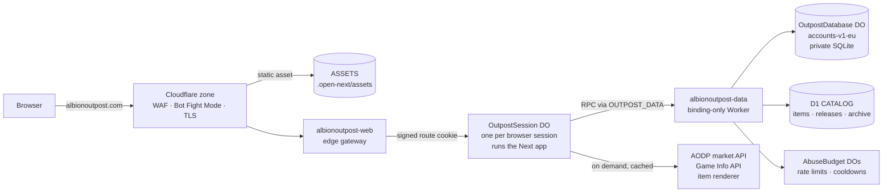

# Architecture

Outpost is a Next.js 16 / React 19 / TypeScript app that runs in production entirely on **Cloudflare's free tier**: two Workers, SQLite Durable Objects and a D1 database, built with OpenNext. Locally the same code runs on Node with Postgres and Redis. One codebase, two runtimes; the Cloudflare build swaps a handful of infrastructure modules at bundle time.

## Production topology

### `albionoutpost-web` (`wrangler.jsonc`, `cloudflare/web/worker.ts`)

- Redirects `www.` → apex (308).
- Issues/validates an HMAC-signed `outpost-route` cookie (HttpOnly, SameSite=Lax, Secure, 30 min) and forwards the request to `SESSIONS.getByName(id)`.
- **`OutpostSession` Durable Object** runs the whole OpenNext app for that browser session. Rendering inside a DO (instead of directly in the Worker) is what fixed the Free-tier CPU-limit failures (Error 1102). Each session has an in-memory budget of 240 requests/min (429 + `Retry-After` beyond that); the object writes nothing to storage, so page views cost no Durable Object storage writes. The route cookie is valid for 30 minutes from issue and is not refreshed, so session objects rotate every 30 minutes regardless of activity (Discord login sessions are separate and last 14 days).
- Bindings: `ASSETS`, `OUTPOST_DATA` (service → data Worker), `SESSIONS` (DO). Var `OUTPOST_RUNTIME=cloudflare`; release vars and secrets are listed in [OPERATIONS.md](OPERATIONS.md#runtime-configuration).
- OpenNext caches are `dummy` (no ISR store); images are unoptimized; link prefetch is off by default (`src/components/link.tsx`) to protect CPU and request budgets.

### `albionoutpost-data` (`cloudflare/database/wrangler.jsonc`, `cloudflare/database/worker.ts`)

No public URL — reachable only through the `OUTPOST_DATA` service binding. RPC methods: `query`, `service`, `health`, `rateLimit`, `upstreamBlocked`, `upstreamBlock`, `archiveList`, `archiveFind`.

| Store                                            | What it holds                                                                                               | Notes                                                                                                                                                                                                                                                        |
| ------------------------------------------------ | ----------------------------------------------------------------------------------------------------------- | ------------------------------------------------------------------------------------------------------------------------------------------------------------------------------------------------------------------------------------------------------------ |
| `OutpostDatabase` DO `accounts-v1-eu`            | All private data: users, sessions, accounts, builds, comps, Teams, community, scenarios, timers, watchlists | Single SQLite instance; every batch/service runs in `ctx.storage.transaction`. Self-migrates on start (`cloudflare/d1/migrations` 0001 → 0003 → 0004 → 0005, tracked in `_outpost_schema`). One-way: an older data Worker cannot run against a newer schema. |
| D1 `CATALOG` (named `albionoutpost-staging`, EU) | Public item metadata, catalog releases, archived library builds/comps                                       | Read-only to the app; written only by reviewed import scripts. Real `database_id` injected at release time.                                                                                                                                                  |
| `AbuseBudget` DOs                                | Fixed-window rate limits, regional upstream cooldowns                                                       | One object per hashed key. **Fails closed** — if it errors, the request is denied.                                                                                                                                                                           |

`protocol.ts` guards the RPC: 30-model allowlist, operation allowlist, ≤20 queries per batch, ≤2 MB args, no mixed public/private batches, no `$queryRaw` beyond `SELECT 1`, interactive transactions only inside named services.

### Request flow

1. Browser → zone (WAF, Bot Fight Mode). Asset hits are served from `ASSETS`.
2. Everything else → web Worker → the browser's `OutpostSession` DO → Next (`src/proxy.ts` sets CSP and headers) → page or API route.
3. Database calls become RPC to the data Worker: private models → `accounts-v1-eu`, catalog models → D1.
4. Market/combat data is fetched from AODP / Game Info on demand and cached in the Workers Cache API (≤1 h).

### Free-tier budget

Free allows 100,000 Worker requests and 100,000 Durable Object requests per day (plus 5 M D1 rows read, 100 k rows written). Every dynamic request costs one web Worker invocation and one `OutpostSession` request; static assets cost nothing. To stay inside that:

- Rate limits are per user (content writes, exports, settings) or per upstream region (AODP 50/min, Game Info 12/min) — never one site-wide budget for cached reads, which would block every visitor under load. Per-visitor flooding is handled by the session budget and the zone rate-limiting rule.
- `robots.ts` keeps crawlers out of editors, account pages and the API; "use as template" links are `nofollow` and editors are `noindex`. On 29–30 Oct one crawler alone made 81 % of all Worker requests on `/builds/new` and `/compositions/new`.
- Link prefetch stays off (`src/components/link.tsx`).

## Runtime swap

`next.config.ts` uses a webpack `NormalModuleReplacementPlugin` when `OUTPOST_RUNTIME=cloudflare`:

| Node module (`src/lib`) | Cloudflare module (`cloudflare/database`) | Behaviour on Cloudflare                                                  |
| ----------------------- | ----------------------------------------- | ------------------------------------------------------------------------ |
| `database-driver.ts`    | `web-driver.ts`                           | Prisma-shaped proxy → RPC; array `$transaction` only                     |
| `prisma-runtime.ts`     | `prisma-web.ts`                           | Error classes only                                                       |
| `redis.ts`              | `redis-web.ts`                            | Cache API for `atlas:data:*` keys; rate limits/cooldowns → `AbuseBudget` |
| `grind-library.ts`      | `library-web.ts`                          | Library JSON from `ASSETS`, archive from D1                              |
| `inflight-cache.ts`     | `inflight-web.ts`                         | Per-request de-duplication                                               |

**Domain services** (mostly `src/lib/*/service.ts`; also `builds/discovery-service.ts` and `market-watch-service.ts`) are written once: `databaseService("name", args) ?? localName(args)`. On Node `databaseService` returns `undefined` and the local implementation runs against Postgres; on Cloudflare the data DO runs the same TypeScript inside its transaction with `db` bound through AsyncLocalStorage (`cloudflare/database/context.ts`). Registered services: `reviseBuild`, `duplicateBuild`, `saveComposition`, `duplicateComposition`, `deleteComposition`, `mutateGroup`, `acceptInvitation`, `communityMutation`, `moderateReport`, `saveWatchItem`, `listAccountBuilds`, `listAccountFavorites`, `teamLoot`, `countPlayers`, `applySubscription`, `rememberCustomer` (`cloudflare/database/services.ts`).

## Schemas and migrations

- **Source of truth:** `prisma/schema.prisma` (Postgres): 30 models, 3 enums, 20 migrations in `prisma/migrations`.
- **Generated SQLite schema:** `npm run cloudflare:d1:schema` writes `cloudflare/d1/schema.prisma`, `0001_schema_candidate.sql` (30 tables, 41 indexes) and `manifest.json`. `scripts/cloudflare-domain-constraints.mjs` generates `0003_domain_invariants.sql` (44 triggers mirroring Postgres CHECKs). `0002` adds the D1 owned-library tables; `0004` adds team loot splits.
- Any schema change needs: a Prisma migration, regenerated SQLite schema + constraints, a new numbered `cloudflare/d1/migrations` file, and a matching upgrade step in the `OutpostDatabase` constructor (`cloudflare/database/worker.ts`). See the `outpost-deploy` skill.

## Local runtime

- `docker compose up -d` → Postgres 17 and Redis 7 on loopback (user/db `atlas`).
- `src/lib/db.ts` → plain `PrismaClient`; `redis.ts` → ioredis. Without `REDIS_URL`, rate limits allow in dev and **deny in production mode**.
- `src/lib/env.ts` validates env at startup: `DATABASE_URL` and `REDIS_URL` (both skipped on Cloudflare), `NEXTAUTH_URL` (https required when `NODE_ENV=production`, except localhost), `NEXTAUTH_SECRET` ≥32 chars, Discord ID/secret both-or-neither, `OUTPOST_OWNER_DISCORD_ID` 17–20 digits.
- `E2E_CLOUDFLARE=1` runs the app under local workerd via `scripts/cloudflare-local-server.mjs` with test-only bindings.
- The `Dockerfile` is a legacy standalone Node image; it is not used in production.

## Code layout

- **`src/app`** — 45 pages and 37 API routes, no route groups. Areas: home; tools (market, gold, flipping, transporting, crafting, refining, enchanting, cooking, alchemy, farming, fishing, kill/death feed); items; market-data; builds (+ library); compositions (+ library); groups, invitations; players; guides; favorites; shopping-list; timers; dashboard; settings; admin/reports; legal; signin. Full route list in [API.md](API.md).
- **`src/components`** — 106 flat files. Big ones worth splitting when touched: `production-calculator` (1.2k lines), `composition-editor` (1k), `build-editor`, `group-dashboard`, `equipment-workbench`, `market`.
- **`src/lib`** — `albion/` (AODP clients, region config, calculators, recipes, game JSON, icons), domain folders (`builds`, `compositions`, `groups`, `community`, `catalog`, `timers`), infrastructure (`auth`, `owner-admin`, `http`, `api-errors`, `turnstile`, `env`, `db`, `redis`, `logging`).
- **Styles** — 31 global stylesheets imported in `layout.tsx` (39 CSS files in `src/app`), layered from past design passes and resolved by import order. `product-system.css` owns the live colour/radius tokens and `motion-system.css` owns motion. Consolidation is on the [roadmap](ROADMAP.md).

## Security model

**Identity.** NextAuth v4 with Discord only (`identify email`, PKCE + state), database sessions (14 days), sign-in at `/signin`. The owner is promoted to `ADMIN` server-side when the verified Discord account ID equals `OUTPOST_OWNER_DISCORD_ID`; there is no role-assignment endpoint.

**Mutations** go through `mutationUser` (`src/lib/http.ts`): exact `Origin` match with `NEXTAUTH_URL`, a server session, and a `content:<userId>` budget (30/min). Bodies use `boundedJson` (JSON only, 64 KiB default, 1 MiB for comps). Errors are non-disclosing.

**Authorization** is checked inside the transaction against current rows: ownership for builds/scenarios/timers; visibility (public/unlisted/private/group) for reads and lists; Team roles `OWNER/ADMIN/OFFICER/MEMBER` — `canEditShared` = owner/admin/officer, `canManageMembers` = owner/admin; moderation requires a current `ADMIN`/`MODERATOR` user role. Private Teams return 404 to outsiders.

**Billing.** The Supporter plan (`User.plan`, `planStatus`, `planRenewsAt`, `stripeCustomerId`, `stripeSubscriptionId`) is written only by `/api/billing/webhook`: the Stripe signature is verified with HMAC-SHA256 and a five-minute tolerance (`src/lib/billing/stripe.ts`), and the subscription is re-read from Stripe before anything is written, so replayed or reordered events cannot roll the plan back. Checkout and the customer portal are started server-side for the signed-in user (`mutationUser`), never from client-supplied ids. Gates (`src/lib/billing/gate.ts`) read the owner's plan from the database on each request and stay open while billing is not configured. Ads are hidden for Supporters on the server.

**Abuse controls.** Rate limits per route — public routes share one **site-wide** counter per route group (e.g. all `/api/market*` routes share 120/min), signed-in budgets are per user (e.g. market 120/min, history/economy/transport/build-cost 60/min, opportunities 30/min, export 5/h, delete 3/h), Turnstile on comments/edits/reports in production (fails closed when partly configured), WAF rule blocking sensitive paths, Bot Fight Mode.

**Headers.** Per-request CSP nonce with `strict-dynamic`; `img-src` self/data/blob/`render.albiononline.com`; Turnstile allowed in script/frame/connect; AdSense origins (googlesyndication, doubleclick, adtrafficquality) are added to script/frame/img/connect only when `NEXT_PUBLIC_ADSENSE_CLIENT` is a valid `ca-pub-` id; `frame-ancestors 'none'`, `object-src 'none'`, `form-action 'self'`. HSTS on https, `nosniff`, `X-Frame-Options: DENY`, restrictive Permissions-Policy, `Cache-Control: private, no-store` on dynamic responses, `no-referrer` on invitation pages.

## Known architectural limits

- **Single private DO** (`accounts-v1-eu`): every session lookup and write is serialized through one object — a throughput ceiling and single point of failure. Scaling means partitioning by tenant or moving to a paid database.
- **No backups** of the private DO are scripted or tested yet.
- **Two schemas** must be kept in parity by generation scripts; local tests run against Postgres, not the production SQLite path (the Cloudflare e2e run and `qa-cloudflare-database.mjs` cover that).
- **Bundle headroom:** web ≈1.98 MB / data ≈1.02 MB gzip against a 3 MiB Free limit each.
- Historical identifiers containing `atlas` (cookies `atlas-theme`/`atlas-region`, cache keys `atlas:*`, export formats `albion-atlas-*`, ICS UIDs) are kept for compatibility; renaming needs a backward-compatible reader.
