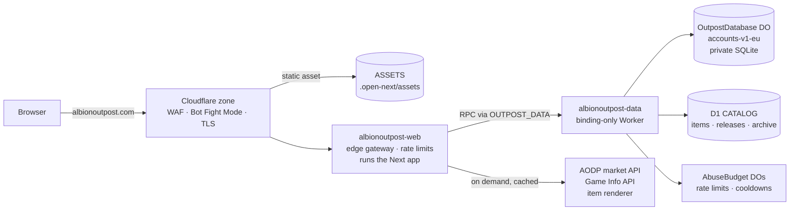

# Architecture

Outpost is a Next.js 16 / React 19 / TypeScript app that runs in production on **Cloudflare Workers Paid** (zone on the Free plan): two Workers, SQLite Durable Objects and a D1 database, built with OpenNext. Locally the same code runs on Node with Postgres and Redis. One codebase, two runtimes; the Cloudflare build swaps a handful of infrastructure modules at bundle time.

## Production topology

### `albionoutpost-web` (`wrangler.jsonc`, `cloudflare/web/worker.ts`)

- Redirects `www.` → apex (308).
- Answers signed-out GETs on the public routes in `cloudflare/web/edge-cache.ts` (JSON) and the public pages in `cloudflare/web/page-cache.ts` (HTML, [§ Page cache](#page-cache)) from the edge cache before anything else runs.
- Checks the caller's budgets (`cloudflare/web/request-budget.ts`) with four Workers Rate Limiting bindings, keyed by `cf-connecting-ip` (IPv6 per /64): 240 requests/min overall, 30 uncached searches/min, 20 item-database price pages/min per server and 20 market reads/min per server. They are counted at each Cloudflare location and cost no Durable Object request; a limiter error fails closed (503).
- **Runs the whole OpenNext app in the Worker itself** (the standard OpenNext deployment). Workers bill CPU time, not wall-clock time. Until 9 Nov 2026 the app ran in an `OutpostSession` Durable Object per browser session (chosen for the Free plan's CPU limit, Error 1102); Durable Objects bill wall-clock time while any request, timer, `waitUntil` promise or pending service-binding call keeps them in memory, and those objects billed 43–250 s per request against 0.6 s of CPU. The class is still exported, unbound and inert, until the next release deletes it ([OPERATIONS.md](OPERATIONS.md#retiring-the-session-object)). No routing cookie is set any more.
- Every render has a 30-second deadline, streamed body included (504 if nothing was sent), and background work handed to `waitUntil` gets ten seconds; both timers are cleared as soon as their work settles. `limits.cpu_ms` caps one request at 10 s of CPU (the Paid default is 30 s).
- Bindings: `ASSETS`, `OUTPOST_DATA` (service → data Worker), `EDGE_REQUESTS`, `EDGE_SEARCH`, `EDGE_ITEM_PRICES`, `EDGE_MARKET` (rate limits), `CF_VERSION_METADATA` (the deploy's version id, part of every page cache key). Var `OUTPOST_RUNTIME=cloudflare`; release vars and secrets are listed in [OPERATIONS.md](OPERATIONS.md#runtime-configuration).
- OpenNext caches are `dummy` (no ISR store); images are unoptimized; link prefetch is off by default (`src/components/link.tsx`) to protect CPU and request budgets.

### `albionoutpost-data` (`cloudflare/database/wrangler.jsonc`, `cloudflare/database/worker.ts`)

No public URL — reachable only through the `OUTPOST_DATA` service binding. RPC methods: `query`, `service`, `health`, `rateLimit`, `upstreamBlocked`, `upstreamBlock`, `archiveList`, `archiveFind`, `archiveTotals`, `topKills`, `recentKills`. A cron trigger (`* * * * *`) reads each server's Game Info kill feed into its `KillBoard` Durable Object (SQLite): the seven-day top-kill shortlist (`kills` table, top 40 by fame), the newest kill time seen, and a rolling window of the newest 100 distinct fights (one `meta` value, rewritten once a tick, under 1.5 MB). `/api/combat-events` serves its first pages from that window (`recentKills`) and compares any live answer against the newest kill time to flag an old copy of the feed.

| Store                                            | What it holds                                                                                                                          | Notes                                                                                                                                                                                                                                                                 |
| ------------------------------------------------ | -------------------------------------------------------------------------------------------------------------------------------------- | --------------------------------------------------------------------------------------------------------------------------------------------------------------------------------------------------------------------------------------------------------------------- |
| `OutpostDatabase` DO `accounts-v1-eu`            | All private data: users, sessions, accounts, builds, comps, Teams, community, scenarios, timers, watchlists, favorites and spec levels | Single SQLite instance; every batch/service runs in `ctx.storage.transaction`. Self-migrates on start (`cloudflare/d1/migrations` 0001 → … → 0015, schema version 14, tracked in `_outpost_schema`). One-way: an older data Worker cannot run against a newer schema. |
| D1 `CATALOG` (named `albionoutpost-staging`, EU) | Public item metadata, catalog releases, archived library builds/comps                                                                  | Read-only to the app; written only by reviewed import scripts. Real `database_id` injected at release time.                                                                                                                                                           |
| `AbuseBudget` DOs                                | Fixed-window rate limits, regional upstream cooldowns                                                                                  | One object per hashed key. **Fails closed** — if it errors, the request is denied.                                                                                                                                                                                    |

`protocol.ts` guards the RPC: 43-model allowlist, operation allowlist, ≤20 queries per batch, ≤2 MB args, no mixed public/private batches, no `$queryRaw` beyond `SELECT 1`, interactive transactions only inside named services.

### Request flow

1. Browser → zone (WAF, Bot Fight Mode). Asset hits are served from `ASSETS`.
2. Everything else → web Worker (edge cache, then rate limits) → Next in the same Worker (`src/proxy.ts` sets CSP and headers, and passes a valid `?region=` to the layout as `x-outpost-region` so the shell renders on the server with it) → page or API route.
3. Database calls become RPC to the data Worker: private models → `accounts-v1-eu`, catalog models → D1.
4. Market/combat data is fetched from AODP / Game Info on demand and cached in the Workers Cache API (≤1 h).

### Request budget

The account is on Workers Paid and the bill must stay at the $5 base, so every included allowance is a ceiling; [OPERATIONS.md § Cost guardrails](OPERATIONS.md#cost-guardrails) has the figures and the queries. Per dynamic request the web Worker costs one Worker request and its CPU time; static assets and edge-cache hits run no app code. A signed-out page view makes no Durable Object request (catalog reads go to D1); a signed-in one reads its session from `accounts-v1-eu`. To keep it that way:

- Edge budgets are Rate Limiting bindings, not Durable Objects. App-level rate limits (`AbuseBudget`) are per user (content writes, exports, settings) or per upstream region (AODP 50/min, Game Info 12/min) and run only on writes and upstream misses — never one site-wide budget for cached reads, which would block every visitor under load. The zone rate-limiting rule also caps `/api/`.
- Anything a page polls is edge-cached for signed-out visitors: market prices, the homepage pulse (`/api/market`), the kill feed (`/api/combat-events`, 30 s), item database prices.
- `robots.ts` keeps crawlers out of editors, account pages and the API; "use as template" links are `nofollow` and editors are `noindex`. On 29–30 Oct one crawler alone made 81 % of all Worker requests on `/builds/new` and `/compositions/new`.
- Link prefetch stays off (`src/components/link.tsx`).
- The homepage asks for its live previews once: `/api/landing` returns market, history, crafting, planner and top kills together (edge-cached signed out), and its like chips share one batched `/api/library-likes?items=` read.

### Page cache

Signed-out views of public pages are kept in the Workers Cache API (`caches.default`, per Cloudflare location) by `cloudflare/web/page-cache.ts`, so a repeat view costs a cache read instead of a render (≈ 0.6 s CPU). A hit skips the rate limit and the app, gets the edge security headers, and stays `private, no-store` for the browser.

| Route (allowlist, `pageRoutes`)                                                                                                                       | TTL   |
| ----------------------------------------------------------------------------------------------------------------------------------------------------- | ----- |
| `/`, `/market-data`, `/tools/kill-feed`, `/tools/market`                                                                                              | 60 s  |
| `/builds`, `/compositions`, `/groups` (lists of players' public content: a change shows within a minute)                                              | 60 s  |
| `/items/<id>` (lists three community builds; as signed-out search)                                                                                    | 2 min |
| `/builds/activities`, `/builds/library/<slug>`, `/compositions/library/<slug>`, `/guides`, `/guides/<slug>`, `/tools`, the other tool pages, `/items` | 5 min |

Never kept: a player's own build, comp or Team page (`/builds/<id>`, `/compositions/<id>`, `/groups/<slug>`: making one private or hiding it takes effect at once, `e2e/seo.spec.ts`); any other route (editors, `/builds/new`, `/compositions/new`, `/groups/new`, account, admin, sign-in, giveaways, players, invitations, legal, `/api/*`); a request with any `next-auth` cookie or a cookie named like auth, session or token; non-GET; RSC, prefetch and Server Action requests (`RSC` or any `Next-*` header, `_rsc` query), which therefore always render and can never be answered with HTML; queries with click-tracking parameters (`utm_*`, `fbclid`, `gclid` …), repeated names or over 512 characters; an answer that is not a 200 HTML document, has `Set-Cookie` or `X-Outpost-Partial`, lacks a CSP nonce, is cut off (no closing `</html>`, as after the render deadline) or streamed a not-found, redirect or error boundary (`data-dgst`, which root `loading.tsx` streaming sends under a 200).

**Key:** `https://albionoutpost.com/__page/<version>/<light|dark>/<region|->/<path>?<query>`. The version is the deploy's id, so a page kept by one deploy never names another deploy's script chunks and every deploy or rollback starts empty. Theme (`atlas-theme`) and server (`atlas-region`) are the only cookies a signed-out render reads; a cookie the key could read differently from Next (repeated, a value other than `light`/`dark` or a server id, a look-alike name, percent-encoded) skips the cache rather than risk keying one render under another's name. The query is kept exactly as sent: Next embeds it in the router payload (`"c":["","builds?…"]`), so a reordered query is a different page.

**Nonce.** The page is stored as rendered, nonce included. The nonce appears in script and preload `nonce` attributes, in React's `"nonce"` props inside the flight payload (font and stylesheet hints) and in the `Link` font-preload header. On each hit a fresh nonce (base64 of a random UUID, as `src/proxy.ts` makes it) replaces every occurrence of the exact stored value in the body, `Link` and `Content-Security-Policy`, so two hits never share a nonce and the policy always matches the body. It is the same length, so length-prefixed flight rows stay valid. Rewriting every `nonce=` attribute with HTMLRewriter would miss the flight payload and would give a valid nonce to any injected attribute; replacing only the render's own value does neither. The policy itself is unchanged.

No stale-while-revalidate: without coordination across isolates every stale hit would render in the background, which can cost more CPU than a plain miss. Operating it (purge, disable): [OPERATIONS.md § Cost guardrails](OPERATIONS.md#cost-guardrails).

## Runtime swap

`next.config.ts` uses a webpack `NormalModuleReplacementPlugin` when `OUTPOST_RUNTIME=cloudflare`:

| Node module (`src/lib`) | Cloudflare module (`cloudflare/database`) | Behaviour on Cloudflare                                                      |
| ----------------------- | ----------------------------------------- | ---------------------------------------------------------------------------- |
| `database-driver.ts`    | `web-driver.ts`                           | Prisma-shaped proxy → RPC; array `$transaction` only                         |
| `prisma-runtime.ts`     | `prisma-web.ts`                           | Error classes only                                                           |
| `redis.ts`              | `redis-web.ts`                            | Cache API for `atlas:data:*` keys; app rate limits/cooldowns → `AbuseBudget` |
| `grind-library.ts`      | `library-web.ts`                          | Library JSON from `ASSETS`, archive from D1                                  |
| `inflight-cache.ts`     | `inflight-web.ts`                         | Per-request de-duplication                                                   |

**Domain services** (mostly `src/lib/*/service.ts`; also `builds/discovery-service.ts` and `market-watch-service.ts`) are written once: `databaseService("name", args) ?? localName(args)`. On Node `databaseService` returns `undefined` and the local implementation runs against Postgres; on Cloudflare the data DO runs the same TypeScript inside its transaction with `db` bound through AsyncLocalStorage (`cloudflare/database/context.ts`). Registered services: `createBuild`, `reviseBuild`, `duplicateBuild`, `saveComposition`, `duplicateComposition`, `deleteComposition`, `mutateGroup` (including every Team role action), `acceptInvitation`, `communityMutation`, `moderateReport`, `saveWatchItem`, `listAccountBuilds`, `listAccountFavorites`, `accountSaves`, `teamLoot`, `teamWallet`, `teamGames`, `giveawayBoard`, `changeGiveaway`, `countPlayers`, `applySubscription`, `rememberCustomer` (`cloudflare/database/services.ts`).

## Schemas and migrations

- **Source of truth:** `prisma/schema.prisma` (Postgres): 43 models, 3 enums (historical migrations plus additive follow-ups) in `prisma/migrations`.
- **Generated SQLite schema:** `npm run cloudflare:d1:schema` writes `cloudflare/d1/schema.prisma`, `0001_schema_candidate.sql` (30 tables, 41 indexes) and `manifest.json`. `scripts/cloudflare-domain-constraints.mjs` generates `0003_domain_invariants.sql` (44 triggers mirroring Postgres CHECKs). `0002` adds the D1 owned-library tables; `0004` adds team loot splits. `0010` adds the Team crest, activities and recruiting columns (private-store schema step 9; Postgres `20261106230000_team_crest`). `0011` adds the nullable `User.avatarFrame` (step 10; Postgres `20261107120000_avatar_frame`). `0012` adds Team roles (`GroupCustomRole`, `GroupRoleAssignment`) and gives every existing Team the old fixed roles as editable ones with the same rights (step 11; Postgres `20261107180000_team_roles`; checked by `scripts/qa-d1-schema.py`). `0013` adds the Team economy (`GroupWalletEntry`, `GroupCoinFlip`, `GroupLootRoll`, `GroupLootRollEntry`), widens the role permission bound to ten flags and gives Manage wallet to every role that held Manage loot splits (step 12; Postgres `20261108090000_team_economy`; checked by `scripts/qa-d1-schema.py`). `0014` adds `Group.guildTaxPercent` (default 0, triggers enforcing 0–100 with one decimal, as the Postgres CHECK does) (step 13; Postgres `20261109090000_team_guild_tax`; checked by `scripts/qa-d1-schema.py`). `0015` adds `LibraryFavorite` and `MasteryLevel`, the account copies of library favorites and spec levels (new tables only; triggers enforce the key formats and 1–100 levels as the Postgres CHECKs do) (step 14; Postgres `20261110090000_account_saves`; checked by `scripts/qa-d1-schema.py`). `0016` adds giveaways (`Giveaway`, `GiveawayEntry`), widens the role permission bound to eleven flags and gives Manage giveaways to every role that held Manage team; triggers freeze a drawn or cancelled giveaway and its entries (step 15; Postgres `20261111090000_giveaways`; checked by `scripts/qa-d1-schema.py`).
- Any schema change needs: a Prisma migration, regenerated SQLite schema + constraints, a new numbered `cloudflare/d1/migrations` file, and a matching upgrade step in the `OutpostDatabase` constructor (`cloudflare/database/worker.ts`). See the `outpost-deploy` skill.

## Local runtime

- `docker compose up -d` → Postgres 17 and Redis 7 on loopback (user/db `atlas`).
- `src/lib/db.ts` → plain `PrismaClient`; `redis.ts` → ioredis. Without `REDIS_URL`, rate limits allow in dev and **deny in production mode**.
- `src/lib/env.ts` validates env at startup: `DATABASE_URL` and `REDIS_URL` (both skipped on Cloudflare), `NEXTAUTH_URL` (https required when `NODE_ENV=production`, except localhost), `NEXTAUTH_SECRET` ≥32 chars, Discord ID/secret both-or-neither, `OUTPOST_OWNER_DISCORD_ID` 17–20 digits. On Cloudflare the same check runs too: OpenNext bundles `instrumentation.ts` statically and Next calls `register()` on the first request of each isolate, after the bindings are copied into `process.env`; an invalid configuration fails every request (500) and logs `Invalid server configuration: <keys>` rather than serving with a weak secret.
- `E2E_CLOUDFLARE=1` runs the app under local workerd via `scripts/cloudflare-local-server.mjs` with test-only bindings.
- The `Dockerfile` is a legacy standalone Node image; it is not used in production.

## Code layout

- **`src/app`** — the page and API route trees, no route groups. Areas: home; tools (market, gold, flipping, transporting, crafting, refining, enchanting, cooking, alchemy, farming, fishing, kill/death feed); items; market-data; builds (+ library); compositions (+ library); groups, invitations; players; guides; favorites; shopping-list; timers; dashboard; settings; administration (overview, users, account detail, review, audit and reports); legal; signin. Full route list in [API.md](API.md).
- **`src/components`** — 106 flat files. Big ones worth splitting when touched: `production-calculator` (1.2k lines), `composition-editor` (1k), `build-editor`, `group-dashboard`, `equipment-workbench`, `market`.
- **`src/lib`** — `albion/` (AODP clients, region config, calculators, recipes, game JSON, icons), domain folders (`builds`, `compositions`, `groups`, `community`, `catalog`, `timers`), infrastructure (`auth`, `owner-admin`, `http`, `api-errors`, `turnstile`, `env`, `db`, `redis`, `logging`).
- **Styles** — 16 global stylesheets imported in `layout.tsx` (39 CSS files in `src/app`), layered from past design passes and resolved by import order. `product-system.css` owns the live colour/radius tokens and `motion-system.css` owns motion. Route styles load with their route: the build, composition and Team build workspaces through `src/app/build-styles.ts`, guides through their own CSS modules, calculators and features through their own component imports ([DESIGN.md § Components](../DESIGN.md#components)). Consolidation is on the [roadmap](ROADMAP.md).

## Security model

**Identity.** NextAuth v4 with Discord only (`identify email`, PKCE + state), database sessions (14 days), sign-in at `/signin`. Signed-in-only pages redirect there with `callbackUrl` (`signInPath` in `src/lib/sign-in-return.ts`); `safeSignInReturn` accepts only same-origin relative paths from a fixed list (dashboard, settings, timers, favorites, giveaways, new Team, admin, owned build/comp edit, a Team page, comp drafts and invitation confirmation) and sends anything else, including absolute or foreign URLs, to `/settings`. The owner is promoted to `ADMIN` server-side when the verified Discord account ID equals `OUTPOST_OWNER_DISCORD_ID`; there is no role-assignment endpoint.

**Mutations** go through `mutationUser` (`src/lib/http.ts`): exact `Origin` match with `NEXTAUTH_URL`, a server session, and `content:<userId>` budgets (30/min, plus 600/day so one account cannot fill the shared private store). Bodies use `boundedJson` (JSON only, 64 KiB default, 1 MiB for comps). Errors are non-disclosing.

**Storage limits.** The private store is one SQLite object (10 GB), so each account is bounded (`src/lib/storage-limits.ts`): at most 500 builds and 500 comps (Team comps count against their creator), counted inside the same serializable transaction as the create (409); the last 50 revisions per build or comp, older ones deleted in the same transaction as the save; and 50 MiB of saves a day (`spendSaveBudget` in `src/lib/http.ts`, 429). The byte budget is a weighted `AbuseBudget` window: `rateLimit(key, limit, seconds, cost)` spends `cost` (KiB here) and refuses a call that does not fit without spending; on Node the Redis script does the same. With revision copies one account adds at most about 100 MiB a day.

**Account saves.** Library favorites and spec levels go to the account when signed in. The layout passes the session's account id to the shell only so the browser knows to use the account; every read and write of `/api/account/saves` takes the user from the server session, and the `accountSaves` service re-checks the account row inside its transaction, so another account's rows can never be named. Guests keep both in `localStorage` as before.

**Profiles.** `/players/[id]` renders only for an account with a public build or comp, or a visible comment on one (or for the signed-in account itself); any other ID is a 404, so an account ID never reveals a name or join date.

**Authorization** is checked inside the transaction against current rows: ownership for builds/scenarios/timers; visibility (public/unlisted/private/group) for reads and lists; Team roles (below); moderation requires a current `ADMIN`/`MODERATOR` user role. Private Teams return 404 to outsiders. Member Discord pictures (`User.image`) and join dates are read only inside the members-only part of `groupDashboard` (`src/lib/groups/dashboard.ts`), so outsiders and public Team pages never receive them; join requesters' pictures go only to members who review requests. Team profile changes, the crest included, need `manageTeam` and are validated against fixed allow-lists (item ids, palette colours, activities); a crest is never an uploaded image.

**Team roles.** Each Team keeps its own ordered roles (`GroupCustomRole`: name, palette colour, position, a permission bitmask, a default flag) and who holds them (`GroupRoleAssignment`, whose composite keys tie a role to its own Team and to a current member, so a role can never be held across Teams and leaves with the member). `src/lib/groups/permissions.ts` is the one resolver: rights are the union of the held roles' permissions, rank is the highest held position, and the owner (`Group.ownerId`, shown as Leader) has every permission above every role. `mutateGroup`, `teamLoot`, the comp services and invitation acceptance read the actor's roles inside their own transaction (`loadTeamAccess` in `src/lib/groups/roles.ts`); nothing comes from the client. Hierarchy: a member edits, moves, deletes or hands out only roles strictly below their highest role, changes the roles of or removes only members ranked below them, and can grant or remove only permissions they hold, so nobody can raise themselves: a role they hand out, take away, delete or make the default may carry only rights they hold, even when it ranks below them (otherwise a lower role with more rights would lift them, or an alt, past their own). Every role change revokes open invitation links whose issuer lost `inviteMembers`.

**Team economy.** `teamWallet` and `teamGames` (`src/lib/groups/economy-service.ts`, registered services) read the actor's access inside their own serializable transaction. A balance is the sum of its `GroupWalletEntry` rows (member, or the pot when `userId` is null), never a stored total; entries are append-only (SQLite trigger) and keyed by `sourceId` (`op:<client key>`, `split:`, `roll:`), unique per member, so a retry or a second payment of the same split cannot book twice. Debits and payouts are checked against the balance in the same transaction. Coin sides and 1–100 rolls come from `crypto.getRandomValues` with rejection sampling (`src/lib/groups/economy.ts`), drawn inside the write; request schemas are strict, so a client cannot send an outcome, a value or a winner. One roll per member is the `GroupLootRollEntry` primary key. Coin flips carry no stake and never touch the ledger; they settle ties and decisions. The browser animations only replay stored results. In-game silver bookkeeping only; no money, purchases or transfers. `GroupMember.role` is legacy: it fed the one-time migration (Admin → `manageTeam`, `inviteMembers`, `manageRequests`, `removeMembers`, events, comps, loot, builds; Officer → invite, events, comps, loot, builds; Member → none; only the owner manages roles, as before) and nothing reads it for rights.

**Giveaways.** `giveawayBoard` and `changeGiveaway` (`src/lib/giveaways/service.ts`, registered services) read the actor inside one serializable transaction: a site-wide giveaway (`groupId` null) is run by a current, unbanned global `ADMIN`; a Team's by members holding `manageGiveaways`, and outsiders get 404 for both the board and every action. Any signed-in player enters a site-wide giveaway; only current members enter a Team's. One entry per player is the `GiveawayEntry` primary key. Entries, leaving and edits are refused once `closesAt` passes or the giveaway is drawn or cancelled. The draw runs only after the deadline: it reads the entries, keeps current members (Team) or unbanned accounts (site-wide), sorts them by id and draws `winnerCount` distinct winners with a partial Fisher–Yates shuffle over `crypto.getRandomValues` with rejection sampling (`drawWinners` in `rules.ts`), marks their places and then flips the giveaway to `DRAWN` with `drawnAt` and `drawnById` by compare-and-set, all in the same transaction. A second draw returns the stored result unchanged. Request schemas are strict, so a client cannot send winners, a status, a team or a time. On the private store, triggers refuse any change to a drawn or cancelled giveaway or its entries (account deletion still removes a player's entries and clears the creator and drawer links). Prizes are in game; Outpost takes no payment and holds nothing.

**Supporter.** `isSupporter` (`src/lib/billing/plan.ts`) is true for a stored plan, an admin gift or the **launch grant**: while `launchGrant.closedAt` is null every account, including ones that sign up later, is a lifetime Supporter, without any row being written. Setting `closedAt` to a date ends the launch: accounts created before it keep Supporter for life, later ones need a gift. The gates (`src/lib/billing/gate.ts`) apply whether or not billing is configured: creating a Team and managing one (profile, events, announcements, invites, roles, shared builds, loot, wallet, flips and rolls, and giveaway create/edit/cancel/draw) need the owner to be a Supporter (402); RSVPs, entering a giveaway, leaving, removing members, transfer and delete never lock. While the launch is open the gates answer without a database read. The UI labels the grant "Launch Supporter" (settings, admin, `/supporter`), and never shows prices or checkout during the launch.

**Billing.** Supporter entitlement is reconciled only from signed webhooks and the complete customer subscription history for the configured price, then written against the account revision captured before provider reads. A canceled old subscription cannot replace an active matching one. Checkout first records a durable idempotent operation; account deletion verifies provider cancellation/checkout completion and rechecks the account in the deletion transaction. No active subscription is canceled implicitly. See [billing security](BILLING_SECURITY.md) for operation recovery, additive migrations, tests and provider-verification limits. Ads are hidden for Supporters on the server.

**Display names** (`src/lib/display-name.ts`). A name is cleaned when an account is created (`createUser` in `src/lib/auth.ts`) and when a player changes it in settings: format and control characters (bidi overrides and isolates, zero-width characters), blank-rendering letters and repeated whitespace are removed. Names that read as Outpost or its staff (Outpost, Outpost staff, admin, moderator, official, support, system and a few more; case, accents, spacing, punctuation and look-alike letters ignored) are refused in settings and dropped at sign-up. Stored names are not rewritten; `displayName` applies the same cleaning wherever a player's name is shown, and shows "Adventurer" for an empty or reserved one.

**Abuse controls.** Rate limits per route — public routes share one **site-wide** counter per route group (e.g. all `/api/market*` routes share 120/min), signed-in budgets are per user (e.g. market 120/min, history/economy/transport/build-cost 60/min, opportunities 30/min, export 5/h, delete 3/h), per-address budgets count IPv6 per /64 (`src/lib/client-address.ts`), Turnstile on comments/edits/reports in production (fails closed when partly configured), WAF rule blocking sensitive paths, Bot Fight Mode. Before Next runs, the web Worker applies its per-address edge budgets (Rate Limiting bindings, above); no cookie renews them.

**Rendering is not an isolation boundary.** Requests from different visitors share Worker isolates, as they did when pages rendered in per-session Durable Objects (objects of one class share isolates too). Nothing private lives in module state: authority comes from the NextAuth session and the database services on every request, and private responses are `private, no-store`. The page cache shares a render only between visitors with no account cookie, only on allowlisted public routes, and gives each copy its own CSP nonce ([§ Page cache](#page-cache)). The `outpost-route` cookie that addressed the old session object was routing only; nothing (CSRF, NextAuth, permissions) read it, and it is no longer set.

**Headers.** Per-request CSP nonce with `strict-dynamic`; `img-src` self/data/blob/`render.albiononline.com`; Turnstile allowed in script/frame/connect; while ads are active (publisher id plus a complete `OPERATOR_*` imprint, `adsActive()` in `src/components/adsense-loader.tsx`) the policy adds Google's ad and consent origins to frame/connect, `https:` to img and `fonts.gstatic.com` to font; scripts still need the nonce (asserted by `tests/advertising-privacy.test.ts`). Otherwise `NEXT_PUBLIC_ADSENSE_CLIENT` only emits the ownership `<meta>`; `frame-ancestors 'none'`, `object-src 'none'`, `form-action 'self'`. HSTS on https, `nosniff`, `X-Frame-Options: DENY`, restrictive Permissions-Policy, `Cache-Control: private, no-store` on dynamic responses (signed-out `/api/search`, `/api/landing`, `/api/landing/craft`, `/api/economy/crafts`, `/api/economy/black-market` and `/api/combat-events/top` are answered from the edge cache, keyed on validated parameters, for two minutes, and Market Explorer's `/api/market` (60 s) and `/api/history` (5 min) for their server cache lives; an answer marked `X-Outpost-Partial` (a part failed) is served but not kept; see `cloudflare/web/edge-cache.ts`), `no-referrer` on invitation pages.

**Static asset caching.** Files in `.open-next/assets` (the `public/` folder and the build output) are answered by Workers Static Assets without running the Worker, with the headers in `public/_headers`: the same security set as the Worker, plus `public, max-age=31536000, immutable` for the content-hashed `/_next/static/*`, and `public, max-age=2592000, stale-while-revalidate=604800` (30 days, then a week served while it refreshes) for artwork, icons and fonts under `/albion/*`, `/brand/*`, `/scenes/*`, `/library/media/*`, `/fonts/*` and `/icon-*`, which keep their names when they change. Everything else from Static Assets, including the library JSON rebuilt on every deploy and `/llms.txt` (a plain-text summary of the site for language-model crawlers), keeps the platform default (`public, max-age=0, must-revalidate`, an ETag check). Pages and `/api/*` always run the Worker and stay `private, no-store` for the browser (signed-out public pages and APIs may be answered from the Worker's edge cache, above). A returning visitor can see a replaced artwork up to about a month late, so give a changed file a new name (`-v2`) when it must show at once.

## Known architectural limits

- **Single private DO** (`accounts-v1-eu`): every session lookup and write is serialized through one object — a throughput ceiling and single point of failure. Scaling means partitioning by tenant or moving to a paid database.
- **No backups** of the private DO are scripted or tested yet.
- **Two schemas** must be kept in parity by generation scripts; local tests run against Postgres, not the production SQLite path (the Cloudflare e2e run and `qa-cloudflare-database.mjs` cover that).
- **Bundle headroom:** web ≈3.13 MiB / data ≈1.00 MiB gzip against the 10 MiB Workers Paid limit each; smaller still starts faster. Client-only heavy libraries stay out of the Worker. The Treasury's coin and chest are CSS 3D (`economy-stage.tsx`), so three.js is no longer a dependency.
- Public downloads and new composition/trade exports use `albion-outpost-*`; composition imports also accept the legacy `albion-atlas-composition` format. Historical cookies (`atlas-theme`/`atlas-region`), cache keys (`atlas:*`), database names, source version identifiers and ICS UIDs remain stable so preferences, cached budgets, provenance and existing calendar events retain their identity. Calendar producer metadata uses Albion Outpost. Archived evidence retains the name used when captured.

## Administrative controls (schema 7)

The administration domain in `src/lib/admin` supplies current-role read services, atomic audited gift/session/ban mutations, and atomic OAuth session creation/resolution. `DiscordBan` and `AdminAudit` are private models. Gifts use separate account fields and never write Stripe subscription state. Session creation and ban checks are named services so the same concurrency boundary runs inside the private SQLite transaction as on PostgreSQL. There are no browser role-grant or arbitrary database endpoints. See the [role/action matrix and recovery constraints](ADMINISTRATION.md).

The old activity timestamp touch was removed. Public account statistics now count registered records (the legacy RPC field remains named `monthlyPlayers` only for rolling compatibility); the UI calls them Accounts. They are not unique people or monthly active players. Admin charts expose stored creation events with explicit sampling limits, not analytics or revenue.
