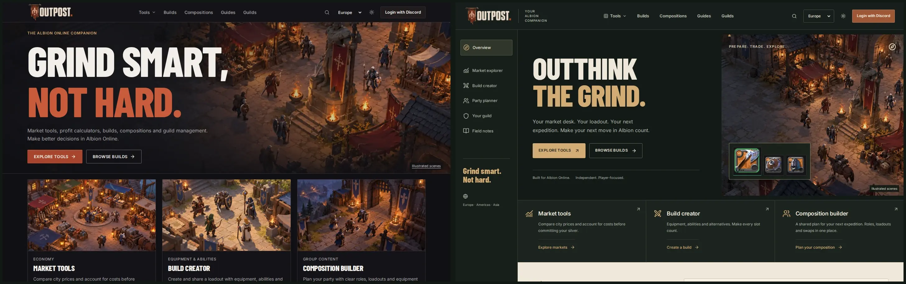
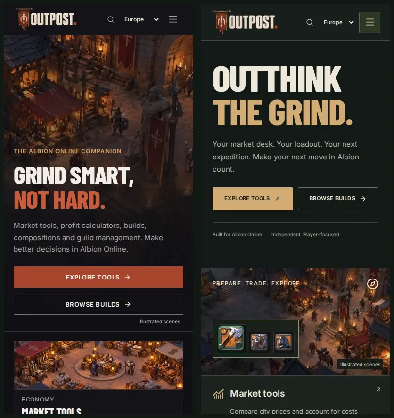

# Homepage and navigation redesign

**Rejected and reverted:** the user requested removal of this green/ivory design. These screenshots are historical evidence, not the active design.

Implemented directly in Outpost after inspecting the original running site. The homepage now uses an expedition field-guide composition: a labelled desktop rail, asymmetric hero, ink/forest grounds, ivory/gold typography, genuine equipment icons, compact tool entries and an ivory market workbench. Existing market logic and permitted public-build queries are preserved. Other workspace bodies were not redesigned.

The shared header is larger and clearer, with a two-column tool menu and distinct current-page states. Mobile navigation has grouped destinations, aligned icons, region selection, theme control, focus trapping and Escape/focus return. The narrow loaded-price table fits its panel.

**Before is left, after is right.** These are actual local Playwright/Chromium screenshots, not mockups. The unchanged existing scene illustration remains disclosed; equipment art comes from the actual Albion renderer. No new scene artwork or fabricated market/community data was introduced.

| View              | Before                                | After                               |
| ----------------- | ------------------------------------- | ----------------------------------- |
| Desktop full page | [1440px](before-home-1440.webp)       | [1440px](after-home-1440.webp)      |
| Mobile full page  | [390px](before-home-390.webp)         | [390px](after-home-390.webp)        |
| Desktop tool menu | [Before](before-tools-menu-1440.webp) | [After](after-tools-menu-1440.webp) |
| Mobile navigation | [Before](before-navigation-390.webp)  | [After](after-navigation-390.webp)  |

[Desktop full-page comparison](compare-home-1440.webp), [mobile full-page comparison](compare-home-390.webp). Screenshots were opened and inspected through multiple implementation passes, including real loaded/error market states in isolated tests. Test quotes and public-build fixtures are not live data.

Targeted homepage/navigation tests pass. Initial contrast issues were corrected in dark/light themes; two old layout assertions were updated for the new header height and duplicate sidebar/header destinations. Existing values, persistence, authorization and quote-identity assertions remain. Two homepage hero goldens were added, and the two changed navigation goldens were reviewed and updated; the eight existing equipment/gallery regions remain protected. The final full gate is recorded in [QA_REPORT.md](../../../QA_REPORT.md).

[Portable evidence](evidence.json) records final scope, hashes and actual results. Playwright MCP remains policy-blocked; the installed local Chromium fallback works. Physical-device, full screen-reader, genuine OAuth and owner visual acceptance remain separate. Fresh Docker verification remains blocked by its read-only buildx activity path; no deployment occurred.

Final `npm run qa:phase`: 10/10 gates PASS,143 unit tests,66 production browser tests,15 disposable database checks and nine regional endpoint checks. One homepage Lighthouse13.5.0 mobile sample measured performance96,accessibility100,LCP2.557s,CLS0.062; this is neither a before/after speed claim nor field evidence. Impeccable’s detector reports no findings in the changed homepage/navigation targets.
