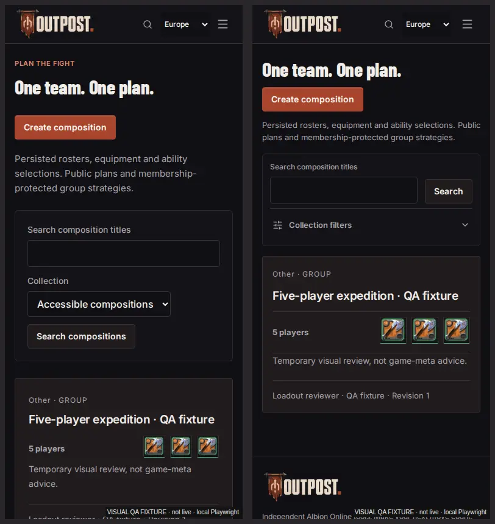
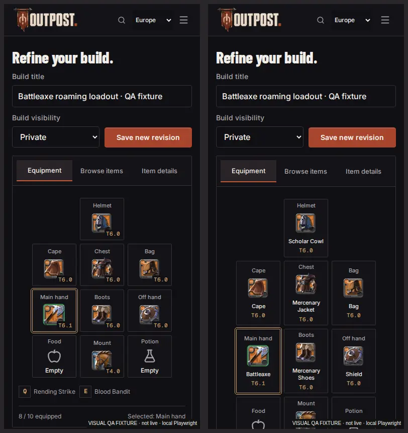
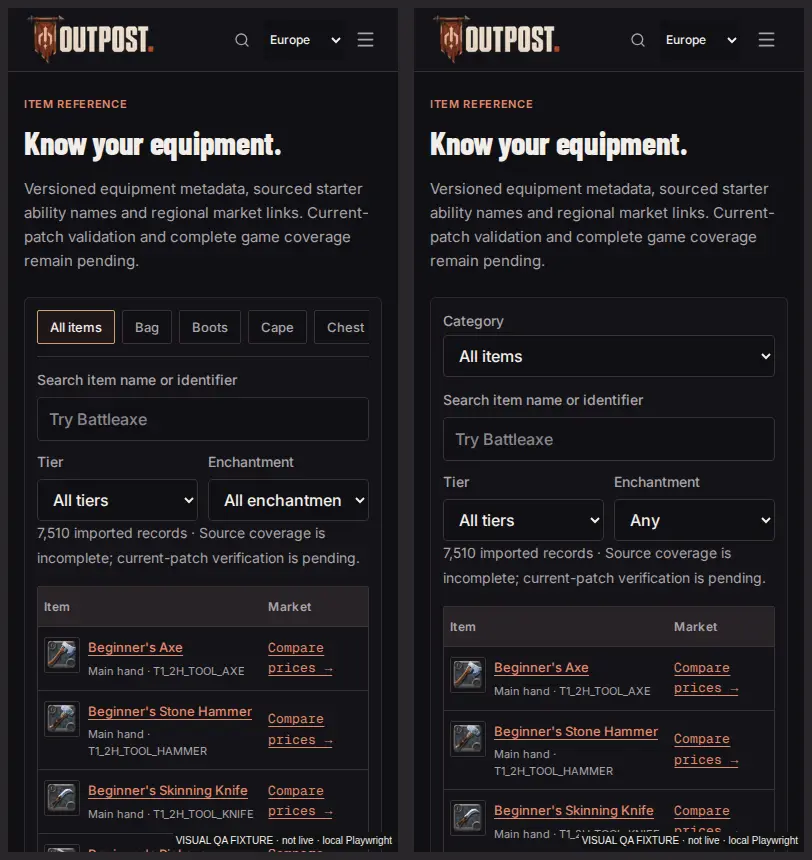

# Outpost rendered refinement — 26 October 2026

Implemented after the user authorized application changes following the [original audit](../../engineering/UI_UX_CODE_AUDIT_2026-10-26.md). This is a targeted refinement of the existing Outpost interface, not a new visual identity or a completed product redesign. The charcoal/copper palette, banner, Barlow/Inter/Geist typography, item renderer, calculations and permission boundaries remain.

## Actual visible changes

- Equipment cards now show the actual equipped name as well as its icon and tier. Tier badges no longer overlap the name. Helmet wording is consistent. Mobile pane switches move keyboard focus into search/details or back to the selected slot; views have explicit relationships and 44px navigation targets.
- The composition directory keeps title search visible and collapses the secondary collection filter on phones/tablets. The first 390px fixture roster starts around 412px rather than 613px in the matched screenshots (about 201px earlier). Actual roster counts and authentic equipment previews remain; previews are 44px rather than 36px, with clearer separation from description/author information.
- Mobile item categories use a full native selector instead of a long horizontal strip. Enchantment uses the complete short value “Any” beneath its label. “All cities” and “Newest first” keep the existing filter/sort values while fitting narrow controls.
- The mobile navigation groups tools in two columns, increases touch targets and preserves focus trapping, Escape, focus return, current page and regional URLs.
- Calculator price entry uses a short “Enter price” placeholder, 16px phone input text and a separate return-choice row. Missing data is still explicitly unavailable; no default prices or arithmetic changed.
- Equipment/party/large-roster/build-detail/workspace links derive names from their actual visible content instead of replacing it with an incomplete action label. The workspace aside has a distinct landmark name. Item provenance wraps locally, preserving full source hashes without document overflow.
- Each Barlow file has a single owner. The UI font remains preloaded; the 800 display face and 600/700 supporting faces load when used. Existing 800 heading roles bind to the display face, preserving their actual font weight. The duplicate transfer is removed.

Market and Dashboard layouts were inspected and retained. Builds retains its discovery layout with the shorter sort value. These screenshots are not evidence of a redesign of those pages.

## Before and after images actually inspected

Production localhost:3001, local Playwright/Chromium fallback. Playwright MCP returned approval-required under a never policy; DevTools MCP lacked its configured Chrome. The dedicated Browser plugin was absent. No security restriction was changed.

Fixtures create an owned temporary user/session/build/group/composition and clean them afterward. Market/history values are synthetic, labelled in the images. These are not real OAuth or live-price screenshots. Equipment art uses the actual renderer. Screenshots wait for headings, fonts and visible images, with scroll position reset.

Baseline full-page captures cover ten affected routes at six widths. The final full-page capture covers 29 routes × six widths = **174 configurations**, including 320/375/390/768/1440/1920. All fit the document width; no console/page errors or failed requests were recorded. Main-page full-page contact sheets below were opened and visually examined, in addition to individual native-size mobile/desktop captures and the supplied composition/reference images. Contact sheets establish composition; native-size examples establish the readable details. The baseline below follows the initial accessibility fixes, while the original 320px provenance failure is separately retained.

**Left: before. Right: after**, same 390px viewport, fixture content and scroll position:

The equipment-name improvement deliberately makes the phone equipment panel taller. It trades some above-fold density for readable gear identity; the full loadout remains scrollable and mobile panes remain available. Owner visual acceptance, physical-device use and full screen-reader acceptance remain open.

## Full-page screenshot links

Each link is the full page, not only the first viewport. The overview links place 1440/768/390/320 captures left-to-right. Raw PNGs and other routes remain under ignored `.qa/frontend-pass/refinement-*`; the linked WebP evidence is retained in this directory.

| Page                | Width  | Before                                  | After                                 |
| ------------------- | ------ | --------------------------------------- | ------------------------------------- |
| Market              | 1440px | [Before](before/market-1440.webp)       | [After](after/market-1440.webp)       |
| Market              | 768px  | [Before](before/market-768.webp)        | [After](after/market-768.webp)        |
| Market              | 390px  | [Before](before/market-390.webp)        | [After](after/market-390.webp)        |
| Market              | 320px  | [Before](before/market-320.webp)        | [After](after/market-320.webp)        |
| Builds              | 1440px | [Before](before/builds-1440.webp)       | [After](after/builds-1440.webp)       |
| Builds              | 768px  | [Before](before/builds-768.webp)        | [After](after/builds-768.webp)        |
| Builds              | 390px  | [Before](before/builds-390.webp)        | [After](after/builds-390.webp)        |
| Builds              | 320px  | [Before](before/builds-320.webp)        | [After](after/builds-320.webp)        |
| Equipment editor    | 1440px | [Before](before/editor-1440.webp)       | [After](after/editor-1440.webp)       |
| Equipment editor    | 768px  | [Before](before/editor-768.webp)        | [After](after/editor-768.webp)        |
| Equipment editor    | 390px  | [Before](before/editor-390.webp)        | [After](after/editor-390.webp)        |
| Equipment editor    | 320px  | [Before](before/editor-320.webp)        | [After](after/editor-320.webp)        |
| Crafting calculator | 1440px | [Before](before/crafting-1440.webp)     | [After](after/crafting-1440.webp)     |
| Crafting calculator | 768px  | [Before](before/crafting-768.webp)      | [After](after/crafting-768.webp)      |
| Crafting calculator | 390px  | [Before](before/crafting-390.webp)      | [After](after/crafting-390.webp)      |
| Crafting calculator | 320px  | [Before](before/crafting-320.webp)      | [After](after/crafting-320.webp)      |
| Dashboard           | 1440px | [Before](before/dashboard-1440.webp)    | [After](after/dashboard-1440.webp)    |
| Dashboard           | 768px  | [Before](before/dashboard-768.webp)     | [After](after/dashboard-768.webp)     |
| Dashboard           | 390px  | [Before](before/dashboard-390.webp)     | [After](after/dashboard-390.webp)     |
| Dashboard           | 320px  | [Before](before/dashboard-320.webp)     | [After](after/dashboard-320.webp)     |
| Composition gallery | 1440px | [Before](before/compositions-1440.webp) | [After](after/compositions-1440.webp) |
| Composition gallery | 768px  | [Before](before/compositions-768.webp)  | [After](after/compositions-768.webp)  |
| Composition gallery | 390px  | [Before](before/compositions-390.webp)  | [After](after/compositions-390.webp)  |
| Composition gallery | 320px  | [Before](before/compositions-320.webp)  | [After](after/compositions-320.webp)  |
| Item catalog        | 1440px | [Before](before/items-1440.webp)        | [After](after/items-1440.webp)        |
| Item catalog        | 768px  | [Before](before/items-768.webp)         | [After](after/items-768.webp)         |
| Item catalog        | 390px  | [Before](before/items-390.webp)         | [After](after/items-390.webp)         |
| Item catalog        | 320px  | [Before](before/items-320.webp)         | [After](after/items-320.webp)         |

Original provenance failure: [before at 320px](before/item-detail-320.webp), [wrapped after at 320px](after/item-detail-320.webp).

Reviewed full-page overviews: [Market](overview-market.webp), [Builds](overview-builds.webp), [Equipment](overview-editor.webp), [Crafting](overview-crafting.webp), [Dashboard](overview-dashboard.webp), [Compositions](overview-compositions.webp), [Items](overview-items.webp). Desktop equipment comparison: [1440px before/after](comparison-editor-1440.webp).

## Verification and limits

The new [populated accessibility/reflow regressions](../../../e2e/refinement.spec.ts) verify names, five equipment/party widths, mobile focus transitions, six-width long-provenance wrapping, preserved complete hashes and WCAG A/AA checks. All existing axe tag sets now include WCAG 2.1 A and, where 2.2 AA is checked, 2.2 A. Expanded coverage exposed and then fixed the additional workspace, large-roster and build-detail names.

The [pixel/interaction suite](../../../e2e/premium-visual.spec.ts) adds ten reviewed Linux/Chromium golden images for equipment/gallery at 320/390/768/1440 and mobile navigation at 320/390. These goldens were opened as a contact sheet before rerunning comparisons without snapshot update. They mask only remote renderer artwork to prevent upstream availability from causing pixel noise; real-art review captures above remain unmasked. They retain typography, layout and control pixels. They also test the mobile menu focus cycle, dismissal, regional navigation, collection submit/reload and native item category filtering. This small suite is not complete visual state coverage or a browser-engine matrix.

Initial expanded checks failed on existing accessible names; the first full browsing phase then exposed an invalid newly labelled generic div, corrected to a labelled section. A later full phase passed all 66 browser tests but failed lint because a Playwright fixture callback named `use` was interpreted as React's `use` hook. Renaming that callback fixes the lint error without disabling rules. Logs retain each failure. The corrected final phase passes all ten gates (143 unit, 66 browser, 15 disposable database checks and nine regional endpoints). Unrestricted axe on eight populated routes at 1440/390 reports zero violations in sixteen checks; [incomplete checks are retained](accessibility.json), without a conformance claim. A capture overlapping a rebuild hit a stale server/chunk error; the server was restarted and this sixteen-state pass repeated cleanly after the final build. The final phase and its postchecks are authoritative in [QA_REPORT.md](../../../QA_REPORT.md); passing fixture journeys are not credentialed OAuth.

Impeccable's final detector returned three existing side-border warnings in global styles (alert, guide-section accent and guild banner). These were inspected rather than suppressed; this refinement preserves existing semantic/brand accents. Detector output is not a design acceptance score.

Seventy-five protected domain/schema/data/package/config files match the audit baseline. No calculator formula, recipe, item record, authentication handler, permission policy, database schema, dependency version or Next configuration changed in this refinement. A temporary external-CSS experiment was reverted.

## Comparable loading measurements

Lighthouse 13.5.0; anonymous initial Market; production localhost:3001; three fresh Chromium processes per candidate; 412×823 / DPR1.75; simulated 150ms RTT, 4× CPU. [Portable samples, font transfers, document sizes and build IDs](performance.json).

| Candidate                                    | LCP samples (seconds) | Median    | Decision                           |
| -------------------------------------------- | --------------------- | --------- | ---------------------------------- |
| Start-of-task baseline                       | 2.554 / 2.706 / 2.705 | 2.705     | Historical baseline                |
| Browsing changes, before font fix            | 3.079 / 2.705 / 2.704 | 2.705     | Direct font baseline               |
| Deduplicated face, display preload retained  | 3.080 / 2.629 / 2.629 | 2.629     | Duplicate removed                  |
| External CSS trial                           | 2.927 / 2.924 / 2.993 | 2.927     | Rejected; restored original config |
| Final: UI preload, display fetched when used | 2.952 / 2.628 / 2.628 | **2.628** | Selected                           |

The actual LCP remains source-note text (`small.market-source-note`). Font requests fall from three to two, eliminating one 22,932-byte Barlow transfer. Median timing falls by about 77ms versus the direct baseline, but ranges overlap; this is not proof of a general speedup. Final performance 95–97, accessibility 100 and CLS 0 in these Market samples. **The 2.5-second LCP target remains missed.** No field p75/INP or production performance claim is made. The global inline-CSS HTML/caching tradeoff remains open despite rejecting this particular external-CSS trial.

## Remaining scope and environment blocks

Seven Outpost skills remain installed/discovered. The six new skills pass integrity checks and were explicitly read through their staged paths; installation fails with EROFS on the sandbox's read-only `.agents` mount despite correct user ownership/mode. No sudo, chmod or remount was attempted. Fresh thirteen-skill discovery remains blocked. [Activation details and owner action](../../engineering/DEVELOPMENT_SKILLS.md).

Git metadata is unavailable in this view. A fresh Docker build again fails on the protected buildx activity directory. Real OAuth/owned HTTPS, current-patch data (still zero patch-verified records), full builder coverage, remaining calculator provenance, legal/media/operator acceptance and production operations remain separate release gates. Broad component/CSS refactors and watchlist name-resolution work from the audit are not claimed complete.
