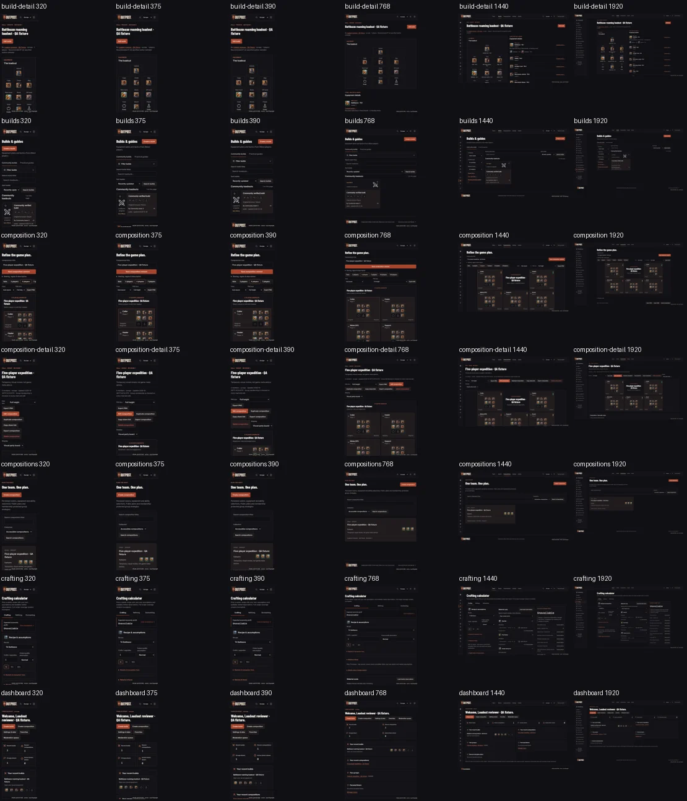
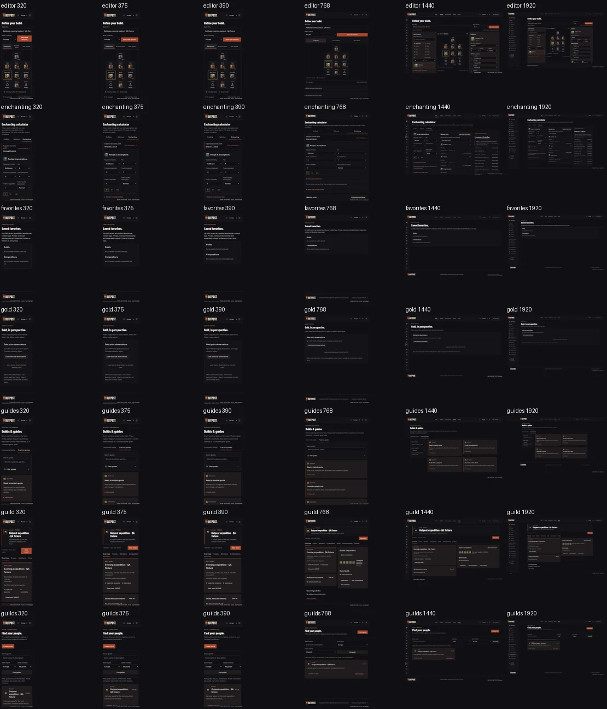
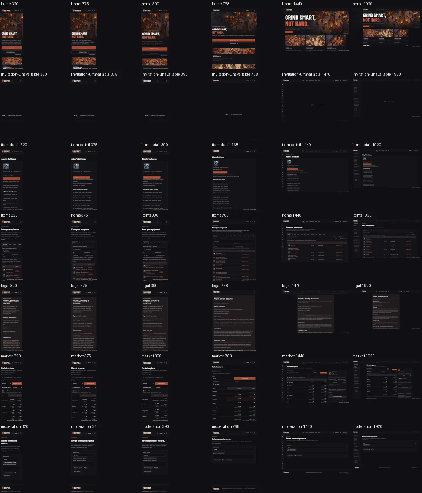
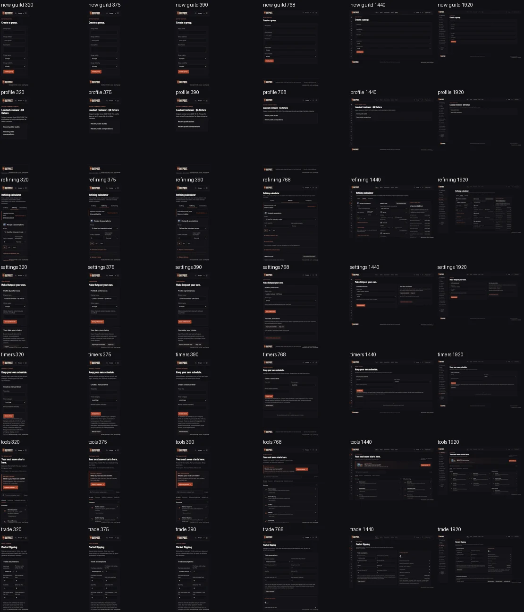

# Skills-enabled read-only audit

Current production-source review, 26 October 2026. No app changes were made after the audit-only instruction. [Findings and prioritized plan](../../engineering/UI_UX_CODE_AUDIT_2026-10-26.md), [skill sources and activation limits](../../engineering/DEVELOPMENT_SKILLS.md).

The local Playwright fallback captured 29 routes at six widths, with isolated labelled sessions/content and synthetic market observations. Actual 320px item detail overflows to 375px because of the provenance hash; the remaining 173 configurations fit. Full-size examples and five overview sheets were opened. Unrestricted axe on eight populated routes at desktop/mobile reveals label/name mismatches missed by the existing tag filter. Follow-up captures after the full phase rebuild retain the failing item-detail case. No owner/physical-device/screen-reader acceptance is claimed.

The contact sheets show viewport composition, not detailed text/contrast acceptance. Representative full-size evidence remains under ignored `.qa/frontend-pass/skills-audit`, axe details under `.qa/skill-upgrade/accessibility-reviewed.json`. The [portable evidence](evidence.json) records the reviewed scope and hashes. Existing supplied references remain in the corresponding Market, composition and frontend-pass reviews.

