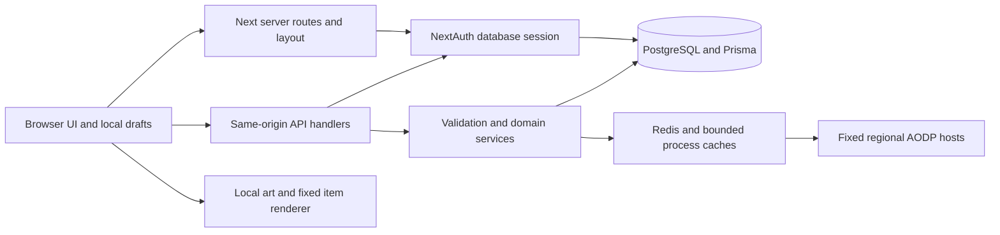

# Architecture and execution model

## Shape of the application

Outpost is a modular monolith. Next.js server components render pages and query PostgreSQL; focused client components manage interactive drafts, source requests and local calculations; App Router handlers validate and persist changes. Prisma owns relational persistence. Redis and bounded process caches protect fixed Albion source integrations. There is no separate microservice frontend, generic CMS, websocket market feed or background game simulation to recreate.

## Repository map

| Path                                                              | Responsibility                                                                                               |
| ----------------------------------------------------------------- | ------------------------------------------------------------------------------------------------------------ |
| `src/app`                                                         | 32 page routes,33 API route files, root layout/proxy-adjacent app conventions and layered CSS                |
| `src/components`                                                  | 55 focused modules: shell/search, browsers, editors, calculators, charts and account/group controls          |
| `src/lib/albion`                                                  | Fixed-source HTTP/cache clients, ID/equipment helpers, price identity/freshness, recipes and pure accounting |
| `src/lib/builds`, `compositions`, `groups`, `community`, `timers` | Validation, ownership/membership decisions, transaction services and state transitions                       |
| `src/lib/catalog`                                                 | Normalization, runtime search, release integrity and independent data-verification stages                    |
| `prisma`                                                          | Exact schema and additive SQL migration history                                                              |
| `data/catalog`                                                    | Pinned normalized external item snapshot, not a live account backup                                          |
| `public`                                                          | Original brand, official sign-in symbol, pinned hero equipment, retained licenses and archived illustrations |
| `assets/source`                                                   | Original artwork/provenance bytes retained for history                                                       |
| `tests`, `e2e`                                                    | Pure/domain/security/HTTP and production browser regressions                                                 |
| `scripts`                                                         | Setup, bounded data preparation/activation, QA, reporting and handoff inventory tools                        |
| `docs`, root Markdown                                             | Current authority, runbooks, visual evidence and clearly separated historical decisions                      |

The [inventory](INVENTORY.md) enumerates every component and library export/import. `inventory.json` fingerprints actual rebuild inputs. Generated caches, private environments and `.qa` are not source requirements.

## Initial request

`src/app/layout.tsx` calls `connection()`, reads cookies and the database session, optionally reads the user’s saved region, and derives initial shell settings. Region defaults to Europe through the schema. `Shell` receives authentication/theme/region state; its key includes initial region/theme so changed server preferences are respected. `Suspense` provides a loading fallback. The root binds local Inter/Barlow/Geist font variables and imports global/workspace/product/brand/interaction styles in order.

`src/proxy.ts` creates a per-request nonce, forwards CSP to the renderer and response, applies private/no-store page behavior, conditionally sets HSTS and protects invitation referrers. Its matcher excludes APIs/static/image paths and prefetch requests. Do not assume the page proxy secures every API: handlers and shared mutation/access services are mandatory.

Pages await promised `params`/`searchParams`, render primary headings and call focused clients. Some protected routes redirect to `/signin`; others return readable public content, metadata-only outsider states or404 based on resource policy. API route IDs and page slugs have different purposes: guild pages use `[slug]`, mutation endpoints use database `[id]`.

## Client/server state ownership

| State                                         | Owner and persistence                                                                                  |
| --------------------------------------------- | ------------------------------------------------------------------------------------------------------ |
| Session/identity/roles                        | Server session plus current database role/membership; never a trusted browser role                     |
| Builds/comps/scenarios/timers/guild resources | Database with ownership/version controls; client draft until successful save                           |
| Region                                        | URL parameter first in the shell, then saved initial/cookie fallback; `RegionContext` supplies clients |
| Theme                                         | Shell state plus `atlas-theme` cookie; server initializes the next request                             |
| Search/query/menu/selected weapon             | Local UI state; global search resets on dismissal and debounces cancellable requests                   |
| Market values                                 | Validated source observations with item/quality/region/city/side/source-time identity                  |
| Manual prices                                 | Explicit user assumptions, preserved separately from observations                                      |
| Scenario share link                           | Validated static JSON in the URL fragment; not a server-published saved record                         |
| PNG/JSON comp export                          | Local browser download of the actual draft/saved state; no Discord upload                              |

Client keystrokes recalculate pure accounting locally. Loading a price is an explicit request or a bounded visible-page refresh, not a request on every arithmetic change. Abort superseded item/region/query operations and reject late mismatched responses.

## Domain transactions

Build saves update the expected version and replace equipment/create a revision atomically. Restoring an old revision creates a new revision while retaining current visibility. Comps save roster JSON and immutable snapshots with serializable membership/destination checks. Guild actions recheck current roles and related resources inside transactional service logic. Watchlist creation checks duplicate/cap under serializable isolation. Timer transitions use expected versions. Do not reproduce only the UI while replacing these transaction semantics with unchecked single-record writes.

`retrySerialization` retries only Prisma P2034 rolled-back database transactions, at most two retries with short waits. It must not wrap network posts, notifications or other external effects: those could duplicate side effects. Comps surface exhausted contention as a retriable503 retaining the client draft.

## Integration/cache boundaries

The browser talks to same-origin data endpoints. Server clients allow only the three configured HTTPS AODP hosts and stats path families, reject redirects, validate bounds/schema and retain source timestamps. Public source cache keys include region/path, whose item set and quality are encoded. Private resource responses must not enter those shared caches. Authentication/membership checks are never cached as public market facts.

The optional item icon service only accepts validated IDs/quality and a fixed renderer host. It has bounded concurrency, queue, byte/cache budgets and neutral fallback. Five homepage images are separately pinned locally and optimized by Next Image; their original bytes/source/checksums are in the asset ledger. Generated scenery is archived rather than fetched into the current homepage.

## Error and compatibility contracts

`HttpError` supplies intentional public status/messages; `apiHandler` maps invalid JSON/schema input to400 and unexpected errors to sanitized503, logs a safe operation code and sets private/no-store. Request limits deny when storage is unavailable in production. User text is rendered as text, not arbitrary HTML. Use actual empty/unavailable states instead of seeded activity.

Retain existing `atlas-*` cookies/cache namespaces, npm package identity, JSON export filenames/formats, calendar PRODID/UID and original migration/release identifiers. They are compatibility details, not permission to restore obsolete branding. There is no public staff-role assignment, arbitrary image proxy, verified Albion character ownership, dedicated farming engine or automatic current-patch focus/spec engine hidden behind a different service.
