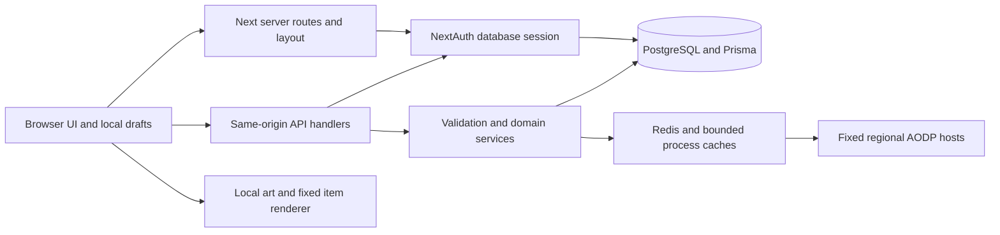

# Outpost complete rebuild handbook

Generated from the maintained chapters in this directory. Use this single file when handing the project to another AI. Source, assets, dataset, lockfile and migrations remain required; private credentials/database contents are intentionally excluded. Start with the instruction in the first chapter. Regenerate with `node scripts/rebuild-inventory.mjs`.

## 01. Outpost rebuild and AI handoff

This is the entry point for another AI or engineer to reproduce the entire **implemented** Outpost website. It documents the application at the [implementation baseline](baseline.json), including the latest real-equipment homepage, search palette and animated top navigation. It is an implementation specification, not a proposal for another redesign or a claim that every planned Albion feature is finished.

For an exact recreation, use the commit containing this handoff (or a reviewed later descendant), its versioned source, lockfile, migrations, dataset and original assets. The feature baseline identifies the preceding UI implementation; that earlier publication alone omitted unit tests, which this handoff restores. Prose cannot recover a missing logo, licensed dataset, OAuth credential or private production database. Those inputs are explicitly separated. Never invent their replacements and present them as authentic.

For a single-file AI handoff, use [the complete handbook](HANDBOOK.md); it contains all chapters and the generated database/component references. The separate chapters remain the maintained source.

The [October27 functionality milestone](../engineering/PRODUCT_MILESTONE_2026-10-27.md) supersedes older starter-scope statements below: named full spare sets,7510 selectable source variants,70 normal production recipes, saved city/refining profiles and batched Market research/watchlist refresh. The original baseline remains historical.

### Start here

1. Read [rebuild sequence](REBUILD_SEQUENCE.md) and [setup/operations](SETUP_AND_OPERATIONS.md).
2. Read [architecture](ARCHITECTURE.md), [database/persistence](DATABASE_AND_PERSISTENCE.md) and [security/authentication](SECURITY_AND_AUTH.md) before implementing mutations.
3. Implement [page/workflow contracts](FEATURES_AND_ROUTES.md), [frontend/design](FRONTEND_DESIGN.md) and [component map](COMPONENT_GUIDE.md).
4. Preserve [HTTP contracts](HTTP_API.md), [game-data rules](GAME_DATA.md) and [calculator formulas](CALCULATORS.md).
5. Run [testing and acceptance](TESTING_AND_ACCEPTANCE.md). Keep [incomplete/blocked scope](DECISIONS_AND_LIMITS.md) explicit.
6. Use the generated [inventory](INVENTORY.md), [exact database reference](DATABASE_REFERENCE.md) and [machine inventory](inventory.json) to check completeness.

The current inventory has **32 page routes, 34 API route files exposing 45 HTTP operations, 60 component modules, 54 library modules, 29 database models, three enums and 18 SQL migrations**. These are source inventory counts, not test results or a completeness score for Albion mechanics. The generator captures locked dependency versions, exported symbols/imports and hashes of the rebuild inputs.

```bash
node scripts/rebuild-inventory.mjs
node scripts/rebuild-inventory.mjs --check
```

Regenerate after changes to source/configuration/assets/migrations, then inspect the difference. The `--check` command fails on stale generated documentation. It does not verify gameplay truth, legal rights or runtime security. Do not hand-edit generated inventory/schema references.

### Authority and conflict resolution

| Question                                       | Authoritative input                                                                                                                                                   |
| ---------------------------------------------- | --------------------------------------------------------------------------------------------------------------------------------------------------------------------- |
| What code and behavior should be recreated?    | Versioned implementation, this handbook and its source links; executable schemas/services settle ambiguous prose                                                      |
| Which fields, indexes and cascades must exist? | `prisma/schema.prisma` **and all committed SQL migrations**, reproduced in the database reference                                                                     |
| What was actually tested most recently?        | [QA_REPORT](../../QA_REPORT.md) and [QA evidence](../qa-evidence.json), not a hard-coded historical test count here                                                   |
| What is incomplete or blocks release?          | [Implementation status](../../IMPLEMENTATION_STATUS.md), [release readiness](../../RELEASE_READINESS.md), [project plan](../../PROJECT_PLAN.md)                       |
| Which game data/formulas/media can be trusted? | [Source ledger](../../DATA_SOURCES.md), item manifests, field/patch reviews and media ledgers                                                                         |
| Which design is current?                       | The real-equipment/search/top-navigation implementation and [latest visual evidence](../design-review/playful-ui/README.md); older scene/sidebar concepts are history |
| How should an AI work in this repository?      | [AGENTS.md](../../AGENTS.md), installed applicable project skills and [skill-system contract](../engineering/SKILL_SYSTEM.md)                                         |

When old documents conflict, trace the relevant source and update the stale statement. Do not restore a rejected sidebar, generated panorama, earlier green palette or fabricated market display because an archived screenshot contains it. Preserve compatibility identifiers even where they still contain the historical internal name.

### Copyable instruction for the next AI

> Rebuild Outpost from the source baseline and `docs/rebuild/README.md`. Read every linked handbook chapter and the generated inventories before changing architecture. Preserve the existing Next.js App Router/React/Prisma/Redis boundaries, 18 SQL migrations, server authorization, version conflicts, exact item/region/quality/source identities, pure accounting formulas and explicit unsupported states. Recreate the current top navigation, compact search palette, genuine-equipment hero, desktop workspaces and mobile drawer; use the original assets and local fonts. Follow the installed Next.js documentation rather than assuming older APIs. Build in dependency order from `REBUILD_SEQUENCE.md`; verify each supported journey with the existing tests and actual screenshots. Do not fabricate prices, community activity, abilities, current-patch evidence, provider verification or missing licenses. Run the mandatory phase gate and required postchecks, update the handoff inventory and current reports, and state actual blockers. Credentials/private records must be supplied securely outside source control. Do not deploy or publish anything beyond the user’s authorization.

[Verification of this handoff](VERIFICATION.md) records the actual source extraction, clean-publication checks, negative drift probe, local phase and hosted limits.

### Deliverables a faithful rebuild must retain

- A running website with every listed route and its populated, empty, loading, failure and denied states.
- The actual save/reload/revision/duplicate/export behavior, not decorative buttons.
- Correct database ownership, privacy, group-role and current-membership checks at the server boundary.
- Matching assets, responsive composition, keyboard flows, light/dark states and reduced motion.
- Real observation timestamps and unavailable values; no source failure converted to a plausible number.
- Independently checked formulas and explicit partial recipe/mechanic coverage.
- Reproducible setup, clean build, test commands, source/rights records and remaining release blockers.

No private environment values, credentials, session records, user exports or database backups belong in this handbook. Restoring private account content requires a separately authorized backup/recovery process; rebuilding the code does not recreate that data.

---

## 02. Rebuild sequence for the next AI

Use this dependency order whether restoring the repository or reimplementing the supported application from the contract. Each step has a concrete result and acceptance boundary. Do not replace working behavior with a mock or jump to a broad redesign before the actual product runs.

### 1. Preserve inputs and establish the baseline

Obtain the private repository at the documented implementation baseline or a reviewed later commit. Retain source, lockfile, public/license/original assets, pinned data/manifests and all18 migrations. Read root AGENTS and local Next documentation. Run the rebuild inventory check to identify source drift. Keep credentials/private DB contents separate; record any unavailable input before guessing.

Result: a legitimate writable checkout with understood source/version, original assets and no fabricated account/market content. If original Git metadata is protected, clone the actual remote into an authorized writable location; do not initialize replacement history or reset existing user changes.

### 2. Provision runtime, schema and validated catalog

Install the exact lockfile on Node22. Populate private environment, start intended PostgreSQL/Redis, diagnose connections and review migration target/SQL. Apply committed migrations to a fresh authorized development DB. The seed verifies connection without making fake users/content. Activate the committed reviewed catalog snapshot deliberately and verify its release/checksum/count.

Result: the29-model/three-enum schema with SQL constraints, actual release metadata and an honest empty account/community database. Public metadata/source tools can run without fake login. Schema-valid data is not current-patch verification.

### 3. Recreate trust boundaries before persisted features

Implement NextAuth/Prisma database sessions, conditional Discord provider, proxy/CSP, bounded JSON, canonical-Origin mutations, sanitized errors, safe logging and fail-closed budgets. Implement current server read/role/ownership predicates and transaction retry/version primitives.

Result: allowed/denied direct requests behave correctly before building a beautiful save button. Verify missing/expired sessions, wrong Origin/content type/size and independent-user privacy. Do not bypass real auth just because credentials are missing.

### 4. Rebuild the shell and original visual assets

Bind local fonts and preserve CSS layers/tokens, logo crop and matched content/header width. Recreate bold top tabs, explanatory Tools/account menus, compact search palette, region/theme persistence and mobile drawer. Add native route/theme transitions with no-animation/reduced-motion fallbacks. Reproduce actual accessible names/focus/keyboard dismissal.

Result: working navigation and correct desktop/tablet/phone shell with actual brand, not a generic sidebar dashboard. Inspect real screenshots before declaring the visual direction done.

### 5. Implement fixed-source clients and public research

Recreate item ID/quality/region/city schemas, normalized metadata search/local fallback, fixed-host source budgets/caches/dedup/cooldown and bounded icon fallback. Implement market/history/gold/price lookups and correct source-side dates. Reproduce source failure, missing/stale/identity mismatch states. Add private watch persistence using the actual serializable cap/duplicate rules.

Result: source values remain true across region/item/quality changes and outages. An HTTP fetch is not a fresh observed price. No fake percentage graph, market activity, trade execution or global full-catalog claim.

### 6. Restore pure accounting and scenario persistence

Implement exact trade thresholds, production cash/economic/return distinctions, cargo/order direction and bounded scanner, supported recipe/path tables and private/static-shared scenarios. Use independent examples from [calculator contracts](CALCULATORS.md), then existing units and browser fixtures. Preserve manual inputs and unavailable values.

Result: every supported result can be explained numerically. Unsupported game mechanics remain manual/unavailable; no automatic focus/spec/city coefficients invented to fill the screen.

### 7. Restore builds and equipment workflows

Implement full build schema, saved normalized gear, ownership/versioned snapshots, independent duplicates and restore-as-new-version. Recreate discovery filters, real equipment card previews, anatomical equipment workbench, mobile pane selection, structured abilities/swaps and legacy notes. Include source-based replacement costs with incomplete totals.

Result: create/save/reload/edit/conflict/restore/duplicate/delete and private/unlisted/public access work with independent accounts. A build preview alone is not an editor implementation.

### 8. Restore comps and local exports

Implement validated1–100 member rosters, unique IDs/order, copied independent loadouts, current group permissions, visibility moves and snapshots. Recreate small simultaneous boards, larger compact roster, one member dialog and pointer/keyboard reorder. Validate import and produce actual JSON/PNG downloads with bounded genuine artwork/fallback.

Result: saved/reloaded roster equals the user’s actual draft, duplicate identities are fresh, denied attachments/group changes fail and exported PNG is not a placeholder or remote post.

### 9. Restore guild collaboration and moderation

Implement actual guild owner/membership, public metadata versus private dashboard, fixed roles, invite hash/expiry/revocation, membership requests/decisions, ownership transfer/deletion, announcements/shared builds, versioned events/RSVP and private calendar snapshots. Add current-target favorites/votes/comments/revisions/reports and current-staff moderation/audit.

Result: revoked members and demoted staff lose access after a warm session. Ownership/account deletion safeguards remain. No generic admin role field, arbitrary upload or direct Discord messaging is introduced.

### 10. Restore personal surfaces and homepage assembly

Implement actual bounded dashboard summaries, favorites filtered by current access, manual timer transitions, settings/draft recovery/export/logout/deletion, public selected profile and original expandable guides/legal/operator state. Assemble the real-equipment homepage with actual public builds and source snapshot/history/lookup.

Result: no seeded users/activity, private data in public counters or fake credentials. Missing source/empty community/guild states stay useful and honest.

### 11. Verify, correct and maintain evidence

Run targeted tests after affected work, then the major phase gate and all postchecks. Open screenshots at six widths plus relevant themes/popups/fixtures; fix observed regressions before claiming completion. Review changed goldens separately from unmasked art. Benchmark only diagnosed performance issues with comparable samples. Regenerate this inventory after source/config/assets change.

Result: a reviewable actual implementation, documented test/performance/visual limits and explicit remaining blockers. Passing parser, axe, formulas or fixture auth cannot promote current-game data/real OAuth/legal/owner visual acceptance.

### 12. Commit or deploy only within authorization

Review exact changed/staged files, source/history scans and clean installation/build. Exclude environments, credentials, DBs/backups and ignored private QA artifacts. Preserve existing remote history and inspect actual push/CI responses. Source publication does not authorize a hosted deployment, billing/security changes, destructive migration or external Discord/email message.

For real deployment follow owned HTTPS/OAuth/migration/monitoring/backup/recovery runbooks. Do not mark a public release GO from a local successful rebuild or from this handbook existing.

---

## 03. Setup, deployment and recovery

Cloudflare deployment addendum (28 October2026): production is public Workers hosting with a private data service, EU D1 public catalog/archive and SQLite Durable Object account transactions. Next SSR runs in signed, expiring browser-session objects with request budgets; no private HTML/role cache. PostgreSQL/Redis below remains the supported local runtime. Cloudflare Access is removed. Only server-verified persisted Discord account303585687460904970 receives owner ADMIN. See [current runtime and verification](../deployment/CLOUDFLARE_PORT_PROGRESS.md); fixture sessions are not real OAuth, and production recovery is not certified.

### Reproducible runtime

Use the committed `package-lock.json` with `npm ci`, not floating dependency upgrades. [Inventory JSON](inventory.json) records both requested ranges and the exact installed lockfile versions; for example, the installed React API includes `ViewTransition` even though the package range began earlier. Node must satisfy `>=22.12.0`; `.nvmrc` selects22. The documented local execution uses Node22.22.2. PostgreSQL17 and Redis7 are the Compose service families. This is a Node server application, not a static HTML export.

Read the relevant guides in `node_modules/next/dist/docs/` before writing Next.js code. This implementation uses async `cookies()`, promised route/search parameters, `connection()`, the App Router, `src/proxy.ts`, React19.3 transitions and Next16 image behavior. Do not translate it mechanically to older Next.js examples.

### Private configuration

Only names and purposes are documented here. Copy `.env.example` into an ignored local `.env` in a fresh environment, then populate it privately.

| Variable                                              | Purpose                            | Rebuild behavior                                                                                     |
| ----------------------------------------------------- | ---------------------------------- | ---------------------------------------------------------------------------------------------------- |
| `DATABASE_URL`                                        | PostgreSQL connection              | Required for catalog, accounts and persisted product features; example is loopback development only  |
| `REDIS_URL`                                           | Redis connection                   | Used for cache/budgets; missing/unavailable budget storage fails closed in production                |
| `NEXTAUTH_URL`                                        | Canonical application origin       | Must match the actual browser/Discord origin; public production requires HTTPS                       |
| `NEXTAUTH_SECRET`                                     | Session/authentication secret      | Generate at least32 random bytes, keep stable for an environment, never write its value to docs/logs |
| `DISCORD_CLIENT_ID`, `DISCORD_CLIENT_SECRET`          | Real Discord provider              | Configure both together; neither means provider is deliberately unavailable                          |
| `OPERATOR_NAME`, `OPERATOR_ADDRESS`, `OPERATOR_EMAIL` | Legal/operator disclosure          | Real owner-supplied values; placeholders do not close release gates                                  |
| `PORT`                                                | Local/standalone listening port    | Defaults3000; documented review server may use3001                                                   |
| `NODE_ENV`                                            | Runtime mode                       | Production changes security/budget behavior                                                          |
| `NEXT_TELEMETRY_DISABLED`                             | Build/runtime telemetry preference | Used in container/CI                                                                                 |

`src/lib/env.ts` validates URL schemes, secret length, paired provider credentials and HTTPS public origins. `scripts/db-diagnose.mjs` is the intended read-only diagnostic entry point. Do not print connection strings or secret values while troubleshooting.

Generate a secret locally with a cryptographic random generator, then place it in `.env`; do not paste generated values into a rebuild guide or commit. Port changes must be reflected in `NEXTAUTH_URL` and the registered Discord callback when testing authentication. A browser running3001 against a canonical3000 origin can correctly receive403 from mutation origin checks.

### Fresh development install

Run from an authorized writable checkout. The commands below create and initialize the intended development database; review target/SQL before adapting them to any existing database.

```bash
nvm use
npm ci
# Populate ignored .env from .env.example before continuing.
docker compose up -d
npm run db:diagnose
npm run db:deploy
npm run db:seed
npm run data:sync
npx playwright install chromium
npm run dev
```

Open `http://localhost:3000`. Compose binds PostgreSQL5432 and Redis6379 to loopback, persists their named volumes and enables Redis append-only storage. Its fixed example database credentials are development defaults, not production credentials. The database seed deliberately creates **no synthetic users, builds, prices or community activity**.

`data:sync` mutates the runtime catalog by activating the committed reviewed July snapshot. It is an explicit activation step for this fresh rebuild, not a harmless read-only command to run against an unknown target. It must not overwrite an operator’s unrelated catalog or production DB without that target’s authorization. See [game data](GAME_DATA.md).

When Docker is unavailable, use separately provisioned PostgreSQL/Redis and private connection URLs. Diagnose permissions rather than using sudo or weakening filesystem/socket policies. A read-only Prisma cache can use a scoped writable `XDG_CACHE_HOME` under an authorized temporary directory. Do not repurpose the user’s home or global agent directories.

### Production-mode local run

```bash
npm run build
npm start
# Optional separate review port:
PORT=3001 npm start
```

The build runs Prisma generation, `next build` and `scripts/prepare-standalone.mjs`. The last step copies `.next/static` and `public` into the standalone output. `npm start` loads local `.env` when available and launches `.next/standalone/server.js`; it forwards termination signals. Stop an existing production review server before rebuilding its `.next` directory. Restart it afterward. Do not measure loading performance during builds or browser suites.

The Dockerfile builds in Node22 Debian with OpenSSL/CA certificates, copies the standalone runtime/static/public assets, runs as the `node` user and exposes3000. Inject configuration privately at runtime; the image must not contain `.env`, OAuth secrets, backups or database dumps. `/api/health` checks PostgreSQL and Redis; its provider state is `configured-unverified` or `not-configured`. HTTP200 is not a release certificate.

### Database lifecycle

Apply the **17 ordered committed migrations** using `prisma migrate deploy` on the intended target. Do not substitute `db push`, recreate tables from a shortened schema or reset an existing database. The SQL includes invariants beyond ORM types. Review migration status and take an authorized private backup before changing a populated environment. Local17-migration/watchlist evidence does not prove an HTTPS staging target is migrated.

The QA integration runner creates/drops only disposable owned `atlas_qa_*` and `atlas_restore_*` databases. It verifies constraints, repeat deployment and synthetic backup/restore. It must never be pointed at a shared production database for destructive test setup.

To restore a real installation: provision compatible services; recover the separately protected database backup under operator control; preserve or deliberately rotate auth secrets with a session-expiry plan; apply only reviewed forward migrations; verify owners/memberships/private reads; run read-only health and application journeys; check backups/monitoring before reopening access. Do not overwrite current user data simply to reproduce a screenshot.

### Hosting and CI

The committed `.github/workflows/quality.yml` pins checkout/setup actions, uses the Node version file, runs installation/formatting, creates fresh local services, deploys migrations/imports catalog, installs Chromium and runs source checks/full QA/browser-bundle secret checks. `playwright.config.ts` limits concurrency to two because local services and public budgets are shared. Hosted Actions status must be read from the actual run; a workflow file or historical local pass is not hosted success.

The source repository is private `AlbionOutpost/Outpost`; the implementation baseline is in `baseline.json`. In the original restricted environment `.git` was unusable, so publication used a clone of the actual remote in writable `/tmp`, preserving protected metadata and existing history. A normal new developer should work directly in a legitimate writable clone. Never initialize a replacement history over an existing project or force-push to solve a sandbox problem.

HTTPS staging, credentialed OAuth, monitoring/alerts, encrypted scheduled backups, real restore rehearsal, deployment/rollback operation, operator disclosures and rights review remain governed by [release readiness](../../RELEASE_READINESS.md) and the [deployment runbook](../DEPLOYMENT.md). This handbook does not supply those private external inputs or authorize deployment.

---

## 04. Architecture and execution model

Cloudflare deployment addendum (28 October2026): production is public Workers hosting with a private data service, EU D1 public catalog/archive and SQLite Durable Object account transactions. Next SSR runs in signed, expiring browser-session objects with request budgets; no private HTML/role cache. PostgreSQL/Redis below remains the supported local runtime. Cloudflare Access is removed. Only server-verified persisted Discord account303585687460904970 receives owner ADMIN. See [current runtime and verification](../deployment/CLOUDFLARE_PORT_PROGRESS.md); fixture sessions are not real OAuth, and production recovery is not certified.

### Shape of the application

Outpost is a modular monolith. Next.js server components render pages and query PostgreSQL; focused client components manage interactive drafts, source requests and local calculations; App Router handlers validate and persist changes. Prisma owns relational persistence. Redis and bounded process caches protect fixed Albion source integrations. There is no separate microservice frontend, generic CMS, websocket market feed or background game simulation to recreate.



### Repository map

| Path                                                              | Responsibility                                                                                               |
| ----------------------------------------------------------------- | ------------------------------------------------------------------------------------------------------------ |
| `src/app`                                                         | 32 page routes,33 API route files, root layout/proxy-adjacent app conventions and layered CSS                |
| `src/components`                                                  | 55 focused modules: shell/search, browsers, editors, calculators, charts and account/group controls          |
| `src/lib/albion`                                                  | Fixed-source HTTP/cache clients, ID/equipment helpers, price identity/freshness, recipes and pure accounting |
| `src/lib/builds`, `compositions`, `groups`, `community`, `timers` | Validation, ownership/membership decisions, transaction services and state transitions                       |
| `src/lib/catalog`                                                 | Normalization, runtime search, release integrity and independent data-verification stages                    |
| `prisma`                                                          | Exact schema and additive SQL migration history                                                              |
| `data/catalog`                                                    | Pinned normalized external item snapshot, not a live account backup                                          |
| `public`                                                          | Original brand, official sign-in symbol, pinned hero equipment, retained licenses and archived illustrations |
| `assets/source`                                                   | Original artwork/provenance bytes retained for history                                                       |
| `tests`, `e2e`                                                    | Pure/domain/security/HTTP and production browser regressions                                                 |
| `scripts`                                                         | Setup, bounded data preparation/activation, QA, reporting and handoff inventory tools                        |
| `docs`, root Markdown                                             | Current authority, runbooks, visual evidence and clearly separated historical decisions                      |

The [inventory](INVENTORY.md) enumerates every component and library export/import. `inventory.json` fingerprints actual rebuild inputs. Generated caches, private environments and `.qa` are not source requirements.

### Initial request

`src/app/layout.tsx` calls `connection()`, reads cookies and the database session, optionally reads the user’s saved region, and derives initial shell settings. Region defaults to Europe through the schema. `Shell` receives authentication/theme/region state; its key includes initial region/theme so changed server preferences are respected. `Suspense` provides a loading fallback. The root binds local Inter/Barlow/Geist font variables and imports global/workspace/product/brand/interaction styles in order.

`src/proxy.ts` creates a per-request nonce, forwards CSP to the renderer and response, applies private/no-store page behavior, conditionally sets HSTS and protects invitation referrers. Its matcher excludes APIs/static/image paths and prefetch requests. Do not assume the page proxy secures every API: handlers and shared mutation/access services are mandatory.

Pages await promised `params`/`searchParams`, render primary headings and call focused clients. Some protected routes redirect to `/signin`; others return readable public content, metadata-only outsider states or404 based on resource policy. API route IDs and page slugs have different purposes: guild pages use `[slug]`, mutation endpoints use database `[id]`.

### Client/server state ownership

| State                                         | Owner and persistence                                                                                  |
| --------------------------------------------- | ------------------------------------------------------------------------------------------------------ |
| Session/identity/roles                        | Server session plus current database role/membership; never a trusted browser role                     |
| Builds/comps/scenarios/timers/guild resources | Database with ownership/version controls; client draft until successful save                           |
| Region                                        | URL parameter first in the shell, then saved initial/cookie fallback; `RegionContext` supplies clients |
| Theme                                         | Shell state plus `atlas-theme` cookie; server initializes the next request                             |
| Search/query/menu/selected weapon             | Local UI state; global search resets on dismissal and debounces cancellable requests                   |
| Market values                                 | Validated source observations with item/quality/region/city/side/source-time identity                  |
| Manual prices                                 | Explicit user assumptions, preserved separately from observations                                      |
| Scenario share link                           | Validated static JSON in the URL fragment; not a server-published saved record                         |
| PNG/JSON comp export                          | Local browser download of the actual draft/saved state; no Discord upload                              |

Client keystrokes recalculate pure accounting locally. Loading a price is an explicit request or a bounded visible-page refresh, not a request on every arithmetic change. Abort superseded item/region/query operations and reject late mismatched responses.

### Domain transactions

Build saves update the expected version and replace equipment/create a revision atomically. Restoring an old revision creates a new revision while retaining current visibility. Comps save roster JSON and immutable snapshots with serializable membership/destination checks. Guild actions recheck current roles and related resources inside transactional service logic. Watchlist creation checks duplicate/cap under serializable isolation. Timer transitions use expected versions. Do not reproduce only the UI while replacing these transaction semantics with unchecked single-record writes.

`retrySerialization` retries only Prisma P2034 rolled-back database transactions, at most two retries with short waits. It must not wrap network posts, notifications or other external effects: those could duplicate side effects. Comps surface exhausted contention as a retriable503 retaining the client draft.

### Integration/cache boundaries

The browser talks to same-origin data endpoints. Server clients allow only the three configured HTTPS AODP hosts and stats path families, reject redirects, validate bounds/schema and retain source timestamps. Public source cache keys include region/path, whose item set and quality are encoded. Private resource responses must not enter those shared caches. Authentication/membership checks are never cached as public market facts.

The optional item icon service only accepts validated IDs/quality and a fixed renderer host. It has bounded concurrency, queue, byte/cache budgets and neutral fallback. Five homepage images are separately pinned locally and optimized by Next Image; their original bytes/source/checksums are in the asset ledger. Generated scenery is archived rather than fetched into the current homepage.

### Error and compatibility contracts

`HttpError` supplies intentional public status/messages; `apiHandler` maps invalid JSON/schema input to400 and unexpected errors to sanitized503, logs a safe operation code and sets private/no-store. Request limits deny when storage is unavailable in production. User text is rendered as text, not arbitrary HTML. Use actual empty/unavailable states instead of seeded activity.

Retain existing `atlas-*` cookies/cache namespaces, npm package identity, JSON export filenames/formats, calendar PRODID/UID and original migration/release identifiers. They are compatibility details, not permission to restore obsolete branding. There is no public staff-role assignment, arbitrary image proxy, verified Albion character ownership, dedicated farming engine or automatic current-patch focus/spec engine hidden behind a different service.

---

## 05. Database and persistence contracts

Cloudflare deployment addendum (28 October2026): production is public Workers hosting with a private data service, EU D1 public catalog/archive and SQLite Durable Object account transactions. Next SSR runs in signed, expiring browser-session objects with request budgets; no private HTML/role cache. PostgreSQL/Redis below remains the supported local runtime. Cloudflare Access is removed. Only server-verified persisted Discord account303585687460904970 receives owner ADMIN. See [current runtime and verification](../deployment/CLOUDFLARE_PORT_PROGRESS.md); fixture sessions are not real OAuth, and production recovery is not certified.

**October27 implementation update:** Migration18 adds `Build.equipmentSets` as non-null JSONB default[]; Build versions include it through validated input, older snapshots default[]. Each strict set has UUID/name and1–10 unique-slot equipment choices, with abilities/quality/alternatives and valid hand combinations; up to five distinct sets. Comp members carry the same JSON sets. Copying a Build copies values rather than linking mutable arrays; JSON imports preserve exported sets.

The [exact database reference](DATABASE_REFERENCE.md) reproduces all29 Prisma models, three enums and18 ordered migration paths/checksums. It is the complete schema appendix. This chapter explains how those tables work together. Recreate both ORM definitions and committed SQL; do not infer constraints only from forms.

### Entity groups

| Domain                | Tables                                                                | Purpose                                                                                |
| --------------------- | --------------------------------------------------------------------- | -------------------------------------------------------------------------------------- |
| Identity              | `User`, `Account`, `Session`, `VerificationToken`                     | NextAuth adapter identity/provider/session records; profile, region and staff role     |
| Builds                | `Build`, `BuildEquipment`, `BuildVersion`                             | Build metadata, one equipment row per occupied slot and immutable numbered snapshots   |
| Guilds                | `Group`, `GroupMember`, `GroupInvitation`, `GroupMembershipRequest`   | Ownership, current role, hashed invites and approval workflow                          |
| Shared planning       | `Composition`, `CompositionVersion`, `GroupBuild`                     | JSON party roster/revisions and saved shared build snapshots                           |
| Guild communication   | `GroupAnnouncement`, `GroupEvent`, `EventRSVP`                        | Announcements, versioned UTC events and one RSVP per user/event                        |
| Personal planning     | `SavedScenario`, `Timer`, `MarketWatchItem`                           | Private accounting assumptions, manual reminder state and per-region/quality watchlist |
| Metadata              | `CatalogRelease`, `ItemMetadata`                                      | Immutable release identity/checksum plus active normalized game metadata               |
| Community             | `BuildFavorite`, `CompositionFavorite`, `BuildVote`                   | Unique user/content relationships, not fabricated popularity                           |
| Discussion/moderation | `ContentComment`, `CommentRevision`, `ContentReport`, `ModerationLog` | Versioned text, target-specific reports, staff review and audit history                |

`BuildVisibility` is PUBLIC/PRIVATE/UNLISTED. `ContentVisibility` is PUBLIC/PRIVATE/GROUP for comps. `GroupRole` is OWNER/ADMIN/OFFICER/MEMBER. Staff role is a separate string on `User`, not the guild role enum. Many operational states are schema-constrained strings with SQL checks rather than Prisma enums; preserve those SQL checks too.

### Keys, relations and deletion

User/content primary keys are generated cuid strings except explicitly composite relationships. Group membership/request keys combine group/user; favorites/votes combine user/content; RSVP combines event/user. Build equipment is unique per build/slot. Version snapshots are unique per resource/version. Watchlist identity is unique on user/region/item/quality. OAuth account uniqueness is provider/providerAccountId and session tokens are unique. Exact optional relations, cascade/SetNull behavior and indexes are in the reference.

Deleting a user is not a UI-only cleanup. The server first requires owned groups to be transferred or deleted, then deletes the actual user and relies on committed relation semantics for dependent private records/sessions. Do not disable the group ownership safeguard to make deletion easier. Shared/group data can have different retention or nullable-author behavior from personal data; follow migration/schema definitions.

Content comments/reports must reference the supported target shape. SQL enforces checks and unique/relationship invariants that a lax JSON document store would lose. Treat a rejected write as an actual conflict/validation failure, not an excuse to drop a constraint.

### Build save, revision, duplicate and restore

A build create validates the full `BuildInput`, derives `authorId` from the session, inserts gear rows and stores version1 snapshot. Update accepts `{version, build}`. In one transaction, update only the row matching id/author/version, increment version, replace gear rows and add the new snapshot. Failure to match returns409 and leaves the old state intact. The browser must retain the draft and ask for reload/reconciliation rather than silently overwriting.

A duplicate first verifies readable/nonhidden access and creates an independent PRIVATE record with its own equipment/revision1. Restoration accepts `{revision, version}`; only the owner can restore, the old snapshot is revalidated, current visibility is retained and a **new** numbered revision is written. Do not mutate the old version row or reset the revision counter.

Legacy `abilities`/`alternatives` prose and structured `abilitySelections`/`alternativeItemIds` coexist. They are not interchangeable: structured selections get equipment compatibility validation, while author prose stays text and is not promoted to verified game data.

### Comp persistence

A comp contains1–100 uniquely identified member slots. Each member has player label, role/custom role, mandatory/substitute/notes, optional sourceBuildId and up to10 unique equipment choices. The roster is JSON, validated before both create and update; snapshots use the same logical input shape. Create stores version1; update accepts `{version, composition}` and preserves immutable author identity.

Saving GROUP visibility requires an eligible current guild role and matching groupId. Other visibility requires groupId null. Shared editors can edit content but only the author can move/republish it. Access/destination checks occur inside serializable transactions. Existing copied build sources and newly attached sources have distinct validation handling; preserve that service rather than trusting any browser-supplied buildId. A duplicated comp becomes PRIVATE, clears group linkage, gets fresh member UUIDs and clears sourceBuildId links while retaining independent copied equipment.

### Watchlist and scenarios

Watchlist POST accepts strict `{region,itemId,quality}` with a2048-byte body limit. It returns an existing exact identity rather than making duplicates and enforces the100-item user cap under serializable isolation/retry. GET returns at most100 rows for the current user. DELETE includes user ownership in the predicate; another user’s id is404. Reload persistence is real local implementation, not just localStorage.

Saved scenarios store title, kind and validated configuration JSON owned by a user. GET filters supported kind **before** the newest50 limit; it is not a single global mixed list with client-only privacy. A share fragment copies static assumptions into a URL; it does not make the database row public or refresh saved source timestamps.

### Guild and moderation writes

Guild creation creates owner membership with the group. The current group role is re-read for actions; fixed permissions govern invitations, membership decisions, role changes, ownership transfer and shared resources. Invites use32 random bytes represented as64 hex characters; only SHA256 hashes are stored. Preserve expiry, single-use/revoked checks and transactional membership creation.

Group profile edits use expectedUpdatedAt; event edits use an expected integer version. Calendar snapshots use stable event identity/revision. Moderation rechecks the current database staff role inside the transaction, checks report version, updates target hide/restore or report status and writes an audit record. Do not issue staff roles through a newly invented public endpoint.

### Catalog activation

`CatalogRelease.version` and checksum bind a normalized immutable bundle. `data:sync` validates before a serializable transaction, refuses divergent bytes under an existing release version, deactivates previous item rows and upserts the activated release. Re-running the same intact release reports its actual existing state; it does not silently overwrite conflicting release history. Local verification/import and current-patch verification are separate.

The committed snapshot is rebuild input. A production DB contains accounts/content and deployment state that are **not** in Git. Do not create a database dump in this documentation or replace missing private account content with seeded “real users.” The seed is intentionally empty.

---

## 06. Authentication, privacy and authorization

Cloudflare deployment addendum (28 October2026): production is public Workers hosting with a private data service, EU D1 public catalog/archive and SQLite Durable Object account transactions. Next SSR runs in signed, expiring browser-session objects with request budgets; no private HTML/role cache. PostgreSQL/Redis below remains the supported local runtime. Cloudflare Access is removed. Only server-verified persisted Discord account303585687460904970 receives owner ADMIN. See [current runtime and verification](../deployment/CLOUDFLARE_PORT_PROGRESS.md); fixture sessions are not real OAuth, and production recovery is not certified.

### Login lifecycle

Use NextAuth with PrismaAdapter, Discord and **database sessions**. Provider registration is conditional on both Discord credentials. Scope is `identify email`, checks are state+PKCE, the custom sign-in page is `/signin` and the database session max age is14days. The session callback exposes `user.id` to server/client consumers. The login button calls the actual provider with `/settings` callback; it is not a fake login selector or a permanent seeded account.

A working fixture session proves application authorization tests only. Genuine Discord exchange, repeat sign-in, logout/expiry and Secure-cookie behavior still require owned HTTPS staging and real credentials. Never document a token, session cookie, client secret or authenticated response body as a reproducibility input. Configure test users only in isolated tests and remove them afterward.

### Mutation boundary

The shared API helper checks Origin against `new URL(NEXTAUTH_URL || req.url).origin`, requires a server session and consumes the current user’s30-changes/minute budget. Reject a missing or different Origin. Inputs require JSON content type and bounded stream parsing: default65536bytes; comp creates/updates explicitly1048576bytes; watch creates2048bytes. Actual handlers are authoritative for exceptions. A trusted session does not bypass input, current role, ownership or version checks.

`apiHandler` adds private/no-store responses, returns deliberate HttpError status/messages, maps invalid JSON/schema to400 and sanitizes unexpected failure as503. Some public source handlers use explicit400/429/503 responses instead of that wrapper; do not assume every API has identical middleware. Preserve the relevant headers/statuses in tests.

Server Actions for settings use their existing session/validation/budget/framework boundary and keep failed drafts visible. Settings save allows bounded display/character names and region, updates the region cookie and revalidates layout. Deletion requires literal `DELETE` and rejects an account still owning groups. Staff assignment is not a profile setting.

### Resource matrix

| Resource/action                         | Anonymous or outsider                                             | Owner/current eligible actor                                             |
| --------------------------------------- | ----------------------------------------------------------------- | ------------------------------------------------------------------------ |
| Public build read                       | Allowed unless hidden from that actor                             | Author can inspect own hidden content                                    |
| Unlisted build read                     | Direct readable URL allowed; omitted from public discovery        | Owner edits/duplicates/restores through the same services                |
| Private build read/cost/duplicate       | 404 unless author                                                 | Owner only; readable duplication becomes new private record              |
| Build update/restore/delete             | Session plus ownership required; denied write leaves DB unchanged | Expected version for update/restore; delete includes owner predicate     |
| Public comp read                        | Allowed unless hidden                                             | Author/group policies still govern mutation                              |
| Private comp read                       | 404 unless author                                                 | Author owns non-group writes                                             |
| GROUP comp read                         | Current membership required, including for a former author        | Role must be read from current database membership                       |
| GROUP comp edit                         | Ordinary member denied                                            | OWNER/ADMIN/OFFICER can edit; only author moves/republishes              |
| GROUP comp delete                       | Outsider/member denied                                            | Author with edit role or OWNER/ADMIN; see exact deletion service         |
| Public guild page                       | Public metadata only, no dashboard resources                      | Current members receive the authorized dashboard                         |
| Private guild page/discovery            | No outsider disclosure                                            | Membership-scoped visibility                                             |
| Member management                       | No client-role trust                                              | OWNER/ADMIN, with owner-specific restrictions                            |
| Shared guild plans/events/announcements | No outsider write                                                 | Eligible OWNER/ADMIN/OFFICER roles, as action-specific service permits   |
| Invitation accept                       | Sign-in required; invalid/revoked/expired/used token denied       | Token verified by stored hash; atomic membership change                  |
| Favorite/vote/comment/report            | Must first be able to read the actual target                      | Session, action-specific rules and optimistic comment versions           |
| Moderator queue/actions                 | Current ADMIN/MODERATOR database role required                    | Checked again inside moderation transaction                              |
| Scenarios/timers/watchlist/export       | Current owner only; no userId switch in request                   | Session-derived owner and expected versions/caps where applicable        |
| Public player profile                   | Only selected public, nonhidden content                           | Does not expose email, OAuth/session data or certify character ownership |

This is a rebuild matrix, not a complete security certification. Preserve exact action-specific safeguards in the referenced services, including owner demotion/removal restrictions, visibility moves, membership revocation, inaccessible attachments and content hiding.

### Guild actions and roles

The discriminated group action union contains `profile`, `edit-event`, `invite`, `revoke`, `request`, `decide`, `role`, `remove`, `leave`, `transfer`, `delete`, `announcement`, `remove-announcement`, `event`, `cancel-event`, `rsvp`, `share-build`, `remove-build`. Do not turn this into a generic unchecked `{action,payload}` dispatcher. Validate every branch using `src/lib/groups/validation.ts` and preserve transaction decisions in `service.ts`.

`canEditShared` is OWNER/ADMIN/OFFICER; `canManageMembers` is OWNER/ADMIN. Ownership transfer is a separate transactional action and cannot be emulated by posting `role: OWNER`. Invitation and calendar URLs are private resources, not public guild feeds. An old invitation token should not rejoin someone after revocation/expiry.

### Content and external-input policy

All author prose is rendered as text. Do not introduce unrestricted HTML, arbitrary Markdown HTML injection, generic file upload, URL proxying or user-selected upstream hosts while rebuilding. These features do not exist in the baseline. Validate source responses, size/time bounds, image signatures and identity before caching or presenting values.

CSP uses per-request nonce/strict-dynamic for scripts, self-hosted fonts, self/data/blob/fixed renderer images, no objects/frames, self-only forms and development-only websocket/unsafe-eval allowances. Preserve page no-store and invitation no-referrer handling. Public HTTPS mode conditionally adds HSTS. Do not copy dev relaxations into a public reverse proxy or claim actual deployed cookie/security verification without testing.

### Caches, export and logging

Private profile/roster/guild/scenario/search results must not enter public region/source caches. Revoked members must lose read/write access immediately through current database predicates. Do not retain a browser search’s private result set across dismissal and unrelated identity states. Logout/account deletion must invalidate actual sessions through the real auth/account mechanisms, not just remove a displayed username.

Account export explicitly selects allowed profile/provider identifiers and owned content/revisions/personal planning/community records/membership metadata; provider access/refresh tokens and session tokens are excluded. The filename remains `albion-atlas-account.json` for compatibility. Export/download filenames, calendar identifiers and historical namespaces are not branding mistakes to replace casually.

Structured logs contain operation/error codes, not secrets, private request bodies or full upstream responses. Source/artifact scans check configured values and known token/key patterns with explicit limits. Source upload remains private; do not add `.env`, `.aws`, agent auth, DB dumps, backups or ignored QA session/request logs to a rebuilt repository.

### Required negative acceptance

Run independent-user cases, not only the happy path: outsider private reads, wrong-owner updates/deletes, cross-user scenario/watch ids, stale versions, bad Origin/content type/oversized bodies, revoked group membership, role demotion after session warmup, hidden content across search/list/export, inaccessible build attachments, expired/reused/revoked invites, owner-account deletion and private cache headers. Confirm returned status and unchanged database state. Existing e2e/domain tests are mapped in [testing](TESTING_AND_ACCEPTANCE.md).

---

## 07. HTTP and Server Action contracts

**October27 implementation update:** `GET /api/market/batch?region=europe&items=T4_BAG,T4_CAPE&quality=1` validates1–12 distinct IDs plus region/quality, shares the existing market public budget, and returns AODP rows with source/request identity. Missing quotes are not substituted. Research/watchlist refresh groups by quality and makes bounded sequential chunks; the private saved-selection API retains its existing authentication/ownership/no-store boundaries.

[Generated HTTP inventory](INVENTORY.md#http-routes-34) lists all34 handlers/45 exported operations and exact source paths. Query/body field names below are implementation contracts. User/session IDs come from server authentication, never from a trusted browser author field. All examples are **illustrative request shapes**, not real saved records, users, game recommendations or market observations.

### Common behavior

Successful reads/updates generally return200; creation routes use201; build/comp deletion uses204. Timer/scenario/watch deletion may return JSON instead; follow individual handlers. Error JSON is `{error: string}`. Important statuses:400 invalid data,401 missing session,403 origin/permission,404 unavailable/not-owned resource,409 revision/cap/state conflict,413 oversized body,415 wrong content type,422 readable but unsupported copied equipment,429 exhausted budget and503 service unavailable. Do not rewrite every failure to200 with an empty list.

For JSON mutations send `Content-Type: application/json`, the exact canonical `Origin` and real auth cookies. Browser same-origin fetch normally supplies the Origin; examples must not invent permanent test cookies. `boundedJson` defaults64KiB; comp roster create/update allows1MiB and watch creation2KiB. `apiHandler` gives private/no-store; plain market/history handlers set their own response semantics. Dynamic route params are awaited promises in this Next version.

### Observations and metadata

| GET route               | Required/optional query                                                                                   | Response and limits                                                                                                                       |
| ----------------------- | --------------------------------------------------------------------------------------------------------- | ----------------------------------------------------------------------------------------------------------------------------------------- |
| `/api/market`           | `region`, `item`, `quality`                                                                               | `{region,fetchedAt,source,prices}`; uppercase ID syntax3–100 chars, quality1–5; public120/minute; source zero is not a free item          |
| `/api/history`          | `kind=gold,region` **or** `kind=history,region,item,city,quality`                                         | `{region,fetchedAt,source,data}`; public60/minute; gold168 observations; item daily aggregates for bounded30-day range                    |
| `/api/items`            | `search` default empty/max100; optional exact equipment `slot`, `tier`1–8, `enchantment`0–4; `page`1–1000 | `{items,total,page,pageSize:30}`; active metadata only, stable ID order                                                                   |
| `/api/item-icon`        | `id`, optional `quality=1`                                                                                | PNG or neutral SVG fallback, `X-Icon-Status`, bounded public cache age; fixed renderer only                                               |
| `/api/economy/prices`   | `kind,region,recipeId,materialCity,outputCity,quality,enchantFamily,tier,fromEnchant,toEnchant`           | `{region,source,prices}`; supported recipe only; material/output quality identity and source sell observations;60/minute                  |
| `/api/transport/prices` | `region,itemId,quality,fromCity,toCity,saleMode`                                                          | Source buy/sell observation pair for the selected direction;60/minute; Black Market listing denied                                        |
| `/api/opportunities`    | `region,fromCity,toCity,saleMode,quality,tax,fee,items` comma-separated                                   | `{region,observedAt,rows,methodology}`;1–25 input IDs/deduplicated batches;30/minute; bounded observation estimates, not executable fills |
| `/api/search`           | `q` trimmed2–100                                                                                          | `{results:[{category,title,url}]}`; server-access-filtered active items/tools/builds/comps/guilds; up to8 each DB category;120/minute     |
| `/api/health`           | none                                                                                                      | PostgreSQL/Redis health plus independent provider configuration state; dependency failure503; no connection strings                       |

Example: `/api/market?region=europe&item=T4_BAG&quality=1`. Prices retain source `item_id`, `city`, `quality`, `sell_price_min`, `sell_price_min_date`, `buy_price_max`, `buy_price_max_date`. `fetchedAt` means the application response time, not when that city/side was observed. `/api/opportunities.observedAt` likewise does not turn stale source rows into new observations.

All data hosts, supported city strings, quality/tier/enchant bounds, TTLs and null/freshness rules are in [game data](GAME_DATA.md). The optional icon endpoint returns a usable fallback instead of blocking the whole page.

### Builds

| Operation                         | Body/query                             | Result and important semantics                                                                                                                                          |
| --------------------------------- | -------------------------------------- | ----------------------------------------------------------------------------------------------------------------------------------------------------------------------- |
| `POST /api/builds`                | Full `BuildInput`                      | 201 `{id,version}`; session author; version1 equipment/snapshot                                                                                                         |
| `GET /api/builds/[id]`            | none                                   | Readable record plus equipment ordered by slot; private/hidden access enforced                                                                                          |
| `PUT /api/builds/[id]`            | `{version,build:BuildInput}`           | `{id,version}`; atomic expected-version save/revision; denied or stale update409                                                                                        |
| `DELETE /api/builds/[id]`         | none                                   | 204, owner predicate or404                                                                                                                                              |
| `POST /api/builds/[id]/duplicate` | none                                   | Independent private copy/revision1, verified readable source                                                                                                            |
| `POST /api/builds/[id]/restore`   | `{revision,version}` positive integers | New revision from validated historical snapshot, current visibility retained                                                                                            |
| `GET /api/builds/[id]/cost`       | `region,city,sets`1–1000               | `{region,city,sets,source,fetchedAt,rows,knownCost,total,stale}`; groups requests by quality; missing row makes total null, not partial knownCost presented as complete |

`BuildInput` includes title3–100, description≤4000, enumerated contentType, region, PUBLIC/PRIVATE/UNLISTED visibility, playerCount1–400, recommendedIP0–4000, strategy≤12000, patchNotes≤2000 and1–10 unique equipment slots including Main hand. A gear row includes `slot,itemId,quality,abilities,alternatives,abilitySelections,alternativeItemIds`; prose limits1000, structured ability keys20/name100 and at most4 alternatives. See the exact schema in `src/lib/builds/validation.ts`.

```json
{
  "title": "Example private build",
  "description": "Illustrative request shape only",
  "contentType": "Other",
  "region": "europe",
  "visibility": "PRIVATE",
  "playerCount": 1,
  "recommendedIP": 0,
  "strategy": "",
  "patchNotes": "",
  "equipment": [
    {
      "slot": "Main hand",
      "itemId": "T4_MAIN_AXE",
      "quality": 1,
      "abilities": "",
      "alternatives": "",
      "abilitySelections": {},
      "alternativeItemIds": []
    }
  ]
}
```

### Comps

| Operation                               | Body/query                               | Result                                                                                                               |
| --------------------------------------- | ---------------------------------------- | -------------------------------------------------------------------------------------------------------------------- |
| `POST /api/compositions`                | Full `CompositionInput`                  | 201 `{id,version}`                                                                                                   |
| `GET /api/compositions/[id]`            | none                                     | Permission-checked record/roster                                                                                     |
| `PUT /api/compositions/[id]`            | `{version,composition:CompositionInput}` | New current version plus snapshot; current group/destination checks                                                  |
| `DELETE /api/compositions/[id]`         | none                                     | 204 after the exact group/non-group deletion policy                                                                  |
| `POST /api/compositions/[id]/duplicate` | none                                     | Independent private copy with fresh member UUIDs and no sourceBuildId ties                                           |
| `GET /api/compositions/loadout`         | `id` of an accessible build              | `{sourceBuildId,equipment,notes}`; requires sign-in;422 if gear cannot be represented by supported equipment choices |

`CompositionInput`: title3–100, description≤4000, region, contentType1–80, PUBLIC/PRIVATE/GROUP, groupId nullable, notes≤12000 and1–100 unique member slots. GROUP requires groupId; other visibility requires null. Each slot: UUID id, playerName≤60, one of the supported roles, customRole≤60, mandatory boolean, substitute≤60, notes≤2000, sourceBuildId nullable/max100, up to10 unique equipment choices. Roles include Tank, Healer, Melee DPS, Ranged DPS, Support, Defensive support, Engage, Pierce, Caller, Scout, Custom. Equipment choices preserve actual family/item/ability compatibility.

PNG/JSON comp exports are local browser operations. There is no remote PNG upload, “send comp to Discord” endpoint or automatic recommended comp generator.

### Guilds, invitations and calendar

`POST /api/groups` accepts `{name,slug,description,region,visibility}`. Name3–80, slug3–60 lowercase alphanumeric/hyphen segments, description≤4000, region enum and PUBLIC/PRIVATE. It creates owner membership and returns201 `{id,slug}`; duplicate slug409. `GET /api/groups/[id]` returns current-member dashboard or allowed public metadata; it is not a public roster leak.

`POST /api/groups/[id]/actions` accepts the validated discriminated action union. Field details are in `src/lib/groups/validation.ts`:

| Action                                 | Additional fields                                                                  |
| -------------------------------------- | ---------------------------------------------------------------------------------- |
| `profile`                              | `expectedUpdatedAt,name,description,region,visibility`                             |
| `event`                                | `title,description,startsAt,timezone,expectedParticipants,voiceInfo,compositionId` |
| `edit-event`                           | Event fields plus `eventId,version`                                                |
| `cancel-event`                         | `eventId`                                                                          |
| `rsvp`                                 | `eventId,status,role`; status AVAILABLE/MAYBE/UNAVAILABLE                          |
| `invite` / `revoke`                    | `hours`1–168 / `invitationId`                                                      |
| `request` / `decide`                   | `message` / `userId,approve`                                                       |
| `role` / `remove` / `transfer`         | `userId` and, for role, ADMIN/OFFICER/MEMBER                                       |
| `leave` / `delete`                     | No additional action fields                                                        |
| `announcement` / `remove-announcement` | `title,body` / `id`                                                                |
| `share-build` / `remove-build`         | `buildId` / `id`                                                                   |

Event start is an ISO datetime; timezone is validated with Intl, not a guessed UTC offset. Participant count1–400; voice text≤200; linked comp access is checked. A guild OWNER is assigned through creation/transfer, not through the ordinary role field.

`POST /api/invitations/[token]` accepts a real current invitation into the authenticated user’s membership. `GET /api/groups/[id]/events/[eventId]/calendar` is a member-only `text/calendar` attachment with escaped text, UTF-8 folding, UTC dates, stable UID/SEQUENCE and cancelled status. It is a private exported snapshot, not a public subscription feed.

### Community and moderation

`GET /api/community/[kind]/[id]` reads permitted target stats/comments. Kind is `build` or `composition`; optional history has additional author/moderator protection. `POST` takes one of:

- `{action:"favorite",active:boolean}` or `{action:"vote",active:boolean}`; preserve build-only voting rules.
- `{action:"comment",body}` with3–3000 trimmed characters.
- `{action:"edit-comment",commentId,version,body}` or `{action:"delete-comment",commentId,version}`.
- `{action:"report",reason,commentId?}` with reason10–2000.

`GET /api/admin/reports?page=1&status=OPEN` requires current staff; page size20 plus a next-row probe and status OPEN/RESOLVED/DISMISSED/ALL. `POST` takes `{reportId,version,action,note}`; action hide/restore/resolve/dismiss, note10–2000. Staff access, target availability, expected version and audit writes are checked inside the transaction. There is no public staff-grant endpoint.

### Personal records and settings

| Operation                       | Contract                                                                                                            |
| ------------------------------- | ------------------------------------------------------------------------------------------------------------------- |
| `GET /api/scenarios?kind=...`   | Current user’s newest50, kind-filtered before limit; kind crafting/refining/enchanting/transporting/flipping        |
| `POST /api/scenarios`           | `{title,configuration}`; title3–100; configuration must parse the appropriate calculator schema;201 `{id}`          |
| `DELETE /api/scenarios/[id]`    | Owner-only deletion; do not expose another user’s row                                                               |
| `GET /api/timers`               | Current user’s newest100                                                                                            |
| `POST /api/timers`              | `{title,category,durationMinutes}`; title1–100, supported category,1–30000 minutes;201 persisted timer              |
| `PATCH /api/timers/[id]`        | `{action,version}` for pause/resume/reset/complete or `{action:"rename",version,title}`; state/version409, owner404 |
| `DELETE /api/timers/[id]`       | Owner-only `{deleted:true}`                                                                                         |
| `GET /api/market-watch`         | Current user’s≤100 `{id,region,itemId,quality}` rows, newest first                                                  |
| `POST /api/market-watch`        | Strict `{region,itemId,quality}`; duplicate-safe and100-cap serializable check;201 row                              |
| `DELETE /api/market-watch/[id]` | Owner-only `{deleted:true}` or404                                                                                   |
| `GET /api/account/export`       | Authenticated selected profile/owned data attachment;5/hour; excludes OAuth/session tokens                          |
| `/api/auth/[...nextauth]`       | GET/POST NextAuth handlers; use provider/session/signout contracts, never custom fabricated auth endpoints          |

Settings Server Actions are `saveSettings(previous,FormData)` and `deleteAccount(previous,FormData)` in `src/app/settings/actions.ts`. Save fields are name,region,characterName; deletion needs confirmation DELETE and no owned group. Failed changes return an error while retaining the draft; successful save revalidates layout/redirects, deletion redirects to sign-in. Preserve the framework’s action boundary rather than exposing an unchecked new REST profile endpoint.

---

## 08. Pages, workflows and state contracts

The [generated page table](INVENTORY.md) is the exhaustive current route list. Every route must render inside the shared shell with a primary heading, correct access state and functional links/actions. `/loading`, `/error` and `/not-found` are not extra content routes: Next loading/error/not-found files provide boundary states.

### Homepage and global navigation

`/` is a short task-led entry point. “Better trades. Better prepared.” explains the planning value; three labelled rows open build creation, crafting and comps. A quieter guild link follows. One `HomeMarketTerminal` demonstrates actual source prices/history and includes a functional catalog picker. Its market link carries selected item and region. No decorative equipment showcase, repeated market snapshot/lookup, community strip or public-build database query runs on the homepage. Existing component sources remain available but are not mounted there.

On phones, task navigation comes first. The preview keeps search, selected item and the market action visible; city/history details expand on demand instead of stacking the desktop dashboard. The six-viewport implementation evidence is in [the task-led UX review](../design-review/ux-transformation/README.md).

The header has bold horizontal Market/Tools/Builds/Comps/Guides/Guilds tabs. Tools is the explanatory two-column menu; the search trigger opens the compact command palette, Ctrl/Cmd+K works, query requests debounce/cancel and result URLs retain region. Empty search offers task shortcuts and example item names. Arrow keys move result focus, Enter opens, Escape closes/reset, and closing returns to the prior focus context. Preserve the accessible input label, actual item images and distinct searching/empty/error states.

Region changes preserve current pathname/query settings while updating the region URL/cookie. Theme persists to the cookie and uses a supported native snapshot crossfade or immediate fallback. Header appearance varies appropriately for anonymous homepage Discord login versus account dropdown on product pages. Mobile replaces the desktop tabs with the focus-managed drawer; see [frontend behavior](FRONTEND_DESIGN.md).

### Markets and item discovery

| Route           | Primary workflow                                                                          | Required states and details                                                                                                                                   |
| --------------- | ----------------------------------------------------------------------------------------- | ------------------------------------------------------------------------------------------------------------------------------------------------------------- |
| `/tools`        | Browse grouped economy/build/comp/guild tools                                             | Original glyphs and genuine relevant equipment; explain actual supported/manual/limited states, not unsupported decorative calculators                        |
| `/tools/market` | Choose item, quality, region; request city quotes; sort/filter; inspect history/watchlist | Name picker with local/remote catalog fallback, advanced exact ID, city/date/side identity, unavailable/stale/source failure, private watchlist sign-in state |
| `/tools/gold`   | Inspect selected-region gold observations                                                 | Source dates and missing/error states; no invented trading signal or fill graph                                                                               |
| `/items`        | Browse active metadata by search/category/slot/tier/enchant and page                      | Source imported coverage note, stable30-row API paging, local starter fallback where used; complete-game/patch claims prohibited                              |
| `/items/[id]`   | Inspect existing item metadata and open a matching market lookup                          | Actual name/ID/tier/enchant/power/available abilities/recipe provenance; absent or unverified fields remain absent/labelled rather than guessed               |

On market entry, show instructions or available loaded data instead of pretending an empty price table contains a zero-cost item. “Compare prices” requests the selected identity; a later region/item/quality change clears or cancels old quotes. City filtering/sorting must not switch sell/buy columns. Current market APIs may return old source observations even after a successful HTTP response; freshness is per side, not a green “live” badge based on fetch time.

The homepage terminal uses the actual T4 Bag/daily-history example with7/30-day controls, selectable history city, city quotes and an inspectable source disclosure. Gaps>36hours stay disconnected. The quick lookup uses real selectable Bag/Battleaxe/Cape names and source rows. Snapshot pause/manual refresh/visibility behavior is independent from the terminal’s history cache.

### Calculators

| Route                 | Component/engine                        | User journey                                                                                                                                               |
| --------------------- | --------------------------------------- | ---------------------------------------------------------------------------------------------------------------------------------------------------------- |
| `/tools/flipping`     | `TradeCalculator`, `OpportunityScanner` | Enter manual prices/fees, inspect profit/threshold/ROI, save/load/share assumptions; optionally request bounded direct/Black Market observations           |
| `/tools/transporting` | `TransportCalculator`                   | Choose item/direction/order mode, manual weight/capacity/trip/risk, explicit source load or manual prices, inspect trips/cash/profit and private scenarios |
| `/tools/crafting`     | `ProductionCalculator` crafting mode    | Select supported recipe/batches/quality, material/output cities, manual/source prices, actual supplied fee/return/focus assumptions and result breakdown   |
| `/tools/refining`     | Same component in refining mode         | Retain Normal output identity, supported starter recipe limits and plain/pristine source warning                                                           |
| `/tools/enchanting`   | Same component in enchanting mode       | Supported family/tier/.0–.3 path/materials, chosen item quality, no unsupported focus/return model                                                         |

Desktop production is assumptions/materials/results in distinct working columns; phone ordering preserves assumptions, editable material rows and visible result summary. Blank numeric inputs must stay editable without React NaN warnings. Source refresh cannot overwrite intentional manual edits. Static share fragments preserve old source timestamps. All unsupported kinds and recipe/metadata gaps are in [calculator contracts](CALCULATORS.md).

### Builds

| Route               | Access and behavior                                                                                                                      |
| ------------------- | ---------------------------------------------------------------------------------------------------------------------------------------- |
| `/builds`           | Public discovery or session-owned collection; q/content/weapon/sort/mine/page filters; actual favorites/recent dates and image-led cards |
| `/builds/new`       | Guest editor with browser-local save/restore/import/export/preview; authenticated visitors save real version1                            |
| `/builds/[id]`      | Read policy, loadout/abilities/notes, source cost, actual author/revision and supported community actions; unavailable404                |
| `/builds/[id]/edit` | Owner editing, expected-version save, independent swaps, restore/duplicate/delete according to actual actions                            |

Discovery supports actual content-type enums, three supported weapon-family filters and saved/recent sorting. It fetches one additional row to page24 results; do not label a bounded page as global totals. Mine while anonymous is empty rather than someone else’s content. Readable unlisted records are not public discovery entries.

The editor separates browser, anatomical equipment arrangement and details/abilities. Mobile uses Equipment/Browse items/Item details tabs so forms do not bury the selected gear. Main hand is required and slot identities unique. Use actual item families/IDs/quality; show unsupported/missing ability metadata instead of invented spell icons. Preserve legacy author notes separately from structured validated abilities and independent alternatives.

### Comps

| Route                     | Access and behavior                                                                                                                |
| ------------------------- | ---------------------------------------------------------------------------------------------------------------------------------- |
| `/compositions`           | Search available public/private-owned/current-group comps, optional mine and24-row paging; show actual roster weapon/role previews |
| `/compositions/new`       | Authenticated creation with permitted group/build options                                                                          |
| `/compositions/[id]`      | Permission-checked read, roster/board, actual assignments/gear and discussion/export where allowed                                 |
| `/compositions/[id]/edit` | Current eligible editor, full roster draft, member dialog, reorder/copy/import/export and expected-version save                    |

Use the player term **comp**, while internal compatibility paths/schema still say composition. Each member has UUID, role/custom role, player/substitute, mandatory state, notes, gear and optional copied build provenance. Auto layout uses a simultaneous board for2–7 slots; larger groups use the compact roster plus one focused member dialog. Manual board/roster controls remain. Do not render100 permanently expanded member forms.

Pointer and keyboard movement must preserve actual order in saved JSON. Duplicating a member or comp creates new UUIDs; imported data is validated and bounded. Copying a build must pass server read/gear compatibility checks; editing the copied gear does not mutate the source build. Browser JSON/PNG exports use actual draft/saved state and label unavailable artwork. There is no automatic Discord post or fabricated recommended party template.

### Guilds

| Route                  | Access and behavior                                                                                        |
| ---------------------- | ---------------------------------------------------------------------------------------------------------- |
| `/groups`              | Public/current-member discovery with bounded q/region/visibility/page filters and actual member counts     |
| `/groups/new`          | Authenticated creation of workspace+owner membership                                                       |
| `/groups/[slug]`       | Current membership determines dashboard versus allowed public metadata/request state; private outsiders404 |
| `/invitations/[token]` | Actual sign-in/availability/acceptance flow for hashed expiring/revocable invite                           |

Dashboard emphasizes actual upcoming events, announcements/shared plans and members/roles. Tabs separate daily coordination from management. Profile/event editors are focused dialogs with existing update timestamps/versions. Fixed roles control member management, invitations, shared builds, events and announcements; ownership transfer/deletion remain distinct guarded actions. Event RSVP/status/role and calendar download must work through real persistence. An Albion guild workspace is not proof of in-game guild/character ownership.

### Personal, community and legal

| Route            | Contract                                                                                                                                                                        |
| ---------------- | ------------------------------------------------------------------------------------------------------------------------------------------------------------------------------- |
| `/dashboard`     | Session required; selected current profile plus up to eight recent builds/comps/memberships/noncompleted timers/scenarios in each bounded section; counts are bounded summaries |
| `/favorites`     | Session required; up to100 accessible saved builds and100 comps; revoked/private-hidden access is filtered immediately                                                          |
| `/timers`        | Session required; newest100 actual manual timers, create/rename/pause/resume/reset/complete/delete with expected versions                                                       |
| `/settings`      | Session required; profile/character label/region, data export, logout, guarded account deletion and retained failed drafts                                                      |
| `/players/[id]`  | Public selected profile name/join date and up to25 recent public nonhidden builds/comps; no private email/session or verified character ownership                               |
| `/guides`        | Original static Outpost workflow notes, searchable/category-filtered expandable articles in the same page; no hidden external CMS/article API                                   |
| `/admin/reports` | Current moderator/admin only; actual report queue, versions, target hide/restore and review audit                                                                               |
| `/signin`        | Real provider availability/login/error state; no fixture login fallback                                                                                                         |
| `/legal`         | Real source/media/operator/privacy status, with incomplete disclosures explicitly marked; archived generated scenes described as archived                                       |

Timers are manual reminders, not verified automatic game cooldowns. Paused state retains remaining milliseconds, resume rebuilds dueAt, reset uses durationMs, complete sets zero. The first client countdown avoids a false hydration-time number and synchronizes from persisted timestamps. No notification/email/push delivery service is implied.

### Universal state acceptance

Every rebuild must retain initial/loading, complete/partial data, valid empty, source failure, validation failure, auth redirect/404/403, stale version409 and retained-draft recovery as appropriate. Distinguish real anonymous pages from isolated authenticated browser fixtures. Use actual screenshots for desktop/tablet/phone and verify navigation after state changes; a route existing in the file tree is not sufficient acceptance.

### Aggregate production and farming

Crafting/refining/enchanting embed a30-recipe production planner with item/quality/city shopping aggregation, preserved per-recipe prices, upfront/cash/economic accounting, bounded manual-preserving observation refresh, private plans and static share/export. `/tools/farming` adds15 historical crops/herbs, user-supplied yield and partial watering, seed asset value, supplied fees, observations and private scenarios. Dashboard links resolve a production plan to its first recipe kind and saved region. These are declared subsets, not full old-site/current-patch parity; [source/formula/evidence ledger](../engineering/ALBION_GRIND_PARITY_2026-10-28.md).

---

## 09. Visual system, responsive layouts and motion

### Current direction and reference hierarchy

Recreate the **current implemented Outpost**, not a fresh theme. Its identity is the original copper/cream banner logo, neutral charcoal product surfaces, restrained warm accents, readable application type and real Albion equipment. The owner rejected the green/ivory expedition, left sidebar and generated panoramic hero. Historical screenshots are useful only with their dated rejection/context. The current homepage/Market/crafting reference is [the task-led UX implementation](../design-review/ux-transformation/README.md). Shared search/menus reference: [search/menus/real-equipment review](../design-review/playful-ui/README.md), with [desktop](../design-review/playful-ui/after-1440.png), [mobile](../design-review/playful-ui/after-390.png), [search](../design-review/playful-ui/search-empty-1440.png), [Tools](../design-review/playful-ui/tools-1440.png), [region](../design-review/playful-ui/region-1440.png) and [light theme](../design-review/playful-ui/light-1440.png).

The user-owned Albion Online Grind influenced readable controls, named task destinations and genuine game imagery. Do not copy its proprietary source, audience counts, example prices, premium claims or unrelated layout wholesale. The rebuild is Outpost, including its actual limited data states.

### Font roles

All fonts are local through `src/app/fonts.ts` and `next/font/local`; retain notices. Inter variable100–900 is UI/body/application headings. Barlow Condensed600/700 is secondary display personality and800 is major display. Geist Mono variable is numeric/financial data. The homepage’s current large headline uses Inter, not tiny condensed application controls. Body is15px in the current shell; desktop nav15px bold, ordinary buttons about14px, card titles19px desktop/16px phone, descriptive card text14px, hero description16px desktop/15px phone. The homepage heading is48px desktop,40px intermediate and34px phone; shared page titles are34px desktop/28px phone. Exact computed sizes depend on the existing layered selectors.

Inter is the prioritized UI font. Barlow variants and Geist use `preload:false`; never reintroduce duplicate Barlow loading declarations or an external Google Fonts waterfall. Preserve fallback fonts/font-display swap and actual font variables (`--font-ui`, `--font-display`, `--font-heading`, `--font-data`).

### Tokens and surfaces

| Token                                           | Current dark value    | Light value from brand overrides                           |
| ----------------------------------------------- | --------------------- | ---------------------------------------------------------- |
| `--bg`                                          | `#121416`             | `#f5f0e8`                                                  |
| `--sidebar` (header/surface compatibility name) | `#181b1e`             | `#fffaf3`                                                  |
| `--panel`                                       | `#202328`             | `#fffdf9`                                                  |
| `--elevated`                                    | `#292d32`             | `#eee4d8`                                                  |
| `--border`                                      | `#3a4047`             | `#d3c2b0`                                                  |
| `--text`                                        | `#f1eee9`             | `#30251f`                                                  |
| `--muted`                                       | `#b8bec7`             | `#6a594b`                                                  |
| `--accent-ink`                                  | `#edaa87`             | `#93442c`                                                  |
| `--action` / hover                              | `#a74a2c` / `#923e25` | `#93412b` / `#7f3421`                                      |
| `--error`                                       | `#f17c73`             | Existing light error token; check actual rendered contrast |
| `--metal`                                       | `#d0ad79`             | `#80582e`                                                  |

The market terminal inherits the shared dark/light tokens; the old brown local palette is removed. Controls use an8px radius and major panels12px through `task-ui.css`. Small range controls use6px and step markers are circular. The spacing scale is4/8/12/16/24/32px; preserve readable data/state hierarchy in both themes.

### CSS composition and source order

The root layout imports `globals.css`, `workspace.css`, `player-workspaces.css`, `product-shell.css`, `brand-interactions.css`, `playful-ui.css`, then `task-ui.css`. The home imports `homepage.css`, which includes `home-market-terminal.css`; specialized equipment/production styles are imported by affected routes/components. Specificity and import order matter: later explicit Outpost overrides intentionally replace older product defaults. Do not rebuild from the first color declaration found by grep.

Classes `.app.outpost`, `.light`, `.home-route`, `.workspace-route`, `.product-route` and main `data-page`/`data-width` select actual page patterns. Product max width is1536px, with matched header/content gutters. Desktop content generally uses24px gutters; phone becomes16px. Reading pages/boards/workspaces deliberately differ. Large tables own their horizontal scrolling; do not hide document overflow to conceal broken controls.

### Logo geometry

Use the unchanged `public/brand/outpost-logo.png` via `Wordmark`. The original2172×724 image contains transparent padding. Header display frame width148px and aspect1530/620 uses image width141.96%, left−22.22%, top−9.68%. The source image remains unchanged. A previously smaller image width inside that crop caused the visible offset; do not reintroduce it. Header is80px desktop,72px intermediate and66px phone. Light mode uses a dark backplate to keep cream letters legible. Verify actual vertical center/crop at each breakpoint, not only CSS numbers.

### Homepage composition

Desktop: a compact introduction and three task links beside one searchable observed-market preview. No equipment collage, redundant market panels or community feed. Genuine item imagery identifies the selected item. Chart points preserve actual dates, missing-day gaps and source identity. A refresh action remains inside source details.

At≤780px, introduction/tasks lead and the market preview initially shows search/selection/navigation only. A labelled button expands city prices/history and sets `aria-expanded`. Crafting uses three persistent mobile steps (recipe, materials, profit); only the chosen panel is visible. Switching steps preserves all fields and moves focus to the panel. Desktop retains simultaneous configuration/material/result access. Missing prices never become zero or a calculated profit.

### Shared interaction contracts

| Interaction                 | Implemented behavior                                                                                                                 |
| --------------------------- | ------------------------------------------------------------------------------------------------------------------------------------ |
| Buttons                     | Short lift/growth on hover, compression on press, visible keyboard focus, no hover-only essential action                             |
| Task glyphs/emblems         | Original meaningful symbols with text labels; short tilt/scale on hover; decorative SVGs hidden from AT                              |
| Tools/account               | Native details/summary, explanatory tool menu, outside dismissal, Escape closes and focuses summary                                  |
| Search                      | Native modal dialog, compact single-focus field, shortcuts/examples, grouped image-led results, Ctrl/Cmd+K and Arrow/Enter/Escape    |
| Region                      | Native select with controlled URL/cookie value; CSS base-select/picker enhancement when supported; classic native fallback elsewhere |
| Theme                       | Snapshot crossfade when `document.startViewTransition` is supported; immediate update otherwise; persisted cookie and pressed state  |
| Route                       | React19.3 `ViewTransition` around main content keyed by pathname; persistent header stays outside it                                 |
| Editor/member/event dialogs | Focused modal workflows, correct close/Escape/focus return and validation/draft retention                                            |
| Source refresh              | Explicit source refresh in the single preview; no separate homepage polling snapshot or invented values                              |

Current shared button transform duration is about190ms; buttons hover up2px/scale1.025 and press down1px/scale.97. Feature cards have their own restrained lift/tilt. Tools move in/out around160ms and search around180ms, retaining full text opacity. Route arrival240ms/exit130ms and theme crossfade280ms communicate state changes. Preserve named CSS transitions and user feedback, not arbitrary duration claims if later source changes.

Reduced motion disables nonessential animations/transitions and native route/theme motion. The region picker has a no-transition fallback. Avoid a new animation dependency, route interception or remounting calculator fields on every query change. `ViewTransition` keys use pathname, not every keystroke or refresh revision.

### Mobile accessibility and interaction

Desktop navigation hides at≤1100px and the drawer takes over. The drawer locks body scrolling, focuses its close button, traps Tab, closes on Escape/resize/outside dismissal and returns focus to the trigger. The background is both inert and aria-hidden while the drawer is open; this prevents duplicate theme controls in the accessibility tree. Search and drawers must not expose competing background controls to keyboard/AT.

At phone/tablet widths the search trigger is icon-only, so hidden shortcut text cannot overflow. At≤360px the compact header theme control hides, but theme remains available in the drawer. Controls keep readable labels and correct accessible names; a visible descriptive subtitle must not be suppressed by an unrelated aria-label. Input focus uses one clear treatment rather than nested orange double borders.

Equipment editing has mobile Equipment/Browse items/Item details tabs. Comp editing keeps one member dialog and a readable board/roster. Discovery filters collapse on phone; selection stays persistent while moving between views. Production result summaries and market tables remain navigable with their own scroll regions where needed.

### Rendered acceptance

Inspect actual1440×900,1920×1080,768px tablet,390×844,375px and320px pages. Capture full-page and above-fold views after fonts/relevant images/source state settle, then **open** the images. Compare the same viewport/state against the baseline; source read, screenshot generation, zero overflow and axe alone cannot establish visual acceptance. Check selected, hover, pressed, focus, popup-open, light/dark, reduced-motion, empty/missing/failure and authenticated fixture states as applicable. Keep genuine artwork captures separate from deterministic goldens that mask variable image pixels.

---

## 10. Component and module responsibility map

The [generated inventory](INVENTORY.md) lists every component export, client boundary and source link; `inventory.json` includes import edges and file hashes. This chapter explains which modules compose into each workflow so another AI does not flatten them into a generic dashboard.

| Concern                 | Components                                                                                                | Important contract                                                                                                                         |
| ----------------------- | --------------------------------------------------------------------------------------------------------- | ------------------------------------------------------------------------------------------------------------------------------------------ |
| Shell                   | `Shell`, `Wordmark`, `GlobalSearch`, `DiscordMark`, `LoginButton`, `RegionContext`, workspace navigation  | Top tabs, account/provider states, region/theme persistence, drawer/dialog focus, actual route transitions                                 |
| Homepage                | `HomeMarketTerminal`, `CatalogItemPicker`                                                                 | Short task navigation; one searchable actual source preview with item/region identity, retry and mobile disclosure                         |
| Optional media          | `ItemIcon`, `AlbionScene`                                                                                 | General bounded renderer/fallback; scene component remains historical/available code but generated scenes are not current homepage content |
| Catalog selection       | `CatalogItemPicker`, `ItemCatalog`, `ItemMarketLink`, `MobileFilterPanel`                                 | Name-first local/remote matching, selected identity, empty remote fallback, exact-ID escape hatch and responsive filtering                 |
| Market/history          | `Market`, `History`, `MarketWatchlist`                                                                    | Quote-side/date identity, source errors/missing values, private watch persistence and region reset                                         |
| Trade                   | `TradeCalculator`, `OpportunityScanner`, `ScenarioControls`                                               | Pure local accounting, explicit observations/manual modes, bounded requests and private saved/static-shared assumptions                    |
| Production/cargo        | `ProductionCalculator`, `TransportCalculator`, `ScenarioControls`                                         | Assumptions/materials/results, quality/source identity, missing/stale/manual semantics, supported scope only                               |
| Build editing           | `BuildEditor`, `EquipmentWorkbench`, `EquipmentPicker`, `EquipmentOverview`, `EquipmentStrip`             | Slot-first selection, supported abilities/swaps, mobile pane selection and versioned saved draft                                           |
| Build reading/discovery | `BuildLoadoutView`, `BuildActions`, `BuildCost`, `BuildPreviewCard`, `FavoriteBuildButton`                | Actual gear/author/revision, independent duplicate/restore and incomplete replacement cost                                                 |
| Comp editing/reading    | `CompositionEditor`, `CompositionView`, `PartyBoard`, `CompositionPngExport`, `EditorDialog`              | Actual roster JSON, member modal, board/compact view, reorder/copy/import/export and permission/version recovery                           |
| Guilds                  | `GroupCreate`, `GroupDashboard`, `GroupRequest`, `GroupProfileEditor`, `GroupEventEditor`, `AcceptInvite` | Actual members/resources/actions, fixed-role affordances and server-enforced permissions                                                   |
| Community/moderation    | `CommunityPanel`, `ModerationQueue`                                                                       | Actual counts/votes/favorites/discussion/reports, current target/staff access and version conflicts                                        |
| Personal content        | `TimerManager`, settings forms                                                                            | Real persisted manual timer state, safe failed settings drafts, export/deletion/logout                                                     |
| Guides/icons            | `GuideDirectory`, `ToolDirectory`, `ToolIcon`, `FeatureEmblem`                                            | Original workflow notes and meaningful original UI symbols; not fabricated game abilities                                                  |

### How to compose the difficult screens

**Build editor:** let the page authorize/read the saved build, then initialize the client draft. The workbench receives selected slot/equipment and exposes bounded family/tier/enchant/quality/ability choices. Keep author notes and structured selections separate. Save the full validated draft to the versioned API; optimistic conflicts keep the unsaved draft visible. Reader/discovery cards share gear display helpers but are not editable copies of the entire form.

**Comp editor:** the server supplies only eligible group/build options. The client maintains unique member UUIDs and actual ordered gear. Render a board or compact roster; open a single focused member editor. Copy/import/duplicate operations must preserve independent identities and cannot mutate the source build or share a mutable object between members. PNG export reads the real current state, uses bounded same-origin art and labels missing art. Download is not a network publication.

**Market:** the item picker emits exact identity, not a guessed name-to-ID concatenation. Loading a new item/quality/region invalidates previous quotes and cancels obsolete responses. The table exposes source per-side dates and correct order bases, and the history panel has its own bounded source request. Watchlist ownership is separate from public quote caching. Price-table totals are not account assets or wallet balances.

**Production:** engine input lives in the client draft; material rows preserve manual overrides across explicit observation refresh. Recipe/identity changes clear incompatible observations, and Normal refining output is explicit. The engine is a pure function; never recompute expected values by calling the same function in a supposed independent verification. Scenario controls persist validated configuration without inventing live status.

### Domain/library map

| Library group                                                                                        | Rebuild responsibility                                                                                                                   |
| ---------------------------------------------------------------------------------------------------- | ---------------------------------------------------------------------------------------------------------------------------------------- |
| `auth`, `http`, `api-errors`, `env`, `logging`, `db`, `redis`                                        | Identity, canonical origin/body budgets, sanitized errors, private configuration, singleton clients and fail-closed limits               |
| `serialization-retry`                                                                                | Retry only rolled-back database transactions, never arbitrary external side effects                                                      |
| `builds/*`                                                                                           | Full schema, read predicate, versioned revisions/restoration and independent private copies                                              |
| `compositions/*`                                                                                     | Roster validation, current group-role access, serializable save/destination rules and editor options                                     |
| `groups/*`                                                                                           | Fixed permissions, action union, transaction service, bounded dashboard and RFC5545 calendar serialization                               |
| `community/*`                                                                                        | Current readable target, current staff role, bounded action validation and discussion/favorite/vote/report mutations                     |
| `timers/engine`                                                                                      | Manual timer input/action/state transitions with explicit timestamps and durations                                                       |
| `market-watch`                                                                                       | Strict identity response/input schemas, independent from public market values                                                            |
| `catalog/*`                                                                                          | Snapshot normalization, schema/release integrity, remote/local name merging, independent verification stages and renderer PNG validation |
| `albion/region-config`, `item-database`, `equipment-*`, `recipes`                                    | Factual identifiers/names, supported editable subset and separately sourced recipe assumptions                                           |
| `albion/data-client`, `market-client`, `history-client`, `backoff`, `icon-cache`                     | Fixed-host bounded data/art delivery, validated identity, TTLs/budgets/cooldown/deduplication                                            |
| `albion/freshness`, `market-preview`, `quote-summary`, `production-observations`, `transport-prices` | Source-time handling, selected identity and correct observation-side extraction                                                          |
| `albion/calculations`, `production`, `transport`                                                     | Pure supported accounting, unit/precision/missing-value contracts                                                                        |
| `albion/assets`, `item-renderer`                                                                     | Media provenance/URL constraints; not a license/patch certification                                                                      |
| `tool-directory`                                                                                     | Supported task names/grouping/descriptions and truthful feature-state labels                                                             |

### Reuse versus compatibility

Keep one shared shell/search/region mechanism, actual domain validators and the current reusable display components. Do not replace all page-specific workspaces with one schema-generated form. Do not delete seemingly duplicated version/save logic until confirming all callers and tests; API compatibility and differing group/private semantics matter. Historical `atlas-*` identifiers and generated-asset code can remain for compatibility/history without being active current product visuals.

---

## 11. Albion data, observations and artwork

**October27 implementation update:** The October27 editor consumes `source-equipment.json` (377 families/7510 exact variants) and `source-abilities.json` (604 base records), with provenance and output hashes in `docs/data/equipment-workbench-source.json`. `abilitiesFor` uses exact tier-source names and retained T4–T8 starter references without extrapolating beginner spells. Recipes now use `expanded-recipes.json`; its separate October12 factual/rights ledger is `docs/data/production-recipes-source.json`. Current-patch/unlock certification remains zero.

### Three independent data systems

| System                       | Source of truth                                                                             | Purpose                                                                                       |
| ---------------------------- | ------------------------------------------------------------------------------------------- | --------------------------------------------------------------------------------------------- |
| Runtime imported metadata    | `CatalogRelease`/active `ItemMetadata` seeded by the pinned normalized bundle               | Name/slot/tier/enchant/power/spell-name browsing; not automatic current-patch certification   |
| Authored supported workbench | `equipment-catalog.ts`, `equipment-validation.ts`, `item-database.ts`, reviewed recipe JSON | Deliberately narrower editable families, compatibility and accounting inputs                  |
| Market/history observations  | Fixed regional AODP endpoints with source timestamps                                        | Observed city prices/daily averages/gold; not game metadata or confirmed executable liquidity |

Do not merge these denominators into a claim that every imported item can be fully equipped/crafted or that a fresh response proves the latest game patch. The full item browser and the structured equipment workbench intentionally support different amounts of data.

### Committed metadata snapshot

The imported factual subset is pinned to `muutmoku/ao-item-snapshot` revision `d72a159ed01ee4645b60d18633cd683779b9adc6`, source date2026-07-12T03:26:10Z. The source manifest records declaredGameBuild/targetPatch as null. The repository MIT notice is retained at `public/licenses/ao-item-snapshot.txt`; it does not grant Sandbox Interactive artwork/trademark rights or prove October compatibility.

Rebuild inputs are `data/catalog/ao-snapshot-20260712.json`, `docs/data/item-snapshot-source.json`, `docs/data/item-snapshot-coverage.json`, the normalization/validation modules and `scripts/prepare-item-snapshot.ts`/`sync-catalog.ts`. Preserve normalized and original checksums from those ledgers rather than changing serialization by hand.

Documented source coverage:7510 schema-valid normalized records,1772 raw base rows with55 excluded identities,1576 ability/passive mappings on604 base records and6309 explicit item-power values. **Full manual verification, unlock coverage and current-patch verification remain zero.** These are committed snapshot counts, not a complete-game denominator or an assertion about an operator’s live DB. A runtime-active count requires an actual DB query after migration/import.

The authored workbench audit separately has205 equipment variants,100 local search names and245 combined unique IDs. It has eight distinct ability names with no verified unlock/statistics/current-patch coverage. Stew/potion variants are not automatically enchantable. Do not quietly expand every editable dropdown from all imported rows without supplying compatibility/ability/recipe support.

### Import and activation sequence

1. Preserve the source revision, date, license reference and hashes.
2. Normalize only explicit factual fields. Validate ID/tier/enchantment/slot agreement, English naming, finite power values and bounded spell lists. Exclude unsupported identities or absent English names explicitly.
3. Keep recipes/unlocks null where absent; do not infer them from a weapon name or reuse another weapon’s spells.
4. Run `npm run data:audit` and relevant catalog/snapshot/reviewed-recipe tests.
5. On the intended authorized development DB, run `npm run data:sync`. The default imports the pinned bundle; `--starter` chooses the narrower original starter release. An explicit bundle path is supported but is not permission to import unreviewed data.
6. Verify the actual release checksum/active item counts in that database. Existing release-version/checksum mismatch must fail rather than silently rewrite a release.

`data:source` and the verification modules are an additional reviewed source/field/patch pipeline. Its example config intentionally fails closed until actual revision/rights/reviewer/target evidence exists. Preparation is not activation; schema-valid, imported, source-reviewed, manually verified and current-patch-verified are separate stages. Bind review evidence to the exact dataset/item/image hashes.

### ID, quality, region and city contracts

Structured catalog/renderer IDs use `^T[1-8]_[A-Z0-9_]+(?:@[1-4])?$`, max100 characters. Market/build legacy paths accept a broader bounded uppercase ID syntax where their schemas say so. A valid string is not proof that the item exists or is editable. Tier is1–8 in metadata, supported workbench tiers are family-specific and enchanting paths are narrower. Plain enchant is no suffix; .1–.4 use `@1`–`@4`.

Qualities are integer1–5: Normal, Good, Outstanding, Excellent, Masterpiece. Quality belongs in query/cache/observation identity. Refining output identity is forced to Normal while crafting/enchanting preserve their supported selected-quality behavior. Do not load quality1 quotes and label them as Masterpiece.

| Region key | Label    | Fixed data host                         |
| ---------- | -------- | --------------------------------------- |
| `europe`   | Europe   | `https://europe.albion-online-data.com` |
| `americas` | Americas | `https://west.albion-online-data.com`   |
| `asia`     | Asia     | `https://east.albion-online-data.com`   |

Supported city strings are Bridgewatch, Martlock, Lymhurst, Fort Sterling, Thetford, Caerleon, Brecilien, Black Market. These strings are identifiers; arbitrary spelling/case changes can break source matching. Guild region filtering and market server selection are related UI concepts, not a permission boundary for private content.

### Source-client safeguards

`requestData` only allows bounded `/api/v2/stats/prices`, `history`, `gold` paths on those fixed hosts; no `..`, max path3900 characters, redirects error,12-second timeout, compressed responses and2,000,000-byte decoded stream cap. Parse with the requested schema before returning or caching. Price batches contain1–50 validated items, deduplicated/sorted, one quality; returned rows must match those IDs/quality.

Normal price TTL is60seconds. Item/gold history TTL is300seconds. The process cache is bounded to128entries/8MiB, expires/evicts entries and shares in-flight requests. Redis keys use the existing `atlas:data:` namespace plus region/path. AODP upstream budget is20 requests/minute/region.429 responses use reset/backoff data and shared/local cooldown; only a short delay≤1000ms may be retried once. Do not bypass budgets to make tests or a loading badge green. Public request budgets are separately listed in the HTTP contracts.

Cache-storage failure can fall back to bounded process storage; request-budget failure denies in production. This distinction is intentional. Process-level in-flight deduplication is not a proven cross-instance global concurrency guarantee.

### Observation identity and truthfulness

A usable price is item+region+city+quality+side+source timestamp. `sell_price_min` is a minimum observed sell listing; `buy_price_max` is a maximum observed buy order. Instant purchase uses sell minimum, instant sale uses buy maximum, listing estimates use sell minimum at the destination. Black Market transport only supports instant observed buy-order sale. Do not flip these columns or infer liquidity, volumes, actual fills or opportunity safety.

Source zero means unavailable, not free. Manual zero is an explicit supported assumption and remains distinct. Missing/stale prices must not produce an invented complete total. Staleness is source age>one hour, invalid timestamp or more than five minutes in the future. Timezone-less source timestamps are interpreted as UTC by the freshness helper. Never use HTTP fetch time as the side’s observed time.

History uses actual daily sell-order averages over a bounded30-day query. The homepage terminal exposes7/30-day views; source gaps greater than36hours are disconnected rather than interpolated. Preserve actual source rows/full precision in inspectable tables. Daily item_count is an aggregate input, not permission to invent a live activity stream.

The homepage snapshot checks four exact items in Lymhurst/Normal and the selected region every60seconds only when visible/online; pause/resume/manual refresh and cancellation exist. Last observations are explicitly retained on refresh failure; changing region cannot display another region’s retained values. These checks do not guarantee new source uploads every minute.

### Artwork and licensing boundary

The original Outpost logo is `public/brand/outpost-logo.png`,2172×724, unchanged bytes and checksum recorded in `docs/assets/OUTPOST_LOGO.json`. Preserve its source permission and CSS crop; do not redraw it from a screenshot. The unmodified black Discord symbol has its official source/checksum/usage limitation in the brand interaction review. Local font license notices remain in `public/licenses`.

General gear icons use the fixed official item renderer and bounded same-origin96px fallback. Renderer requests validate ID/quality/size16–217. The icon service has240/minute application budget, four concurrent requests,32 pending,8MiB/512-entry cache,2.5-second timeout and200,000-byte cap; validate PNG content type/signature. Successful proxy art caches six hours, ordinary missing art five minutes, saturation briefly. Fallback is a neutral original SVG, not a fake item.

Five current hero PNGs are unchanged official renderer bytes at `public/albion/equipment/`, recorded with URLs/quality/size/SHA256 in `docs/assets/HOMEPAGE_EQUIPMENT.json`. Next Image optimizes local delivery; the main weapon is eager/high priority. Original task glyphs and feature emblems are UI symbols, not claimed game spell/currency artwork.

All four generated scenery images are archived. No approved authentic scene replacement or complete ability-art catalog exists. The presskit request was blocked; do not bypass it or extract art from supplied concept screenshots. Public image access, schema-valid IDs and a repository dataset license are not blanket rights for game media. Preserve attribution and [media review](../assets/OUTPOST_MEDIA_INVENTORY.md) when rebuilding or publishing.

---

## 12. Calculator mechanics and independent examples

**October27 implementation update:** October27 expands the earlier starter recipes to45 crafting/25 refining normal T4–T8 recipes. `production-profile.ts` derives historical five-city returns and five-node refining efficiency; estimated focus is fractional and station rounding stays unverified. `mechanicsProfile` persists with production scenarios; changing recipe/rates clears or resets derived assumptions. Preserve manual prices/fees. The old nine-recipe examples remain valid historical independent fixtures; see the latest `docs/engineering/CALCULATOR_PARITY.md` for supported scope.

Reproduce **the declared accounting models**, not guessed Albion mechanics. Pure engines live in `src/lib/albion/calculations.ts`, `production.ts`, `transport.ts` and `recipes.ts`; UI lives in the corresponding calculator components. All prices/costs are silver unless explicitly labelled otherwise. Percentages enter as0–100-style percentage inputs, then divide by100; `returnedMaterialCost` alone takes a fraction0≤r<1. Keep these units distinct.

### Manual trade

Let B=unit buy price, S=unit sale price, Q=positive integer quantity, U=buy-order setup percent when buyMode is buy-order (otherwise0), T=tax percent, F=sale listing fee percent and X=one-time transport/cargo cost.

```text
purchaseFees = B × Q × U / 100
cost = B × Q + purchaseFees + X
revenue = S × Q
fees = revenue × (T + F) / 100
profit = revenue - cost - fees
marginPercent = profit / revenue × 100, or null when revenue = 0
roiPercent = profit / cost × 100, or null when cost = 0
sale break-even = cost / (Q × (1 - (T+F)/100)), if feasible
minimum profitable whole-silver sale = strictly greater than exact break-even
```

Break-even output is an approximate displayed decimal; strict whole-silver profitability uses exact decimal-to-BigInt ratios so near-integer floating error does not suggest the wrong extra silver. If retained revenue is≤0 or the feasible model revenue/cost bound is exceeded, thresholds are null. Zero profit is not positive profit.

Bounds: buy/sell/transport nonnegative≤1e12, quantity integer1–1,000,000, rates0–100; cost and revenue each≤1e12. No automatic current tax/premium presets, repeated-listing costs, partial fills or execution probability is implied.

Independent example: B100, S150, Q10, tax8, fee2.5, transport50, instant purchase gives cost1050, revenue1500, fees157.5, profit292.5, margin19.5%, ROI27.857142857%. Break-even≈117.318435754 and the first profitable whole-silver unit price is118. At117 profit is−2.85; at118 it is6.10. With zero fees the exact105 break-even needs106 for positive whole-silver profit. With100% retained-sales fees no feasible profitable threshold exists.

### Production: crafting/refining/enchanting

`productionSchema` stores kind, region, material/output city, recipe, batches, quality, a price map, per-material return eligibility, ordinary/focus return percentage, useFocus/focusUsed, stationFee, tax/setupFee and enchanting family/tier/path. Batches1–100000; stationFee is silver per batch; focusUsed is **total supplied focus**, not a specialization level or silently calculated cost. Using focus requires a positive total focus input. Enchanting rejects focus or return flags in this model.

For ingredient i let qi=recipe quantity×batches, pi=validated unit price, ei=selected return-eligibility flag, r=chosen ordinary/focus return percentage/100, N=outputCount×batches, P=output unit price and K=station fee per batch.

```text
grossMaterials = sum(qi × pi)
returnCredit = sum(qi × pi × r for selected eligible ingredients)
stationCost = K × batches
upfront = grossMaterials + stationCost
revenue = P × N
fees = revenue × (tax + setupFee) / 100
effectiveCost = grossMaterials - returnCredit + stationCost
economicProfit = revenue - fees - effectiveCost
cashProfit = revenue - fees - grossMaterials - stationCost
profitPerItem = economicProfit / N
profitPerFocus = economicProfit / totalFocusUsed, only with focus
incrementalPerFocus = (focus returnCredit - ordinary returnCredit) / totalFocusUsed
```

Returns are retained-resource value; they do not reduce the initial material purchase cash requirement or create extra sale output. Profit/focus and incremental focus value are different metrics. Do not subtract station fees twice or apply selected output quality to Normal raw ingredients. Refining output always matches Normal quality1. An ingredient can explicitly use the selected quality, notably the base item for enchanting.

Manual prices preserve intentional zero; observed zero/null/wrong quality/region/city becomes missing. Source timestamps can mark stale without inventing a replacement price. When required inputs/output are missing, `complete=false`, relevant material/upfront totals and profit metrics are null, known rows remain inspectable and missing IDs are listed. A partial known material subtotal is not a complete profitable scenario.

The schema validates recipe/path selection and caps scenario material+station cost and output revenue at1e12. Do not allow negative quantities, NaN/infinity, unsupported paths or a blank input converted to a trusted zero. The UI retains manual overrides during source refresh and saves actual assumptions, not a promise of fresh prices.

Independent Bow example: three T4 Bows require96 planks. At50 silver/plank,25 station/batch,2500 per output and supplied10.5% combined sale fees: materials4800, station75, upfront4875, revenue7500, fees787.5, economic and cash profit1837.5 with no returns. Select20% return on planks: retained credit960, effective cost3915, economic profit2797.5, cash profit still1837.5, upfront still4875. These arithmetic examples do not assert a current city bonus or tax rate.

### Recipe table and historical source scope

The nine crafting rows below are pinned July-source ingredient/base-focus records in `reviewed-crafting.json`; outputCount is1 and material quality is Normal. They are not certified as the current live patch. Preserve each exact source URL and recipe ID from the JSON.

| Recipe id/output                                | Ingredients per craft            | Historical base focus |
| ----------------------------------------------- | -------------------------------- | --------------------- |
| `broadsword-t4` / `T4_MAIN_SWORD`               | 16 `T4_METALBAR` +8 `T4_LEATHER` | 1286                  |
| `battleaxe-t4` / `T4_MAIN_AXE`                  | 16 `T4_METALBAR` +8 `T4_PLANKS`  | 1286                  |
| `bow-t4` / `T4_2H_BOW`                          | 32 `T4_PLANKS`                   | 1715                  |
| `shield-t4` / `T4_OFF_SHIELD`                   | 4 `T4_PLANKS` +4 `T4_METALBAR`   | 429                   |
| `scholar-cowl-t4` / `T4_HEAD_CLOTH_SET1`        | 8 `T4_CLOTH`                     | 429                   |
| `mercenary-jacket-t4` / `T4_ARMOR_LEATHER_SET1` | 16 `T4_LEATHER`                  | 858                   |
| `mercenary-shoes-t4` / `T4_SHOES_LEATHER_SET1`  | 8 `T4_LEATHER`                   | 429                   |
| `cape-t4` / `T4_CAPE`                           | 4 `T4_CLOTH` +4 `T4_LEATHER`     | 429                   |
| `bag-t4` / `T4_BAG`                             | 8 `T4_CLOTH` +8 `T4_LEATHER`     | 858                   |

The retained standard T4 steel recipe is2 `T4_ORE` +1 `T3_METALBAR`→1 `T4_METALBAR`. Its old source URL points to **Pristine Steel Bar while output is plain Steel Bar**. That applicability mismatch remains a blocker, not a reason to claim the arithmetic engine verifies the game recipe.

Enchanting supports applicable starter equipment families, family-supported T4–T8 and .0→.1/.2/.3 paths. Mount/Food/Potion are excluded. The original item is quantity1 at selected quality; each step adds the tier’s RUNE, SOUL or RELIC. Current implemented counts are288 for Main hand,192 for Chest/Bag,96 otherwise. These are retained starter assumptions, not verified universal current two-hand/artifact counts. .4 Foundry upgrades are not implemented. Preserve the unsupported/error states rather than extrapolate counts.

`returnRateFromBonus(B)=1−1/(1+B/100)` for bounded supplied production bonus; this algebra is not an automatic current city lookup. Historical focus estimate is `base × 2^(−efficiency/10000) × batches`, with validated supplied total efficiency. At efficiency10000 it is half base,20000 quarter base. It is fractional and does not implement actual station rounding, current specialization-node coefficients or automatic focus usage.

### Cargo and scanner

```text
totalWeight = quantity × supplied unit weight
trips = max(1, ceil(totalWeight / supplied capacity))
transportCost = trips × costPerTrip + supplied risk
```

The complete validated buy/sell observation pair is passed into the same trade engine. Buy uses source minimum sell listing; instant destination sale uses maximum buy order, listing estimate uses minimum sell listing. Observed sell execution must match the chosen mode; Black Market only permits instant mode. Manual weight, mount capacity, travel cost and risk remain manual, not verified game metadata. Zero total weight still makes at least one trip in the declared model.

Example: Q10, weight2, capacity8→20 total weight/3 trips. At5 cost/trip plus7 risk, transportCost22. With B100/S150/no sale fees, total cost1022 and profit478. Wrong item/quality/city/region/side makes the observed pair incomplete. Missing/stale values must remain visible.

The scanner batches at most25 selected IDs and ranks complete one-item estimates using the same accounting. It is not the complete Albion market, an enchantment-upgrade scan or guaranteed executable profit. Preserve the methodology statement and no-liquidity assumption.

### Persistence, UI and missing categories

All five supported scenario kinds use validated private `SavedScenario` configuration and static `#scenario=` fragments. Reject fragments over65536 characters or the wrong calculator kind. Source dates survive save/share; reloading is not a refresh. Tables display inputs, cash/economic distinctions, fees, missing prices and manual/observed provenance beside results, with mobile ordering and readable number fonts.

Farming, animals, cooking, alchemy, laborers, fish processing, calculated IP, automatic current city/focus/spec and multi-recipe/journal planning are not dedicated complete engines. Build replacement cost is a separate observed gear sum with quality batching and incomplete-total propagation. Gold history is observation browsing, not a gold trading model. See [calculator parity](../engineering/CALCULATOR_PARITY.md) and preserve its supported/unsupported boundaries during a rebuild.

---

## 13. Testing, visual verification and rebuild acceptance

Use [QA_REPORT](../../QA_REPORT.md) and its evidence stamp for the latest executed results. A prior143-unit/71-browser run describes its specific source/environment; it is not a permanent promised test count. The source inventory counts files/routes, not dynamic test cases. Tests with seeded sessions are isolated application fixtures, never proof of real Discord OAuth or public community activity.

### Fast checks and phase gate

```bash
npm run typecheck
npm run lint
npm test
node scripts/rebuild-inventory.mjs --check
npm run qa:phase
```

Run Node22 with PostgreSQL/Redis configured for the intended local development environment. `qa:phase` checks database connectivity, types, lint, units, game-data structure, disposable database integration, production build/browser suite, dependency advisories and bounded regional reads. It records each command’s actual PASS/FAIL and blocks browser execution if build fails. Never report a failed gate as passed because a targeted subset later passed; retain both scopes and rerun the required failed scope/gate.

The browser suite launches its own production server on3000 when `E2E_PRODUCTION=1`; an existing review server must use a separate port and be stopped during builds. Concurrency is capped at two locally and one in hosted CI because real local budgets/services are shared. Do not weaken request limits or suppress console errors merely to increase parallelism. Keep screenshots and Lighthouse runs sequential with respect to full suites/builds.

Required postchecks:

```bash
npm run data:audit
node scripts/qa-source-secrets.mjs
node scripts/qa-secret-scan.mjs
python3 scripts/test-docs-validation.py
python3 scripts/qa-reports.py --refresh-evidence
python3 scripts/qa-reports.py --check
python3 scripts/docs-validate.py --require-local-evidence
node scripts/rebuild-inventory.mjs --check
npm run format:check
```

Refresh evidence only after inspecting actual logs, inventory changes and screenshots. The five root QA reports/implementation status/score are generated, not manually rewritten. Default docs validation can warn about missing ignored artifacts in a fresh checkout; strict validation requires legitimate local evidence. Do not manufacture `.qa` files to satisfy it. Regenerate the rebuild inventory after all source/config/asset changes, including scripts it fingerprints.

### Functional regression map

| Contract                                                      | Main source tests and browser journeys                                                                             |
| ------------------------------------------------------------- | ------------------------------------------------------------------------------------------------------------------ |
| Exact trade profit/fees/thresholds/denominators               | `tests/calculations.test.ts`, trade-scenario tests, `e2e/trade-scenarios.spec.ts`, `public.spec.ts`                |
| Recipe/production/focus/manual-observed identity              | Production/reviewed-recipe tests; `production.spec.ts`, `production-modes.spec.ts`, `production-freshness.spec.ts` |
| Cargo/direction/missing prices/scanner                        | Transport tests; `e2e/transport.spec.ts`, `qa-regressions.spec.ts`                                                 |
| Catalog normalization, releases and field/patch separation    | Catalog/snapshot/source/verification/equipment tests; `catalog.spec.ts`, `verified-builds.spec.ts`                 |
| Source budget/cache/cooldown/bytes/identity                   | Source-client/history/icon/backoff tests; public/history/production/source-failure journeys                        |
| Build versions/ownership/copy/restore                         | `builds.spec.ts`, `verified-builds.spec.ts`, `dashboard-loadouts.spec.ts`                                          |
| Comp roles/source-copy/revisions/export                       | `compositions.spec.ts`, `composition-visual.spec.ts`, `player-workflows.spec.ts`, `reference-ui.spec.ts`           |
| Guild current roles/invites/profile/events/ownership/calendar | `groups.spec.ts`, `group-editing.spec.ts`, `guild-visual.spec.ts` and calendar/permission unit tests               |
| Community private targets/comments/votes/moderation           | `community.spec.ts`, account/security/private-cache regressions                                                    |
| Timers/account/settings recovery                              | `personal-tools.spec.ts`, `account.spec.ts`, `settings-recovery.spec.ts`, timer-engine tests                       |
| Private watchlist persistence/cap/concurrency                 | `market-watchlist.spec.ts` and watchlist schema tests                                                              |
| Homepage source/error/region and Market onboarding            | `homepage-polish.spec.ts`, `home-market-terminal.spec.ts`, `home-market-pulse.spec.ts`                             |
| Search/menus/market selection/region/theme                    | `playful-ui.spec.ts`, `public.spec.ts`, `outpost.spec.ts`                                                          |
| Broad rendered layouts/themes/focus                           | `design-review.spec.ts`, `qa-audit.spec.ts`, `qa-light.spec.ts`, per-page visual files and premium goldens         |
| Migration/cascade/backup/restore/health                       | `scripts/qa-database.mjs`, database diagnostics, environment/boundary tests                                        |

The [machine file inventory](inventory.json) lists actual current test paths and hashes. If a category’s filename changes, follow current source imports rather than creating a duplicate test that only mirrors a documentation sentence. Expected formula values must come from independent arithmetic, not the function being tested.

### Actual browser protocol

Prefer a discovered Playwright MCP only after a harmless real call succeeds. A registered tool that says approval policy never or browser launch failed is unavailable. Use the permitted installed local Playwright library/Chromium or CDP fallback and label evidence accurately. Neither source assertions nor generated-but-unopened screenshots count as visual inspection.

At minimum open homepage and main market/build/equipment/calculator/comp/guild/discovery/personal surfaces in their applicable anonymous and isolated authenticated states. Inspect1440×900,1920×1080,768px tablet,390×844,375px and320px. Wait for actual fonts, relevant visible images and the intended loaded/failed data state, return scroll to top, capture both viewport/full-page and open them. Compare the same viewport/theme/session/fixture identity before and after.

Exercise keyboard focus, search result arrows/Enter/Escape, drawer Tab/Escape/focus return, theme/region reload, menus, item/ability selection, dialog cancel/save, preserved unsaved draft, source refresh/manual override, saved scenario reload and actual export downloads. Check label/readability/alignment, clipped controls, broken words, stale values and unintended document overflow. A table’s deliberate scroll region is different from whole-page horizontal overflow.

Run unrestricted axe checks where appropriate and preserve incomplete/manual-review scope. Sampled axe/Lighthouse100 is not full WCAG conformance, voice-control/screen-reader validation or physical touch evidence. Reduced motion must disable nonessential route/theme/hover effects; do not infer this only from a CSS media-query existing in source.

### Goldens and real artwork

`e2e/premium-visual.spec.ts-snapshots` holds reviewed deterministic equipment/comp/mobile navigation images. Deliberate visual changes may be updated with:

```bash
E2E_PRODUCTION=1 npx playwright test e2e/premium-visual.spec.ts --update-snapshots
```

Open every changed golden, explain intentional changes and rerun without updating. These tests mask variable renderer pixels; inspect separate unmasked actual equipment captures to establish artwork identity/clarity. Do not use a concept image or fake fixture price as evidence of real game/source data.

### Performance and operation

Identify actual LCP element and waterfall before changing delivery. For a claimed improvement use at least three comparable baseline and three post-change production samples with the same route/mobile profile/cache description, sequential runs and median/range. Distinguish cold browser from warm application/image/source caches. Record actual CLS/TBT/other lab values and leave field INP/p75 unverified without actual field evidence. The documented hero comparison5.222→2.862s median is a scoped lab result and still misses2.5s.

Current UI/runtime/deployment phases also require actual applicable Docker/Lighthouse attempts and precise permission failures, not stale inherited evidence. An image build, health200 or synthetic restore does not establish real credentialed HTTPS, scheduled encrypted backups, production restore or incident operation. Keep release NO-GO until essential gates actually close.

Mobile crafting steps and independently calculated profit are covered by `e2e/ux-task-flow.spec.ts`. The retired homepage snapshot/manual lookup layouts have been replaced by the single searchable terminal; their old layout assertions are superseded while exact prices, source dates, identity, failure/retry and accounting checks remain.

---

## 14. Decisions, compatibility and missing scope

### Preserve these decisions

| Decision                                          | Why it matters during a rebuild                                                                                             |
| ------------------------------------------------- | --------------------------------------------------------------------------------------------------------------------------- |
| Modular Next.js monolith                          | Public/server rendering, same-origin APIs and transactional domain services already compose; do not invent a second backend |
| Database sessions and current role reads          | Client role/display state is not authorization; membership/staff revocation must take effect                                |
| SQL migrations as well as Prisma schema           | Checks/cascades/history protect more than generated TypeScript types                                                        |
| Exact source identity and independent timestamps  | Prevent another item/region/quality/side or fetchedAt being mistaken for the selected observed price                        |
| Manual assumptions distinct from observations     | Intentional zero/manual edits are not missing source prices; saved inputs are not newly live data                           |
| Separate metadata/workbench/recipe denominators   | Imported search breadth does not imply complete editable/craftable/current-patch mechanics                                  |
| Cash and retained-resource value separated        | Return value must not understate upfront cash or fabricate immediate proceeds                                               |
| Immutable revision snapshots                      | Restoration creates a new version; copies are independent; concurrent users cannot silently overwrite                       |
| Current top navigation and genuine equipment      | Owner rejected earlier sidebar/green/panoramic-generated directions; recreate the current reference                         |
| Native accessible controls and progressive motion | Unsupported browsers retain function; reduced-motion users keep an immediate usable interface                               |
| Source/rights evidence and unknowns               | Public accessibility and schema validity do not establish a license or current patch                                        |

### Explicit incomplete product scope

The current website has working supported surfaces, but it is not a finished complete Albion companion. Keep the following independent gaps visible until real implementation/evidence changes them:

- Full manually verified/current-patch metadata, ability/passive/unlock/statistics and complete recipe coverage.
- Verified current city/focus/spec/tax presets, all refining resources/tiers, full enchanting family/two-hand/current counts, multi-recipe/journal craft planning.
- Dedicated farming, animals, cooking, alchemy, laborers, fish-processing and calculated-IP engines.
- Verified mount/weight metadata, complete cargo route/region/share workflows and broad executable market opportunity scans.
- Full equipment/ability-art/copy-set templates and all end-to-end build/party workflows beyond the supported starter subset.
- Configurable guild permissions, safe uploads, full moderation/abuse/appeals operations and mature CMS/community operations.
- Genuine permitted gameplay-scene replacements and complete media/operator/legal review.
- Real credentialed Discord lifecycle on owned HTTPS, deployed secure cookies, staging/production CI/CD acceptance, monitoring/incident operation and real protected backup/restore/rollback.
- Full accessibility/physical-device/field-vitals/representative production load evidence and explicit owner visual acceptance.

The plain/pristine steel recipe-source mismatch remains a specific known mechanics blocker. Archived examples or mathematical plausibility do not close it. The latest scoped hero lab comparison still misses2.5s median LCP; do not change its report to a target achievement. A source snapshot activated on a development database is not proof that an operator’s staging database is migrated/imported.

The watchlist **is implemented locally**: schema/migration17, private API, cap/concurrency/ownership rules, source-region-quality identity, UI persistence and account export. Older text saying there is no operational API or migration remains unapplied is obsolete for the local milestone. Controlled owned staging rollout and operations/recovery remain separate.

### Compatibility identifiers

Preserve existing cookie/cache `atlas-*` keys, the npm package name, database/migration/release identifiers, account/comp export schemas and filenames, calendar PRODID/UID and historical source records. User-facing branding remains Outpost. Changing an internal identifier can break stored sessions/preferences/share links/imports/calendar clients; treat that as a migration, not a copy edit.

The logo is the unchanged supplied original with a precise display crop. Do not replace it with a generated “similar” mark. The five hero equipment PNGs are original renderer bytes with source/checksum; Next optimization is delivery, not a new art license. Four generated scenes remain archived for evidence; their existence in the repository is not permission to restore them to the current homepage.

### What documentation cannot recreate

Private production account/content data, real OAuth credentials/secrets, DNS/certificates, operator legal identity, organization security settings, provider grants and absent approved media cannot be inferred from the app. Supply them securely with operator authorization. Never fabricate users, transactions, source timestamps, current-patch reviews, licenses or a deployed backup to make the rebuild look complete.

A faithful rebuild is measured against supported code/contracts and observed UI, with explicit unknowns. It is not a promise of “perfect,” “award-winning,” full accessibility/security certification or a source for current Albion balance numbers. Refer to [current release readiness](../../RELEASE_READINESS.md) and [prioritized remaining work](../../PROJECT_PLAN.md) instead of promoting status from the number of documents or tests.

### Source-publication correction and hosted evidence

The previous source publication omitted the `tests/` directory even though local unit tests passed in the original workspace. The handoff publication restores those original test files and its generated source inventory/CI drift check covers their presence. Hosted main run40427946626 independently reported unit and browser FAIL. Its workflow retained only summary logs, so the browser’s detailed root cause was not recovered; do not claim that restoring unit files alone proves the hosted browser issue fixed. Current local and clean-publication checks and any newer hosted result must be reported separately.

---

## 15. Handoff verification — 2026-10-27

This chapter records the documentation milestone’s actual checks, separately from product release acceptance. Future source changes require regeneration/rerun; use the current root QA evidence for the newest execution.

| Check                               | Actual result                                                                                                                                                                                  |
| ----------------------------------- | ---------------------------------------------------------------------------------------------------------------------------------------------------------------------------------------------- |
| Source extraction                   | 32 pages,33 API route files/44 exported HTTP operations,55 component modules,50 library modules,29 models,three enums,17 SQL migrations                                                        |
| Generated inventory/schema/handbook | Generation and `--check` pass; source-relative file hashes and locked dependency versions included                                                                                             |
| Negative drift probe                | Temporarily removed one unit-test source in the owned publication clone; check rejected it, file restored in finally and check passed again                                                    |
| Clean publication unit suite        | 35 files/143 tests pass after restoring the previously omitted original test directory                                                                                                         |
| Full local phase gate               | 10/10 checks pass on Node22/local services, including143 unit tests and71 production browser tests                                                                                             |
| Visual regression review            | Opened current1440/375 homepage captures produced by the phase; application layout/behavior unchanged by this documentation task                                                               |
| Documentation consistency           | Required report regeneration, link/status checks, scanner checks and formatting executed as documented in the root workflow                                                                    |
| Hosted evidence boundary            | Previous main Quality gates run40427946626 failed unit and browser checks; unit-source omission corrected, but a newer successful hosted browser run must be observed before calling CI passed |

Raw logs/probe details are local ignored `.qa/rebuild` artifacts; private environments, account contents, DB backups and session/request logs are not handoff attachments. The committed QA evidence records the local execution. Earlier screenshots and matched hero performance samples remain dated visual/performance evidence, not new benchmarks from this docs-only phase.

The chapter index, consolidated handbook, exact schema and machine inventory together provide the reconstruction contract. Original assets/dataset/source/migrations/lockfile are still required. Credentials, real account records, missing current-patch proofs, scene rights and operator decisions cannot be recovered from this text. Release remains governed by [release readiness](../../RELEASE_READINESS.md), not by the amount of documentation.

---

## 16. Exact database reference

Generated from [prisma/schema.prisma](../../prisma/schema.prisma); SHA256 `6818b11d6f4d65084a7ee1e8f3a5f1570f84b15c6b2af1c63f1dda01d6fdc969`. These are schema definitions, not a dump of anyone’s data. Execute the committed SQL migrations in order as well: migrations contain checks and compatibility details that Prisma declarations alone may not express. Do not use a schema push to replace migration history.

### User

```prisma
model User {
 marketWatchItems MarketWatchItem[]
 timers Timer[]
  id String @id @default(cuid())
  name String?
  email String? @unique
  emailVerified DateTime?
  image String?
  role String @default("USER")
  region String @default("europe")
  characterName String?
  createdAt DateTime @default(now())
  updatedAt DateTime @updatedAt
  compositions Composition[]
  ownedGroups Group[]
  memberships GroupMember[]
  builds Build[]
  accounts Account[]
  sessions Session[]
  groupRequests GroupMembershipRequest[]
  groupRsvps EventRSVP[]

  authoredAnnouncements GroupAnnouncement[]
  authoredGroupEvents GroupEvent[]
  authoredGroupBuilds GroupBuild[]
  issuedGroupInvites GroupInvitation[]

  savedScenarios SavedScenario[]

  buildFavorites BuildFavorite[]
  compositionFavorites CompositionFavorite[]
  buildVotes BuildVote[]
  comments ContentComment[]
  reports ContentReport[] @relation("ReportAuthor")
  reviewedReports ContentReport[] @relation("ReportReviewer")
  moderationLogs ModerationLog[]

}
```

### Account

```prisma
model Account {
  id String @id @default(cuid())
  userId String
  type String
  provider String
  providerAccountId String
  refresh_token String? @db.Text
  access_token String? @db.Text
  expires_at Int?
  token_type String?
  scope String?
  id_token String? @db.Text
  session_state String?
  user User @relation(fields: [userId], references: [id], onDelete: Cascade)
  @@unique([provider, providerAccountId])
  @@index([userId])
}
```

### Session

```prisma
model Session {
  id String @id @default(cuid())
  sessionToken String @unique
  userId String
  expires DateTime
  user User @relation(fields: [userId], references: [id], onDelete: Cascade)
  @@index([userId])
}
```

### VerificationToken

```prisma
model VerificationToken {
  identifier String
  token String @unique
  expires DateTime
  @@unique([identifier, token])
}
```

### BuildVisibility

```prisma
enum BuildVisibility {
  PUBLIC
  PRIVATE
  UNLISTED
}
```

### Build

```prisma
model Build {
  id String @id @default(cuid())
  authorId String
  author User @relation(fields: [authorId], references: [id], onDelete: Cascade)
  title String
  description String @db.Text
  contentType String
  region String
  visibility BuildVisibility @default(PRIVATE)
  playerCount Int @default(1)
  recommendedIP Int @default(0)
  strategy String @db.Text
  patchNotes String @db.Text
  version Int @default(1)
  createdAt DateTime @default(now())
  updatedAt DateTime @updatedAt
  equipmentSets Json @default("[]")
  equipment BuildEquipment[]
  versions BuildVersion[]
  @@index([visibility, updatedAt])
  @@index([authorId, updatedAt])
  groupSnapshots GroupBuild[]

 hiddenAt DateTime?
 comments ContentComment[]
 reports ContentReport[]
 favorites BuildFavorite[]
 votes BuildVote[]

}
```

### BuildEquipment

```prisma
model BuildEquipment {
  id String @id @default(cuid())
  buildId String
  build Build @relation(fields: [buildId], references: [id], onDelete: Cascade)
  slot String
  itemId String
  quality Int
  abilities String @db.Text
  alternatives String @db.Text
  @@unique([buildId, slot])
  abilitySelections Json @default("{}")
  alternativeItemIds String[] @default([])

}
```

### BuildVersion

```prisma
model BuildVersion {
  id String @id @default(cuid())
  buildId String
  build Build @relation(fields: [buildId], references: [id], onDelete: Cascade)
  version Int
  snapshot Json
  createdAt DateTime @default(now())
  @@unique([buildId, version])
}
```

### GroupRole

```prisma
enum GroupRole {
 OWNER
 ADMIN
 OFFICER
 MEMBER
}
```

### ContentVisibility

```prisma
enum ContentVisibility {
 PUBLIC
 PRIVATE
 GROUP
}
```

### Group

```prisma
model Group {
 id String @id @default(cuid())
 name String
 slug String @unique
 description String @db.Text
 region String
 visibility String @default("PRIVATE")
 ownerId String
 owner User @relation(fields:[ownerId],references:[id],onDelete:Restrict)
 createdAt DateTime @default(now())
 updatedAt DateTime @updatedAt
 members GroupMember[]
 compositions Composition[]
 @@index([visibility,updatedAt])
 @@index([ownerId])
  invitations GroupInvitation[]
  requests GroupMembershipRequest[]
  announcements GroupAnnouncement[]
  events GroupEvent[]
  builds GroupBuild[]

}
```

### GroupMember

```prisma
model GroupMember {
 groupId String
 userId String
 role GroupRole @default(MEMBER)
 joinedAt DateTime @default(now())
 group Group @relation(fields:[groupId],references:[id],onDelete:Cascade)
 user User @relation(fields:[userId],references:[id],onDelete:Cascade)
 @@id([groupId,userId])
 @@index([userId])
}
```

### Composition

```prisma
model Composition {
 id String @id @default(cuid())
 authorId String
 author User @relation(fields:[authorId],references:[id],onDelete:Cascade)
 groupId String?
 group Group? @relation(fields:[groupId],references:[id],onDelete:Cascade)
 title String
 description String @db.Text
 region String
 contentType String
 visibility ContentVisibility @default(PRIVATE)
 slots Json
 notes String @db.Text
 version Int @default(1)
 createdAt DateTime @default(now())
 updatedAt DateTime @updatedAt
 versions CompositionVersion[]
 @@index([authorId,updatedAt])
 @@index([visibility,updatedAt])
 @@index([groupId,updatedAt])
  events GroupEvent[]

 hiddenAt DateTime?
 comments ContentComment[]
 reports ContentReport[]
 favorites CompositionFavorite[]

}
```

### CompositionVersion

```prisma
model CompositionVersion {
 id String @id @default(cuid())
 compositionId String
 composition Composition @relation(fields:[compositionId],references:[id],onDelete:Cascade)
 version Int
 snapshot Json
 createdAt DateTime @default(now())
 @@unique([compositionId,version])
}
```

### GroupInvitation

```prisma
model GroupInvitation {
 id String @id @default(cuid())
 groupId String
 group Group @relation(fields:[groupId],references:[id],onDelete:Cascade)
 tokenHash String @unique
 createdById String?
 createdBy User? @relation(fields:[createdById],references:[id],onDelete:SetNull)
 expiresAt DateTime
 acceptedAt DateTime?
 revokedAt DateTime?
 createdAt DateTime @default(now())
 @@index([groupId,createdAt])
}
```

### GroupMembershipRequest

```prisma
model GroupMembershipRequest {
 groupId String
 userId String
 group Group @relation(fields:[groupId],references:[id],onDelete:Cascade)
 user User @relation(fields:[userId],references:[id],onDelete:Cascade)
 status String @default("PENDING")
 message String @db.Text
 updatedAt DateTime @updatedAt
 @@id([groupId,userId])
 @@index([groupId,status])
}
```

### GroupAnnouncement

```prisma
model GroupAnnouncement {
 id String @id @default(cuid())
 groupId String
 group Group @relation(fields:[groupId],references:[id],onDelete:Cascade)
 title String
 body String @db.Text
 authorId String?
 author User? @relation(fields:[authorId],references:[id],onDelete:SetNull)
 createdAt DateTime @default(now())
 @@index([groupId,createdAt])
}
```

### GroupEvent

```prisma
model GroupEvent {
 version Int @default(1)
 id String @id @default(cuid())
 groupId String
 group Group @relation(fields:[groupId],references:[id],onDelete:Cascade)
 title String
 description String @db.Text
 startsAt DateTime
 timezone String
 expectedParticipants Int
 voiceInfo String
 compositionId String?
 composition Composition? @relation(fields:[compositionId],references:[id],onDelete:SetNull)
 cancelled Boolean @default(false)
 authorId String?
 author User? @relation(fields:[authorId],references:[id],onDelete:SetNull)
 createdAt DateTime @default(now())
 rsvps EventRSVP[]
 @@index([groupId,startsAt])
}
```

### EventRSVP

```prisma
model EventRSVP {
 eventId String
 userId String
 event GroupEvent @relation(fields:[eventId],references:[id],onDelete:Cascade)
 user User @relation(fields:[userId],references:[id],onDelete:Cascade)
 status String
 role String
 updatedAt DateTime @updatedAt
 @@id([eventId,userId])
}
```

### GroupBuild

```prisma
model GroupBuild {
 id String @id @default(cuid())
 groupId String
 group Group @relation(fields:[groupId],references:[id],onDelete:Cascade)
 title String
 snapshot Json
 sourceBuildId String?
 sourceBuild Build? @relation(fields:[sourceBuildId],references:[id],onDelete:SetNull)
 authorId String?
 author User? @relation(fields:[authorId],references:[id],onDelete:SetNull)
 createdAt DateTime @default(now())
 @@index([groupId,createdAt])
}
```

### SavedScenario

```prisma
model SavedScenario {
 id String @id @default(cuid())
 authorId String
 author User @relation(fields:[authorId],references:[id],onDelete:Cascade)
 title String
 kind String
 configuration Json
 createdAt DateTime @default(now())
 updatedAt DateTime @updatedAt
 @@index([authorId,updatedAt])
}
```

### CatalogRelease

```prisma
model CatalogRelease {
 id String @id @default(cuid())
 version String @unique
 sourceUrl String
 rightsReference String
 checksum String
 importedAt DateTime @default(now())
 itemCount Int
 items ItemMetadata[]
}
```

### ItemMetadata

```prisma
model ItemMetadata {
 id String @id
 name String
 slot String
 tier Int
 enchantment Int
 itemPower Int?
 abilities Json
 recipe Json?
 releaseId String
 release CatalogRelease @relation(fields:[releaseId],references:[id],onDelete:Restrict)
 active Boolean @default(true)
 @@index([active,slot,tier])
 @@index([name])
}
```

### BuildFavorite

```prisma
model BuildFavorite {
 userId String
 buildId String
 user User @relation(fields:[userId],references:[id],onDelete:Cascade)
 build Build @relation(fields:[buildId],references:[id],onDelete:Cascade)
 createdAt DateTime @default(now())
 @@id([userId,buildId])
 @@index([buildId])
}
```

### CompositionFavorite

```prisma
model CompositionFavorite {
 userId String
 compositionId String
 user User @relation(fields:[userId],references:[id],onDelete:Cascade)
 composition Composition @relation(fields:[compositionId],references:[id],onDelete:Cascade)
 createdAt DateTime @default(now())
 @@id([userId,compositionId])
 @@index([compositionId])
}
```

### BuildVote

```prisma
model BuildVote {
 userId String
 buildId String
 user User @relation(fields:[userId],references:[id],onDelete:Cascade)
 build Build @relation(fields:[buildId],references:[id],onDelete:Cascade)
 createdAt DateTime @default(now())
 @@id([userId,buildId])
 @@index([buildId])
}
```

### ContentComment

```prisma
model ContentComment {
 id String @id @default(cuid())
 authorId String
 author User @relation(fields:[authorId],references:[id],onDelete:Cascade)
 buildId String?
 build Build? @relation(fields:[buildId],references:[id],onDelete:Cascade)
 compositionId String?
 composition Composition? @relation(fields:[compositionId],references:[id],onDelete:Cascade)
 body String @db.Text
 version Int @default(1)
 hiddenAt DateTime?
 deletedAt DateTime?
 createdAt DateTime @default(now())
 updatedAt DateTime @updatedAt
 revisions CommentRevision[]
 reports ContentReport[]
 @@index([buildId,createdAt])
 @@index([compositionId,createdAt])
 @@index([authorId])
}
```

### CommentRevision

```prisma
model CommentRevision {
 id String @id @default(cuid())
 commentId String
 comment ContentComment @relation(fields:[commentId],references:[id],onDelete:Cascade)
 version Int
 body String @db.Text
 createdAt DateTime @default(now())
 @@unique([commentId,version])
}
```

### ContentReport

```prisma
model ContentReport {
 version Int @default(1)
 id String @id @default(cuid())
 authorId String?
 author User? @relation("ReportAuthor",fields:[authorId],references:[id],onDelete:SetNull)
 buildId String?
 build Build? @relation(fields:[buildId],references:[id],onDelete:Cascade)
 compositionId String?
 composition Composition? @relation(fields:[compositionId],references:[id],onDelete:Cascade)
 commentId String?
 comment ContentComment? @relation(fields:[commentId],references:[id],onDelete:Cascade)
 reason String @db.Text
 status String @default("OPEN")
 reviewerId String?
 reviewer User? @relation("ReportReviewer",fields:[reviewerId],references:[id],onDelete:SetNull)
 reviewNote String @default("") @db.Text
 createdAt DateTime @default(now())
 reviewedAt DateTime?
 @@index([status,createdAt])
}
```

### ModerationLog

```prisma
model ModerationLog {
 id String @id @default(cuid())
 actorId String?
 actor User? @relation(fields:[actorId],references:[id],onDelete:SetNull)
 targetType String
 targetId String
 action String
 reason String @db.Text
 createdAt DateTime @default(now())
 @@index([createdAt])
}
```

### Timer

```prisma
model Timer {
 id String @id @default(cuid())
 userId String
 user User @relation(fields:[userId],references:[id],onDelete:Cascade)
 title String
 category String
 status String @default("RUNNING")
 durationMs Int
 dueAt DateTime?
 remainingMs Int?
 version Int @default(1)
 createdAt DateTime @default(now())
 updatedAt DateTime @updatedAt
 @@index([userId,updatedAt])
}
```

### MarketWatchItem

```prisma
model MarketWatchItem {
 id String @id @default(cuid())
 userId String
 user User @relation(fields:[userId],references:[id],onDelete:Cascade)
 region String
 itemId String
 quality Int @default(1)
 createdAt DateTime @default(now())
 @@unique([userId,region,itemId,quality])
}
```

### Ordered migrations (18)

| Migration                                      | SQL                                                                                                                                                                | SHA256                                                             |
| ---------------------------------------------- | ------------------------------------------------------------------------------------------------------------------------------------------------------------------ | ------------------------------------------------------------------ |
| `20261025194321_foundation`                    | [prisma/migrations/20261025194321_foundation/migration.sql](../../prisma/migrations/20261025194321_foundation/migration.sql)                                       | `eec39c694939395f0fac7fefaaf1224bcd190c864a7ce254009a3e7950387d9e` |
| `20261025195551_build_platform`                | [prisma/migrations/20261025195551_build_platform/migration.sql](../../prisma/migrations/20261025195551_build_platform/migration.sql)                               | `0dc693d959ac177f4cfb45770517570fa11468fb34579f86fd7967d477e339a4` |
| `20261025211414_compositions_and_group_access` | [prisma/migrations/20261025211414_compositions_and_group_access/migration.sql](../../prisma/migrations/20261025211414_compositions_and_group_access/migration.sql) | `62894f81927ec6d3931b9b0ac449f881fd9a872e334ad06c147e507a92cd1f18` |
| `20261025212501_group_collaboration`           | [prisma/migrations/20261025212501_group_collaboration/migration.sql](../../prisma/migrations/20261025212501_group_collaboration/migration.sql)                     | `00a7beee25b5e813a292b721c4345d6d4f98a2adc972b94f77c3391edc0fc601` |
| `20261025213500_qa_invariants`                 | [prisma/migrations/20261025213500_qa_invariants/migration.sql](../../prisma/migrations/20261025213500_qa_invariants/migration.sql)                                 | `4c630e30f5818e81dfc0b6e3dee2bd025fb347ad5c45eba2d9603d27a68a8408` |
| `20261025214851_collaboration_foreign_keys`    | [prisma/migrations/20261025214851_collaboration_foreign_keys/migration.sql](../../prisma/migrations/20261025214851_collaboration_foreign_keys/migration.sql)       | `2a59cbdb07dba63a9e9006d491cbf7618160cb19d48b8228593b89ec561f0ee5` |
| `20261025215723_structured_build_abilities`    | [prisma/migrations/20261025215723_structured_build_abilities/migration.sql](../../prisma/migrations/20261025215723_structured_build_abilities/migration.sql)       | `c01d4758c424788b7e427872e76641c66c968fd49422f0f6e4b2a310ad837976` |
| `20261025220602_saved_economy_scenarios`       | [prisma/migrations/20261025220602_saved_economy_scenarios/migration.sql](../../prisma/migrations/20261025220602_saved_economy_scenarios/migration.sql)             | `946c36507e0a3504a43354043fef97118d7eba0a9bac4754b0646dd6ba12216a` |
| `20261025222653_catalog_metadata`              | [prisma/migrations/20261025222653_catalog_metadata/migration.sql](../../prisma/migrations/20261025222653_catalog_metadata/migration.sql)                           | `b9d588776f02fce238e1ecfbfafaccc97bd517f9c93942e621434ddbc38c1d63` |
| `20261025223720_community_interactions`        | [prisma/migrations/20261025223720_community_interactions/migration.sql](../../prisma/migrations/20261025223720_community_interactions/migration.sql)               | `2a55c221dfb6fe0e542f4d5d33511a9e78996e4c1bb798182c1becc2915065fd` |
| `20261025223807_moderation_version`            | [prisma/migrations/20261025223807_moderation_version/migration.sql](../../prisma/migrations/20261025223807_moderation_version/migration.sql)                       | `051586d1e974ba4c885e6cd487125483b712d0da76cd45c7b33a37e1bddf8510` |
| `20261025224025_community_invariants`          | [prisma/migrations/20261025224025_community_invariants/migration.sql](../../prisma/migrations/20261025224025_community_invariants/migration.sql)                   | `d030f41b257aa51ae7c3a56bfd784d22571b9918637382fcb90c3c44a49af9a9` |
| `20261025224426_group_event_revisions`         | [prisma/migrations/20261025224426_group_event_revisions/migration.sql](../../prisma/migrations/20261025224426_group_event_revisions/migration.sql)                 | `7105ec42cdc5110abb34db8895c67719740a3fdae0d0226307e72083e5561dbc` |
| `20261025224924_personal_timers`               | [prisma/migrations/20261025224924_personal_timers/migration.sql](../../prisma/migrations/20261025224924_personal_timers/migration.sql)                             | `db3018a97a20cd7e235d4d160d49b3b7f75bc967903ddb03ea216914f7f277e8` |
| `20261025225221_personal_data_invariants`      | [prisma/migrations/20261025225221_personal_data_invariants/migration.sql](../../prisma/migrations/20261025225221_personal_data_invariants/migration.sql)           | `c2dbaa5c64eb5e6f5dcf0d9f33de1336430802df54e8efc2e0026dafa430d56e` |
| `20261025225359_timer_null_state`              | [prisma/migrations/20261025225359_timer_null_state/migration.sql](../../prisma/migrations/20261025225359_timer_null_state/migration.sql)                           | `96df630603342a1e32149671d9efef21652ad03820e66809a5c29ea593273dcd` |
| `20261026110000_market_watch_items`            | [prisma/migrations/20261026110000_market_watch_items/migration.sql](../../prisma/migrations/20261026110000_market_watch_items/migration.sql)                       | `f20d5b689723f63a8ed01c0c8bc7cdd1cbd3c281cf95592031925dfa3a8d2ca9` |
| `20261027040000_equipment_sets`                | [prisma/migrations/20261027040000_equipment_sets/migration.sql](../../prisma/migrations/20261027040000_equipment_sets/migration.sql)                               | `05e66cebc8892144cd2cd8d5ca7429d89c93532c2263d50fdf85b7c209e9f835` |

---

## 17. Generated implementation inventory

Generated from the current source, without private environment values or database contents. Regenerate with `node scripts/rebuild-inventory.mjs`; verify with `--check`. [Full JSON](inventory.json) includes exports, imports, schema definitions, locked runtime versions and file hashes. Auth-boundary mentions are textual navigation aids; [security contracts](SECURITY_AND_AUTH.md) and actual handlers govern permissions.

### Page routes (41)

| Route                          | Source                                                                                             | Direct client component |
| ------------------------------ | -------------------------------------------------------------------------------------------------- | ----------------------- |
| `/admin/reports`               | [src/app/admin/reports/page.tsx](../../src/app/admin/reports/page.tsx)                             | No (server component)   |
| `/builds/[id]/edit`            | [src/app/builds/[id]/edit/page.tsx](../../src/app/builds/[id]/edit/page.tsx)                       | No (server component)   |
| `/builds/[id]`                 | [src/app/builds/[id]/page.tsx](../../src/app/builds/[id]/page.tsx)                                 | No (server component)   |
| `/builds/library/[slug]`       | [src/app/builds/library/[slug]/page.tsx](../../src/app/builds/library/[slug]/page.tsx)             | No (server component)   |
| `/builds/library`              | [src/app/builds/library/page.tsx](../../src/app/builds/library/page.tsx)                           | No (server component)   |
| `/builds/new`                  | [src/app/builds/new/page.tsx](../../src/app/builds/new/page.tsx)                                   | No (server component)   |
| `/builds`                      | [src/app/builds/page.tsx](../../src/app/builds/page.tsx)                                           | No (server component)   |
| `/compositions/[id]/edit`      | [src/app/compositions/[id]/edit/page.tsx](../../src/app/compositions/[id]/edit/page.tsx)           | No (server component)   |
| `/compositions/[id]`           | [src/app/compositions/[id]/page.tsx](../../src/app/compositions/[id]/page.tsx)                     | No (server component)   |
| `/compositions/library/[slug]` | [src/app/compositions/library/[slug]/page.tsx](../../src/app/compositions/library/[slug]/page.tsx) | No (server component)   |
| `/compositions/library`        | [src/app/compositions/library/page.tsx](../../src/app/compositions/library/page.tsx)               | No (server component)   |
| `/compositions/new`            | [src/app/compositions/new/page.tsx](../../src/app/compositions/new/page.tsx)                       | No (server component)   |
| `/compositions`                | [src/app/compositions/page.tsx](../../src/app/compositions/page.tsx)                               | No (server component)   |
| `/dashboard`                   | [src/app/dashboard/page.tsx](../../src/app/dashboard/page.tsx)                                     | No (server component)   |
| `/favorites`                   | [src/app/favorites/page.tsx](../../src/app/favorites/page.tsx)                                     | No (server component)   |
| `/groups/[slug]`               | [src/app/groups/[slug]/page.tsx](../../src/app/groups/[slug]/page.tsx)                             | No (server component)   |
| `/groups/new`                  | [src/app/groups/new/page.tsx](../../src/app/groups/new/page.tsx)                                   | No (server component)   |
| `/groups`                      | [src/app/groups/page.tsx](../../src/app/groups/page.tsx)                                           | No (server component)   |
| `/guides/[slug]`               | [src/app/guides/[slug]/page.tsx](../../src/app/guides/[slug]/page.tsx)                             | No (server component)   |
| `/guides`                      | [src/app/guides/page.tsx](../../src/app/guides/page.tsx)                                           | No (server component)   |
| `/invitations/[token]`         | [src/app/invitations/[token]/page.tsx](../../src/app/invitations/[token]/page.tsx)                 | No (server component)   |
| `/items/[id]`                  | [src/app/items/[id]/page.tsx](../../src/app/items/[id]/page.tsx)                                   | No (server component)   |
| `/items`                       | [src/app/items/page.tsx](../../src/app/items/page.tsx)                                             | No (server component)   |
| `/legal`                       | [src/app/legal/page.tsx](../../src/app/legal/page.tsx)                                             | No (server component)   |
| `/`                            | [src/app/page.tsx](../../src/app/page.tsx)                                                         | No (server component)   |
| `/players/[id]`                | [src/app/players/[id]/page.tsx](../../src/app/players/[id]/page.tsx)                               | No (server component)   |
| `/settings`                    | [src/app/settings/page.tsx](../../src/app/settings/page.tsx)                                       | No (server component)   |
| `/signin`                      | [src/app/signin/page.tsx](../../src/app/signin/page.tsx)                                           | No (server component)   |
| `/timers`                      | [src/app/timers/page.tsx](../../src/app/timers/page.tsx)                                           | No (server component)   |
| `/tools/alchemy`               | [src/app/tools/alchemy/page.tsx](../../src/app/tools/alchemy/page.tsx)                             | No (server component)   |
| `/tools/cooking`               | [src/app/tools/cooking/page.tsx](../../src/app/tools/cooking/page.tsx)                             | No (server component)   |
| `/tools/crafting`              | [src/app/tools/crafting/page.tsx](../../src/app/tools/crafting/page.tsx)                           | No (server component)   |
| `/tools/enchanting`            | [src/app/tools/enchanting/page.tsx](../../src/app/tools/enchanting/page.tsx)                       | No (server component)   |
| `/tools/farming`               | [src/app/tools/farming/page.tsx](../../src/app/tools/farming/page.tsx)                             | No (server component)   |
| `/tools/fishing`               | [src/app/tools/fishing/page.tsx](../../src/app/tools/fishing/page.tsx)                             | No (server component)   |
| `/tools/flipping`              | [src/app/tools/flipping/page.tsx](../../src/app/tools/flipping/page.tsx)                           | No (server component)   |
| `/tools/gold`                  | [src/app/tools/gold/page.tsx](../../src/app/tools/gold/page.tsx)                                   | No (server component)   |
| `/tools/market`                | [src/app/tools/market/page.tsx](../../src/app/tools/market/page.tsx)                               | No (server component)   |
| `/tools`                       | [src/app/tools/page.tsx](../../src/app/tools/page.tsx)                                             | No (server component)   |
| `/tools/refining`              | [src/app/tools/refining/page.tsx](../../src/app/tools/refining/page.tsx)                           | No (server component)   |
| `/tools/transporting`          | [src/app/tools/transporting/page.tsx](../../src/app/tools/transporting/page.tsx)                   | No (server component)   |

### HTTP routes (34)

| Route                                        | Exported methods | Source                                                                                                                         |
| -------------------------------------------- | ---------------- | ------------------------------------------------------------------------------------------------------------------------------ |
| `/api/account/export`                        | GET              | [src/app/api/account/export/route.ts](../../src/app/api/account/export/route.ts)                                               |
| `/api/admin/reports`                         | GET, POST        | [src/app/api/admin/reports/route.ts](../../src/app/api/admin/reports/route.ts)                                                 |
| `/api/auth/[...nextauth]`                    | GET, POST        | [src/app/api/auth/[...nextauth]/route.ts](../../src/app/api/auth/[...nextauth]/route.ts)                                       |
| `/api/builds/[id]/cost`                      | GET              | [src/app/api/builds/[id]/cost/route.ts](../../src/app/api/builds/[id]/cost/route.ts)                                           |
| `/api/builds/[id]/duplicate`                 | POST             | [src/app/api/builds/[id]/duplicate/route.ts](../../src/app/api/builds/[id]/duplicate/route.ts)                                 |
| `/api/builds/[id]/restore`                   | POST             | [src/app/api/builds/[id]/restore/route.ts](../../src/app/api/builds/[id]/restore/route.ts)                                     |
| `/api/builds/[id]`                           | DELETE, GET, PUT | [src/app/api/builds/[id]/route.ts](../../src/app/api/builds/[id]/route.ts)                                                     |
| `/api/builds`                                | POST             | [src/app/api/builds/route.ts](../../src/app/api/builds/route.ts)                                                               |
| `/api/community/[kind]/[id]`                 | GET, POST        | [src/app/api/community/[kind]/[id]/route.ts](../../src/app/api/community/[kind]/[id]/route.ts)                                 |
| `/api/compositions/[id]/duplicate`           | POST             | [src/app/api/compositions/[id]/duplicate/route.ts](../../src/app/api/compositions/[id]/duplicate/route.ts)                     |
| `/api/compositions/[id]`                     | DELETE, GET, PUT | [src/app/api/compositions/[id]/route.ts](../../src/app/api/compositions/[id]/route.ts)                                         |
| `/api/compositions/loadout`                  | GET              | [src/app/api/compositions/loadout/route.ts](../../src/app/api/compositions/loadout/route.ts)                                   |
| `/api/compositions`                          | POST             | [src/app/api/compositions/route.ts](../../src/app/api/compositions/route.ts)                                                   |
| `/api/economy/prices`                        | GET              | [src/app/api/economy/prices/route.ts](../../src/app/api/economy/prices/route.ts)                                               |
| `/api/groups/[id]/actions`                   | POST             | [src/app/api/groups/[id]/actions/route.ts](../../src/app/api/groups/[id]/actions/route.ts)                                     |
| `/api/groups/[id]/events/[eventId]/calendar` | GET              | [src/app/api/groups/[id]/events/[eventId]/calendar/route.ts](../../src/app/api/groups/[id]/events/[eventId]/calendar/route.ts) |
| `/api/groups/[id]`                           | GET              | [src/app/api/groups/[id]/route.ts](../../src/app/api/groups/[id]/route.ts)                                                     |
| `/api/groups`                                | POST             | [src/app/api/groups/route.ts](../../src/app/api/groups/route.ts)                                                               |
| `/api/health`                                | GET              | [src/app/api/health/route.ts](../../src/app/api/health/route.ts)                                                               |
| `/api/history`                               | GET              | [src/app/api/history/route.ts](../../src/app/api/history/route.ts)                                                             |
| `/api/invitations/[token]`                   | POST             | [src/app/api/invitations/[token]/route.ts](../../src/app/api/invitations/[token]/route.ts)                                     |
| `/api/item-icon`                             | GET              | [src/app/api/item-icon/route.ts](../../src/app/api/item-icon/route.ts)                                                         |
| `/api/items`                                 | GET              | [src/app/api/items/route.ts](../../src/app/api/items/route.ts)                                                                 |
| `/api/market-watch/[id]`                     | DELETE           | [src/app/api/market-watch/[id]/route.ts](../../src/app/api/market-watch/[id]/route.ts)                                         |
| `/api/market-watch`                          | GET, POST        | [src/app/api/market-watch/route.ts](../../src/app/api/market-watch/route.ts)                                                   |
| `/api/market/batch`                          | GET              | [src/app/api/market/batch/route.ts](../../src/app/api/market/batch/route.ts)                                                   |
| `/api/market`                                | GET              | [src/app/api/market/route.ts](../../src/app/api/market/route.ts)                                                               |
| `/api/opportunities`                         | GET              | [src/app/api/opportunities/route.ts](../../src/app/api/opportunities/route.ts)                                                 |
| `/api/scenarios/[id]`                        | DELETE           | [src/app/api/scenarios/[id]/route.ts](../../src/app/api/scenarios/[id]/route.ts)                                               |
| `/api/scenarios`                             | GET, POST        | [src/app/api/scenarios/route.ts](../../src/app/api/scenarios/route.ts)                                                         |
| `/api/search`                                | GET              | [src/app/api/search/route.ts](../../src/app/api/search/route.ts)                                                               |
| `/api/timers/[id]`                           | DELETE, PATCH    | [src/app/api/timers/[id]/route.ts](../../src/app/api/timers/[id]/route.ts)                                                     |
| `/api/timers`                                | GET, POST        | [src/app/api/timers/route.ts](../../src/app/api/timers/route.ts)                                                               |
| `/api/transport/prices`                      | GET              | [src/app/api/transport/prices/route.ts](../../src/app/api/transport/prices/route.ts)                                           |

### Components (75)

| Source                                                                                         | Boundary                 | Exports                                                       |
| ---------------------------------------------------------------------------------------------- | ------------------------ | ------------------------------------------------------------- |
| [src/components/accept-invite.tsx](../../src/components/accept-invite.tsx)                     | Client                   | `AcceptInvite`                                                |
| [src/components/albion-scene.tsx](../../src/components/albion-scene.tsx)                       | Server-compatible module | `AlbionScene`                                                 |
| [src/components/archive-build-links.tsx](../../src/components/archive-build-links.tsx)         | Client                   | `ArchiveBuildCopyLink`, `EquipmentMarketLink`                 |
| [src/components/build-actions.tsx](../../src/components/build-actions.tsx)                     | Client                   | `BuildActions`                                                |
| [src/components/build-cost.tsx](../../src/components/build-cost.tsx)                           | Client                   | `BuildCost`                                                   |
| [src/components/build-editor.tsx](../../src/components/build-editor.tsx)                       | Client                   | `BuildEditor`                                                 |
| [src/components/build-equipment-studio.tsx](../../src/components/build-equipment-studio.tsx)   | Client                   | `BuildEquipmentStudio`                                        |
| [src/components/build-loadout-view.tsx](../../src/components/build-loadout-view.tsx)           | Server-compatible module | `BuildLoadoutView`                                            |
| [src/components/build-preview-card.tsx](../../src/components/build-preview-card.tsx)           | Server-compatible module | `BuildPreviewCard`, `PreviewBuild`                            |
| [src/components/catalog-item-picker.tsx](../../src/components/catalog-item-picker.tsx)         | Client                   | `CatalogItemPicker`, `CatalogOption`                          |
| [src/components/community-panel.tsx](../../src/components/community-panel.tsx)                 | Client                   | `CommunityPanel`                                              |
| [src/components/composition-editor.tsx](../../src/components/composition-editor.tsx)           | Client                   | `CompositionEditor`                                           |
| [src/components/composition-png-export.tsx](../../src/components/composition-png-export.tsx)   | Client                   | `CompositionPngExport`                                        |
| [src/components/composition-view.tsx](../../src/components/composition-view.tsx)               | Client                   | `CompositionView`                                             |
| [src/components/discord-mark.tsx](../../src/components/discord-mark.tsx)                       | Server-compatible module | `DiscordMark`                                                 |
| [src/components/editor-dialog.tsx](../../src/components/editor-dialog.tsx)                     | Client                   | `EditorDialog`                                                |
| [src/components/equipment-overview.tsx](../../src/components/equipment-overview.tsx)           | Server-compatible module | `EquipmentGlyph`, `EquipmentOverview`                         |
| [src/components/equipment-picker.tsx](../../src/components/equipment-picker.tsx)               | Client                   | `EquipmentPicker`                                             |
| [src/components/equipment-sets.tsx](../../src/components/equipment-sets.tsx)                   | Client                   | `EquipmentSets`                                               |
| [src/components/equipment-strip.tsx](../../src/components/equipment-strip.tsx)                 | Server-compatible module | `EquipmentStrip`                                              |
| [src/components/equipment-workbench.tsx](../../src/components/equipment-workbench.tsx)         | Client                   | `EquipmentWorkbench`                                          |
| [src/components/farming-calculator.tsx](../../src/components/farming-calculator.tsx)           | Client                   | `FarmingCalculator`                                           |
| [src/components/favorite-build-button.tsx](../../src/components/favorite-build-button.tsx)     | Client                   | `FavoriteBuildButton`                                         |
| [src/components/feature-emblem.tsx](../../src/components/feature-emblem.tsx)                   | Server-compatible module | `FeatureEmblem`                                               |
| [src/components/fishing-calculator.tsx](../../src/components/fishing-calculator.tsx)           | Client                   | `FishingCalculator`                                           |
| [src/components/global-search.tsx](../../src/components/global-search.tsx)                     | Client                   | `GlobalSearch`                                                |
| [src/components/grind-guide-directory.tsx](../../src/components/grind-guide-directory.tsx)     | Server-compatible module | `GrindGuideDirectory`, `guideArtwork`                         |
| [src/components/group-create.tsx](../../src/components/group-create.tsx)                       | Client                   | `GroupCreate`                                                 |
| [src/components/group-dashboard.tsx](../../src/components/group-dashboard.tsx)                 | Client                   | `GroupDashboard`, `GroupRequest`                              |
| [src/components/group-event-editor.tsx](../../src/components/group-event-editor.tsx)           | Client                   | `GroupEventEditor`                                            |
| [src/components/group-profile-editor.tsx](../../src/components/group-profile-editor.tsx)       | Client                   | `GroupProfileEditor`                                          |
| [src/components/guide-article-content.tsx](../../src/components/guide-article-content.tsx)     | Server-compatible module | `GuideArticleContent`, `safeGuideHref`                        |
| [src/components/guide-directory.tsx](../../src/components/guide-directory.tsx)                 | Client                   | `GuideDirectory`                                              |
| [src/components/history.tsx](../../src/components/history.tsx)                                 | Client                   | `History`                                                     |
| [src/components/home-build-card.tsx](../../src/components/home-build-card.tsx)                 | Server-compatible module | `HomeBuildCard`                                               |
| [src/components/home-equipment-showcase.tsx](../../src/components/home-equipment-showcase.tsx) | Client                   | `HomeEquipmentShowcase`                                       |
| [src/components/home-market-pulse.tsx](../../src/components/home-market-pulse.tsx)             | Client                   | `HomeMarketPulse`                                             |
| [src/components/home-market-terminal.tsx](../../src/components/home-market-terminal.tsx)       | Client                   | `HomeCompPreview`, `HomeEconomyPreview`, `HomeMarketTerminal` |
| [src/components/home-player-preview.tsx](../../src/components/home-player-preview.tsx)         | Client                   | `HomeEquipmentPreview`, `HomeMarketSearch`                    |
| [src/components/item-catalog.tsx](../../src/components/item-catalog.tsx)                       | Client                   | `ItemCatalog`                                                 |
| [src/components/item-icon.tsx](../../src/components/item-icon.tsx)                             | Client                   | `ItemIcon`                                                    |
| [src/components/item-market-link.tsx](../../src/components/item-market-link.tsx)               | Client                   | `ItemMarketLink`                                              |
| [src/components/journal-checklist.tsx](../../src/components/journal-checklist.tsx)             | Client                   | `JournalChecklist`                                            |
| [src/components/library-build-card.tsx](../../src/components/library-build-card.tsx)           | Server-compatible module | `LibraryBuildCard`                                            |
| [src/components/library-build-metadata.tsx](../../src/components/library-build-metadata.tsx)   | Server-compatible module | `LibraryBuildTraits`, `LibraryBuildVideos`, `safeYouTubeLink` |
| [src/components/link.tsx](../../src/components/link.tsx)                                       | Client                   | `Link`, `default`                                             |
| [src/components/loadout-price-check.tsx](../../src/components/loadout-price-check.tsx)         | Client                   | `LoadoutPriceCheck`                                           |
| [src/components/login-button.tsx](../../src/components/login-button.tsx)                       | Client                   | `LoginButton`, `LogoutButton`                                 |
| [src/components/market-batch-quotes.tsx](../../src/components/market-batch-quotes.tsx)         | Client                   | `BatchQuote`, `quoteKey`, `useBatchQuotes`                    |
| [src/components/market-research.tsx](../../src/components/market-research.tsx)                 | Client                   | `MarketResearch`                                              |
| [src/components/market-watchlist.tsx](../../src/components/market-watchlist.tsx)               | Client                   | `MarketWatchlist`                                             |
| [src/components/market.tsx](../../src/components/market.tsx)                                   | Client                   | `Market`                                                      |
| [src/components/mobile-filter-panel.tsx](../../src/components/mobile-filter-panel.tsx)         | Client                   | `MobileFilterPanel`                                           |
| [src/components/moderation-queue.tsx](../../src/components/moderation-queue.tsx)               | Client                   | `ModerationQueue`                                             |
| [src/components/opportunity-scanner.tsx](../../src/components/opportunity-scanner.tsx)         | Client                   | `OpportunityScanner`                                          |
| [src/components/party-board.tsx](../../src/components/party-board.tsx)                         | Client                   | `PartyBoard`                                                  |
| [src/components/production-calculator.tsx](../../src/components/production-calculator.tsx)     | Client                   | `ProductionCalculator`                                        |
| [src/components/production-plan.tsx](../../src/components/production-plan.tsx)                 | Client                   | `ProductionPlan`                                              |
| [src/components/production-profile.tsx](../../src/components/production-profile.tsx)           | Client                   | `ProductionProfile`                                           |
| [src/components/region-context.tsx](../../src/components/region-context.tsx)                   | Client                   | `RegionContext`, `useAtlasRegion`                             |
| [src/components/region-picker.tsx](../../src/components/region-picker.tsx)                     | Client                   | `RegionPicker`                                                |
| [src/components/saved-equipment-sets.tsx](../../src/components/saved-equipment-sets.tsx)       | Server-compatible module | `SavedEquipmentSets`                                          |
| [src/components/scenario-controls.tsx](../../src/components/scenario-controls.tsx)             | Client                   | `ScenarioControls`                                            |
| [src/components/settings-forms.tsx](../../src/components/settings-forms.tsx)                   | Client                   | `DeleteAccountForm`, `PreferencesForm`                        |
| [src/components/shell.tsx](../../src/components/shell.tsx)                                     | Client                   | `Shell`                                                       |
| [src/components/spell-icon.tsx](../../src/components/spell-icon.tsx)                           | Client                   | `SpellIcon`                                                   |
| [src/components/timer-manager.tsx](../../src/components/timer-manager.tsx)                     | Client                   | `TimerManager`                                                |
| [src/components/tool-directory.tsx](../../src/components/tool-directory.tsx)                   | Client                   | `ToolDirectory`                                               |
| [src/components/tool-icon.tsx](../../src/components/tool-icon.tsx)                             | Server-compatible module | `ToolIcon`                                                    |
| [src/components/trade-calculator.tsx](../../src/components/trade-calculator.tsx)               | Client                   | `TradeCalculator`                                             |
| [src/components/transport-calculator.tsx](../../src/components/transport-calculator.tsx)       | Client                   | `TransportCalculator`                                         |
| [src/components/turnstile-challenge.tsx](../../src/components/turnstile-challenge.tsx)         | Client                   | `TurnstileChallenge`                                          |
| [src/components/use-visible-refresh.ts](../../src/components/use-visible-refresh.ts)           | Client                   | `useVisibleRefresh`                                           |
| [src/components/wordmark.tsx](../../src/components/wordmark.tsx)                               | Server-compatible module | `Wordmark`                                                    |
| [src/components/workspace-navigation.tsx](../../src/components/workspace-navigation.tsx)       | Client                   | `WorkspaceNavigation`                                         |

### Domain and infrastructure modules (70)

| Source                                                                                       | Exports                                                                                                                                                                                                                                                                                                                  |
| -------------------------------------------------------------------------------------------- | ------------------------------------------------------------------------------------------------------------------------------------------------------------------------------------------------------------------------------------------------------------------------------------------------------------------------ |
| [src/lib/albion/assets.ts](../../src/lib/albion/assets.ts)                                   | `AlbionScene`, `SceneKey`, `albionArtSources`, `albionScenes`                                                                                                                                                                                                                                                            |
| [src/lib/albion/backoff.ts](../../src/lib/albion/backoff.ts)                                 | `retryDelay`                                                                                                                                                                                                                                                                                                             |
| [src/lib/albion/calculations.ts](../../src/lib/albion/calculations.ts)                       | `returnedMaterialCost`, `trade`, `tradeScenarioSchema`, `tradeSchema`                                                                                                                                                                                                                                                    |
| [src/lib/albion/data-client.ts](../../src/lib/albion/data-client.ts)                         | `requestData`                                                                                                                                                                                                                                                                                                            |
| [src/lib/albion/equipment-abilities.ts](../../src/lib/albion/equipment-abilities.ts)         | `abilitiesFor`, `archivedSpellOptions`                                                                                                                                                                                                                                                                                   |
| [src/lib/albion/equipment-catalog.ts](../../src/lib/albion/equipment-catalog.ts)             | `EquipmentSlot`, `Family`, `equipmentFamilies`, `equipmentId`, `equipmentName`, `equipmentSlots`, `findEquipment`                                                                                                                                                                                                        |
| [src/lib/albion/equipment-sets.ts](../../src/lib/albion/equipment-sets.ts)                   | `EquipmentSet`, `equipmentSet`, `equipmentSets`, `loadoutTemplates`, `templateEquipment`                                                                                                                                                                                                                                 |
| [src/lib/albion/equipment-validation.ts](../../src/lib/albion/equipment-validation.ts)       | `equipmentChoice`, `validHandCombination`                                                                                                                                                                                                                                                                                |
| [src/lib/albion/farming.ts](../../src/lib/albion/farming.ts)                                 | `FarmingInput`, `crops`, `farming`, `farmingSchema`, `initialFarming`                                                                                                                                                                                                                                                    |
| [src/lib/albion/fishing.ts](../../src/lib/albion/fishing.ts)                                 | `FishReference`, `fishConversion`, `fishConversionInput`, `fishFame`, `fishFameInput`                                                                                                                                                                                                                                    |
| [src/lib/albion/freshness.ts](../../src/lib/albion/freshness.ts)                             | `isStale`, `sourceTimestamp`                                                                                                                                                                                                                                                                                             |
| [src/lib/albion/history-client.ts](../../src/lib/albion/history-client.ts)                   | `getGold`, `getHistory`                                                                                                                                                                                                                                                                                                  |
| [src/lib/albion/icon-cache.ts](../../src/lib/albion/icon-cache.ts)                           | `renderIcon`                                                                                                                                                                                                                                                                                                             |
| [src/lib/albion/item-database.ts](../../src/lib/albion/item-database.ts)                     | `items`                                                                                                                                                                                                                                                                                                                  |
| [src/lib/albion/item-renderer.ts](../../src/lib/albion/item-renderer.ts)                     | `itemIconUrl`                                                                                                                                                                                                                                                                                                            |
| [src/lib/albion/market-client.ts](../../src/lib/albion/market-client.ts)                     | `MarketPrice`, `getPrices`, `isStale`                                                                                                                                                                                                                                                                                    |
| [src/lib/albion/market-preview.ts](../../src/lib/albion/market-preview.ts)                   | `PreviewPrice`, `observationLabel`, `parseMarketPreview`                                                                                                                                                                                                                                                                 |
| [src/lib/albion/market-quotes.ts](../../src/lib/albion/market-quotes.ts)                     | `MarketPrice`, `QuoteSelection`, `batchQuery`, `fetchQuoteBatch`, `marketPrice`, `quoteResponse`                                                                                                                                                                                                                         |
| [src/lib/albion/production-observations.ts](../../src/lib/albion/production-observations.ts) | `mergeProductionObservations`, `productionPriceQuery`                                                                                                                                                                                                                                                                    |
| [src/lib/albion/production-plan.ts](../../src/lib/albion/production-plan.ts)                 | `ProductionPlanInput`, `productionPlan`, `productionPlanSchema`                                                                                                                                                                                                                                                          |
| [src/lib/albion/production-profile.ts](../../src/lib/albion/production-profile.ts)           | `MechanicsProfile`, `mechanicsProfile`, `productionCities`, `refiningEfficiency`, `refiningSpecSource`, `returnProfileSource`, `sourcedReturnRates`                                                                                                                                                                      |
| [src/lib/albion/production.ts](../../src/lib/albion/production.ts)                           | `ProductionInput`, `estimatedFocusCost`, `initialProduction`, `observation`, `production`, `productionOutputQuality`, `productionSchema`, `returnRateFromBonus`                                                                                                                                                          |
| [src/lib/albion/quote-summary.ts](../../src/lib/albion/quote-summary.ts)                     | `summarizeQuotes`                                                                                                                                                                                                                                                                                                        |
| [src/lib/albion/recipes.ts](../../src/lib/albion/recipes.ts)                                 | `Recipe`, `enchantable`, `recipeFor`, `recipes`                                                                                                                                                                                                                                                                          |
| [src/lib/albion/region-config.ts](../../src/lib/albion/region-config.ts)                     | `Region`, `cities`, `regionSchema`, `regions`                                                                                                                                                                                                                                                                            |
| [src/lib/albion/transport-prices.ts](../../src/lib/albion/transport-prices.ts)               | `transportObservations`                                                                                                                                                                                                                                                                                                  |
| [src/lib/albion/transport.ts](../../src/lib/albion/transport.ts)                             | `TransportInput`, `initialTransport`, `transport`, `transportBase`, `transportSchema`                                                                                                                                                                                                                                    |
| [src/lib/api-errors.ts](../../src/lib/api-errors.ts)                                         | `HttpError`, `apiHandler`                                                                                                                                                                                                                                                                                                |
| [src/lib/auth.ts](../../src/lib/auth.ts)                                                     | `authOptions`                                                                                                                                                                                                                                                                                                            |
| [src/lib/builds/service.ts](../../src/lib/builds/service.ts)                                 | `duplicateBuild`, `reviseBuild`                                                                                                                                                                                                                                                                                          |
| [src/lib/builds/validation.ts](../../src/lib/builds/validation.ts)                           | `BuildInput`, `buildInput`, `canReadBuild`, `contentTypes`, `slots`                                                                                                                                                                                                                                                      |
| [src/lib/catalog/item-snapshot.ts](../../src/lib/catalog/item-snapshot.ts)                   | `normalizeItemSnapshot`, `snapshotSlots`                                                                                                                                                                                                                                                                                 |
| [src/lib/catalog/png-verification.ts](../../src/lib/catalog/png-verification.ts)             | `validRendererPng`                                                                                                                                                                                                                                                                                                       |
| [src/lib/catalog/release-state.ts](../../src/lib/catalog/release-state.ts)                   | `existingReleaseState`                                                                                                                                                                                                                                                                                                   |
| [src/lib/catalog/search.ts](../../src/lib/catalog/search.ts)                                 | `CatalogOption`, `catalogSearchResponse`, `mergeCatalogOptions`                                                                                                                                                                                                                                                          |
| [src/lib/catalog/validation.ts](../../src/lib/catalog/validation.ts)                         | `catalogBundle`, `catalogItem`                                                                                                                                                                                                                                                                                           |
| [src/lib/catalog/verification.ts](../../src/lib/catalog/verification.ts)                     | `ImageCheck`, `SourceDefinition`, `VerificationItem`, `byteHash`, `contentHash`, `downloadSnapshot`, `normalizeSource`, `readySource`, `reviewEvidence`, `sourceDefinition`, `sourceUrl`, `validateImages`, `verificationDataset`, `verificationFields`, `verificationItem`, `verifySnapshot`                            |
| [src/lib/community/access.ts](../../src/lib/community/access.ts)                             | `communityTarget`, `requireModerator`                                                                                                                                                                                                                                                                                    |
| [src/lib/community/moderation.ts](../../src/lib/community/moderation.ts)                     | `moderateReport`                                                                                                                                                                                                                                                                                                         |
| [src/lib/community/service.ts](../../src/lib/community/service.ts)                           | `communityMutation`                                                                                                                                                                                                                                                                                                      |
| [src/lib/community/validation.ts](../../src/lib/community/validation.ts)                     | `communityAction`, `moderatorAction`, `targetKind`                                                                                                                                                                                                                                                                       |
| [src/lib/compositions/repository.ts](../../src/lib/compositions/repository.ts)               | `editorOptions`                                                                                                                                                                                                                                                                                                          |
| [src/lib/compositions/service.ts](../../src/lib/compositions/service.ts)                     | `canEdit`, `deleteComposition`, `duplicateComposition`, `groupRole`, `requireRead`, `saveComposition`                                                                                                                                                                                                                    |
| [src/lib/compositions/validation.ts](../../src/lib/compositions/validation.ts)               | `CompositionInput`, `EquipmentChoice`, `MemberSlot`, `compositionInput`, `equipmentChoice`, `memberSlot`, `roles`                                                                                                                                                                                                        |
| [src/lib/database-driver.ts](../../src/lib/database-driver.ts)                               | `databaseService`, `db`                                                                                                                                                                                                                                                                                                  |
| [src/lib/db.ts](../../src/lib/db.ts)                                                         | `databaseService`, `db`                                                                                                                                                                                                                                                                                                  |
| [src/lib/env.ts](../../src/lib/env.ts)                                                       | `environmentSchema`, `validateEnvironment`                                                                                                                                                                                                                                                                               |
| [src/lib/grind-build-draft.ts](../../src/lib/grind-build-draft.ts)                           | `createLibraryBuildDraft`                                                                                                                                                                                                                                                                                                |
| [src/lib/grind-library-query.ts](../../src/lib/grind-library-query.ts)                       | `LibraryPage`, `LibraryQuery`, `paginateLibrary`                                                                                                                                                                                                                                                                         |
| [src/lib/grind-library-types.ts](../../src/lib/grind-library-types.ts)                       | `AwakeningTrait`, `GuideNode`, `LibraryBuild`, `LibraryComposition`, `LibraryEquipment`, `LibraryGuide`, `activityName`                                                                                                                                                                                                  |
| [src/lib/grind-library.ts](../../src/lib/grind-library.ts)                                   | `featuredLibraryBuilds`, `findLibraryBuild`, `findLibraryBuilds`, `findLibraryComposition`, `findLibraryGuide`, `libraryBuildDraft`, `libraryBuilds`, `libraryCompositions`, `libraryFishing`, `libraryGuides`, `libraryJournal`, `librarySpellNames`, `libraryTraits`, `queryLibraryBuilds`, `queryLibraryCompositions` |
| [src/lib/groups/calendar.ts](../../src/lib/groups/calendar.ts)                               | `calendarText`, `eventCalendar`                                                                                                                                                                                                                                                                                          |
| [src/lib/groups/dashboard.ts](../../src/lib/groups/dashboard.ts)                             | `GroupDashboardData`, `groupDashboard`                                                                                                                                                                                                                                                                                   |
| [src/lib/groups/permissions.ts](../../src/lib/groups/permissions.ts)                         | `GroupRole`, `canEditShared`, `canManageMembers`, `groupRoles`                                                                                                                                                                                                                                                           |
| [src/lib/groups/service.ts](../../src/lib/groups/service.ts)                                 | `acceptInvitation`, `inviteHash`, `mutateGroup`                                                                                                                                                                                                                                                                          |
| [src/lib/groups/validation.ts](../../src/lib/groups/validation.ts)                           | `groupAction`                                                                                                                                                                                                                                                                                                            |
| [src/lib/http-error.ts](../../src/lib/http-error.ts)                                         | `HttpError`                                                                                                                                                                                                                                                                                                              |
| [src/lib/http.ts](../../src/lib/http.ts)                                                     | `boundedJson`, `mutationUser`                                                                                                                                                                                                                                                                                            |
| [src/lib/inflight-cache.ts](../../src/lib/inflight-cache.ts)                                 | `inflightCache`                                                                                                                                                                                                                                                                                                          |
| [src/lib/journal-progress.ts](../../src/lib/journal-progress.ts)                             | `JournalEntry`, `journalProgress`, `parseJournalProgress`                                                                                                                                                                                                                                                                |
| [src/lib/logging.ts](../../src/lib/logging.ts)                                               | `logEvent`                                                                                                                                                                                                                                                                                                               |
| [src/lib/market-watch-service.ts](../../src/lib/market-watch-service.ts)                     | `saveWatchItem`                                                                                                                                                                                                                                                                                                          |
| [src/lib/market-watch.ts](../../src/lib/market-watch.ts)                                     | `watchInput`, `watchResponse`                                                                                                                                                                                                                                                                                            |
| [src/lib/owner-admin.ts](../../src/lib/owner-admin.ts)                                       | `grantOwnerAdmin`, `promotePersistedOwner`                                                                                                                                                                                                                                                                               |
| [src/lib/prisma-runtime.ts](../../src/lib/prisma-runtime.ts)                                 | `Prisma`                                                                                                                                                                                                                                                                                                                 |
| [src/lib/redis.ts](../../src/lib/redis.ts)                                                   | `rateLimit`, `redis`                                                                                                                                                                                                                                                                                                     |
| [src/lib/serialization-retry.ts](../../src/lib/serialization-retry.ts)                       | `retrySerialization`                                                                                                                                                                                                                                                                                                     |
| [src/lib/timers/engine.ts](../../src/lib/timers/engine.ts)                                   | `TimerState`, `remainingTime`, `timerAction`, `timerInput`, `timerTransition`                                                                                                                                                                                                                                            |
| [src/lib/tool-directory.ts](../../src/lib/tool-directory.ts)                                 | `toolGroups`, `tools`                                                                                                                                                                                                                                                                                                    |
| [src/lib/turnstile.ts](../../src/lib/turnstile.ts)                                           | `turnstileConfiguration`, `verifyTurnstile`                                                                                                                                                                                                                                                                              |

---
